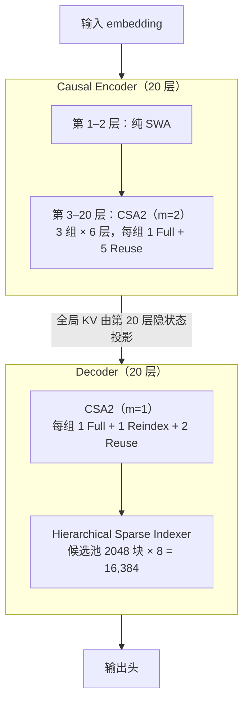

# AI 技术文档模板（章节骨架）

建议的默认章节顺序（可按技术特点增删，但前四节为调研类文档的核心）：

1. **技术背景与动机** — 该技术解决的问题、现有方案的不足、提出动机。
2. **核心架构设计** — 整体架构，配 Mermaid 架构图（分层用 `subgraph`）。
3. **关键技术原理** — 分模块深入，给出公式/机制；必要时单列"训练与工程实现"。
4. **性能对比分析** — 离线基准（表格）+ 生产/部署实测 + 与同类工作对比。
5. **应用场景** — 适合落地的场景与前提条件。
6. **局限性** — 已知限制、数据口径陷阱、未来工作。
7. **总结** — 一句话定位与价值。

## Frontmatter 标准格式（必填块）

每份技术文档**顶部必须**带一个 YAML frontmatter 块（紧挨文档第一行，前后各一个 `---`），字段约定如下，对齐 `harness-engineering` 等知识库的真实写法：

```markdown
---
aliases: [pi Agent Harness, pi Coding Agent, 极简 Harness, Minimal Harness, earendil-works/pi]
tags: [Harness, Agent, pi, Minimal-Core, Extension-System, Self-Extensible, Context-Engineering, Anti-MCP, Provider-Agnostic]
related:
  - "./harness-definition.md"
  - "./claude-code-harness.md"
  - "./codex-harness.md"
  - "./harness-engineering.md"
  - "./agent-harness-engineering-survey.md"
  - "./hook.md"
---

# 技术名称（英文原名）

> 论文：<标题>，arXiv:<编号>，<日期>
> 仓库：<org/repo>
> 官方解读：<链接>
```

字段说明：
- `aliases`：别名数组，多写常见叫法（中英文、仓库路径、特征名），便于检索与双链别名命中。
- `tags`：标签数组，统一小写、用连字符代替空格（如 `Minimal-Core` 而非 `Minimal Core`）。
- `related`：关联文档数组（双链回指）。两种写法都正确，按仓库习惯二选一：
  - **路径式**（harness-engineering 等知识库采用）：`"./harness-definition.md"`
  - **Wiki 式**：`"[[harness-definition]]"`
  - 新增一篇文档后，需回到关联文档的 `related` 补回向链接（见阶段 5）。

## 架构/流程图：Mermaid 优先，ASCII 兜底

- **默认用 Mermaid**：架构图、流程图、数据流图、子系统关系图，一律写成 `mermaid` 代码块。Obsidian 阅读视图原生渲染，比内联 SVG 文件更稳、可随主题着色，后续改图成本也远低于手绘 ASCII。
- **ASCII 只作例外**：仅当图极简（2–3 个节点、单链路）或**必须逐字符对齐**（字节布局、命令输出、目录树、协议帧格式）时才用。
- 分层/分层架构用 `flowchart TB` 或 `LR` + `subgraph ID["标题"] ... end`；分支与数据流向用带标签的边，异步/旁路用虚线 `-.->`。

### Mermaid 图示例（默认写法：分层 + 带标签边）



### ASCII 框图示例（仅限极简 / 需逐字符对齐场景）

```
        ┌─────────────┐
        │   输入序列   │
        └──────┬──────┘
               ▼
        ┌─────────────┐
        │  并行主干    │◄── 半自回归生成
        └──────┬──────┘
               ▼
        ┌─────────────┐
        │ 置信度调度   │◄── 顺序温度缩放(STS)
        └──────┬──────┘
               ▼
        ┌─────────────┐
        │ 接受/拒绝    │
        └─────────────┘
```

Mermaid 注意事项：
- 用 `flowchart`（配 `TB` / `LR` 指定方向）；复杂分层用 `subgraph ID["标题"] ... end`，子图内可再写 `direction TB`。
- **避免非法形状** `[("...")]`（圆柱/体育场内嵌括号），队列/标记用普通矩形 `[]` 即可。
- 节点文本含 `()`、`[]`、`:`、`/` 等字符时**用双引号包裹**：`["turn_start"]`；换行统一 `<br/>`。
- 连接子图可用 `A ==>|标签| B`、`A -->|"标签"| B`；虚线 `-.->` 表示旁路/异步。
- 配色**跟随仓库**：多数知识库不写 `%%{init}%%`（随主题）；若仓库统一锁定暗色，则写 `%%{init:{'theme':'dark','themeVariables':{...}}}%%`，不要两种混用。
- 单图节点控制在 ~20 个以内；超了就拆"总览图 + 局部图"，或用表格承载细节。

## 表格示例（性能对比）

| 模型/系统 | 领域 | 平均接受长度 | 吞吐提升 |
|-----------|------|-------------|---------|
| DSpark    | 数学 | 4.2         | +X%     |
| MTP-1     | 数学 | 2.1         | 基线     |

> 注：表格中的数值必须来自已核实来源；若论文给出的是"名义提升"而非"实测提升"，需在表注或正文中明确标注口径，避免误读。
