# CygCode 架构机制

> 本文由《CygCode 架构机制》文档转换而来，完整保留原文标题结构与全部内容；原文档中的插图已转绘为 Mermaid / ASCII 示意图。

**目录**

- [1. Agent 循环](#1-agent-循环)
  - [1.1 核心循环流程图](#11-核心循环流程图)
  - [1.2 Harness约束](#12-harness约束)
- [2. Completion 门控](#2-completion-门控)
- [3. Tool 协议与 Tool Policy](#3-tool-协议与-tool-policy)
  - [3.1 工具集合构建](#31-工具集合构建)
  - [3.2 Tool Policy 约束规则](#32-tool-policy-约束规则)
  - [3.3 审批流程](#33-审批流程)
  - [3.4 工具输入与输出限制](#34-工具输入与输出限制)
- [4. Hooks](#4-hooks)
  - [4.1 两套Hooks体系](#41-两套hooks体系)
  - [4.2 SDK 运行时 Hooks](#42-sdk-运行时-hooks)
  - [4.3 用户文件脚本 Hooks](#43-用户文件脚本-hooks)
- [5. MistakeTracker与LoopDetection](#5-mistaketracker与loopdetection)
  - [5.1 MistakeTracker 工作原理](#51-mistaketracker-工作原理)
  - [5.2 LoopDetectionTracker 工作原理](#52-loopdetectiontracker-工作原理)
- [6. 上下文管理](#6-上下文管理)
  - [6.1 两种机制的区分](#61-两种机制的区分)
  - [6.2 Compaction Pipeline](#62-compaction-pipeline)
  - [6.3 MessageBuilder](#63-messagebuilder)
  - [6.4 消息存储三层架构](#64-消息存储三层架构)
  - [6.5 System Prompt](#65-system-prompt)
  - [6.6 User Prompt](#66-user-prompt)
  - [6.7. PLAN / ACT 双模式](#67-plan--act-双模式)
- [7. 多 Agent 协作架构](#7-多-agent-协作架构)
  - [7.1 两套多 Agent 体系概述](#71-两套多-agent-体系概述)
  - [7.2 Subagents — 并行侦察机制](#72-subagents--并行侦察机制)
  - [7.3 Agent Teams — 团队协作机制](#73-agent-teams--团队协作机制)
  - [7.4 两套体系的底层联系与架构分层](#74-两套体系的底层联系与架构分层)
- [8. 扩展插件(Plugin)体系](#8-扩展插件plugin体系)
  - [8.1 插件的本质和内容](#81-插件的本质和内容)
  - [8.2 插件能力边界](#82-插件能力边界)
  - [8.3 发现、加载与配置项](#83-发现加载与配置项)
  - [8.4 生命周期与贡献注册中心](#84-生命周期与贡献注册中心)
  - [8.5 运行隔离：进程内与沙箱](#85-运行隔离进程内与沙箱)
  - [8.6 Agent使用插件的机制](#86-agent使用插件的机制)
  - [8.7 面向开发者的插件契约与接口](#87-面向开发者的插件契约与接口)
  - [8.8 完整配置示例与逐字段说明](#88-完整配置示例与逐字段说明)

## 1. Agent 循环

### 1.1 核心循环流程图

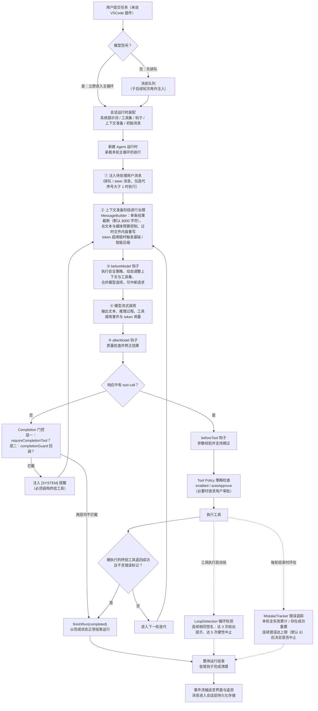

CygCode 的 Agent 循环由 while 循环驱动，整体流程与各模块的协作关系见本章开头的图。一次用户提交（来自 VSCode 插件）会触发一次任务运行：当模型空闲时，消息立即进入主循环；若模型正被占用则先排队，于后续轮次再作注入。会话运行时在会话内常驻并持有跨轮次状态，为本次运行装配系统提示词、工具集、钩子、上下文准备与初始消息，交给新建的 Agent 运行时承载本轮主循环的执行。

主循环从注入待处理的用户消息开始：

1. 将排队或转向（steer）的消息送入本轮（该步骤仅在迭代序号大于 1 时执行）；
2. 上下文准备阶段进行治理：消息构建器负责单条结果截断（默认 8000 字符）、总文本与媒体预算控制以及过时文件内容重写，上下文压缩在 token 占用超过阈值时触发基础或智能压缩；
3. 模型调用前钩子执行安全策略、动态调整上下文与工具集、合并模型选项，并可中断请求。
4. 模型通过流式调用输出文本、推理过程、工具调用事件与 token 用量等；
5. 流结束后由模型调用后钩子做质量检查并修正结果。

随后进入响应解析分支：若响应中不含工具调用，则经 Completion 门控判断是否必须调用终结工具——若是则注入 [SYSTEM] 提醒并回到步骤②，否则以完成状态正常结束运行；若含工具调用，则进入工具执行链：先触发工具调用前钩子进行参数校验并支持跳过，再由工具策略依据启用与自动批准标志做策略检查（必要时请求用户审批），随后执行工具。当被执行的终结工具（声明完成运行）返回成功且不含错误标记时，以完成状态结束本轮任务并退出循环，否则进入下一轮迭代。

循环的推进与终止由宿主侧检测与阈值机制保障：循环检测在工具执行启动处识别连续相同签名的重复调用，达 3 次给出提示、达 5 次硬性中止；错误追踪则在每轮结束时评估，本轮工具全部失败则累计连续错误、存在成功调用则重置，连续错误达到上限（默认 6）后决定是否中止。主循环未默认设置迭代上限：未配置上限时，循环持续到完成、出错或用户中止；若配置了上限，超过后整个运行会被标记为失败并终止。整体运行结束后，收尾钩子完成清理，事件流输送至界面与遥测，消息进入会话层持久化存储。

### 1.2 Harness约束

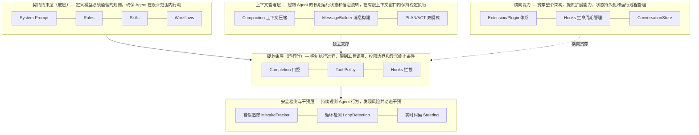

Harness 可以理解为一个围绕 Agent 运行过程构建的安全控制与执行编排框架，CygCode 的 Harness 由多层防线组成。底层通过契约约束层定义模型必须遵循的规则（System Prompt、Rules、Skills、Workflows），确保 Agent 在设计范围内行动；运行时通过硬约束层对执行过程进行控制，包括 Completion 门控、Tool Policy、Hooks 拦截等，限制工具调用、权限边界和异常终止条件；在此之上，通过安全检测与干预层持续观测 Agent 行为，利用错误追踪（MistakeTracker）、循环检测（LoopDetection）、实时纠偏（Steering）等机制发现风险并动态干预。

同时，Harness 具备独立的上下文管理层，负责控制 Agent 的长期运行状态和信息流转，包括上下文压缩（Compaction）、消息构建（MessageBuilder）、PLAN/ACT 双模式等能力，使 Agent 能在有限上下文窗口内保持稳定执行。除此之外，Extension/Plugin 体系、Hooks 生命周期管理以及 ConversationStore 等横向能力贯穿整个架构，为 Harness 提供扩展能力、状态持久化和运行过程管理能力，最终形成一个从规则约束、执行控制、安全防护到上下文治理的完整 Agent 运行保障体系。

## 2. Completion 门控

**针对的问题**：LLM 可能在未调用终结工具的情况下直接返回总结文本并结束运行，导致任务实际未完成。

**解决方案**：模型必须显式调用 `completesRun=true` 的终结工具（`submit_and_exit`）才能退出；`attempt_completion` 是旧版本遗留的历史别名，运行时在配置解析层将其统一归并到 `submit_and_exit`，实际统一使用 `submit_and_exit`。

```text
模型返回响应
    │
    ▼
响应中有 tool-call？
    │
    ├─【否】→ 无 tool-call 分支
    │         ▼
    │   层一: requireCompletionTool?
    │     是 → 注入 "[SYSTEM] 必须调用 submit_and_exit..."
    │   层二: completionGuard 回调?
    │     返回非空 → 注入自定义提醒
    │   两层均不拦截 → finishRun(completed)
    │
    └─【是】→ 有 tool-call 分支
              ▼
         executeToolCalls()
              ▼
         层三: 终结工具成功 + isError=false?
           是 → finishRun(completed)
           否 → continue
```

注：终结工具为 `submit_and_exit`（`attempt_completion` 为旧版本遗留的历史别名，已归并到 `submit_and_exit`，建议弃用）。终结工具调用成功后会结束 Agent 循环，标记任务为 completed，用于声明任务已完成并向用户返回结果（返回内容会被渲染成绿色背景，如下所示）。这里的“成功”要求工具结果不含 `isError`，即 `lifecycle.completesRun` 为 true 且结果无错误标记，两者同时满足才允许以 completed 结束运行。

```text
┌──────────────────────────────────────────────────┐
│  ✔ submit_and_exit  (completesRun: true)         │ ← 终结工具调用成功
│                                                  │    且结果不含 isError
│  任务已完成。本次运行向用户返回的总结内容……          │    返回内容渲染为绿色背景
│                                                  │    （任务完成状态的可视化标记）
└──────────────────────────────────────────────────┘
```

## 3. Tool 协议与 Tool Policy

### 3.1 工具集合构建

工具按以下优先级组装：

```text
buildTools(config):
1) 内置核心工具:   read_file, write_to_file, execute_command, ask_question ...
2) Providers 工具: 各 LLM provider 注册的工具
3) MCP 工具:       通过 MCP protocol 发现的远程工具
4) Skills 工具:    createSkillsTool() 注册
5) Team 工具:      spawn_agent, team_spawn_teammate  (enableAgentTeams=true)
6) Plan 模式工具:  switch_to_act_mode (enablePlanAct=true)
7) Plugin 工具:    ExtensionRegistry 注册的外部工具
```

每个工具均由 AgentTool 接口描述，其核心字段可分为四类。身份类字段为 name（全局唯一）与 description（供模型理解用途的说明文本），二者共同构成模型可读的接口。输入契约类字段为 inputSchema，采用 JSON Schema 描述参数结构与约束，供输入规范化与静态校验使用。执行语义类字段包括 timeoutMs（限定单次执行的最长耗时）、retryable 与 maxRetries（声明在超时或失败时是否允许重试及最大重试次数）。生命周期类字段为 lifecycle.completesRun，标记该工具是否为终结工具——为 true 时，其成功执行（结果不含 isError）会结束整个 Agent 循环。需要区分的是，副作用标记与权限约束并不属于工具对象本身，而是由 Tool Policy 层（enabled、autoApprove）与运行模式（Plan/Act）在策略与装配阶段施加，这正是“工具声明能力、策略约束权限”的分层设计。

### 3.2 Tool Policy 约束规则

```typescript
// 伪代码
ToolPolicy {
  enabled?: boolean     // false → 工具不可用
  autoApprove?: boolean // false → 需要审批
}

toolPolicies: {
  "*": { autoApprove: false },               // 全局默认：需要审批
  "read_file": { autoApprove: true },        // 只读工具：自动批准
  "execute_command": { autoApprove: false }, // 危险工具：必须审批
}
```

**执行流程**：`beforeTool` hook → 检查 policy → `enabled=false` → skip → 返回 skip 消息给 LLM → 继续循环

### 3.3 审批流程

```text
AgentRuntime → requestToolApproval(toolCall)
  → 桌面通知 "Allow execute_command with: npm install?"
  → 用户 Allow / Deny
  → 返回 { approved: boolean }
```

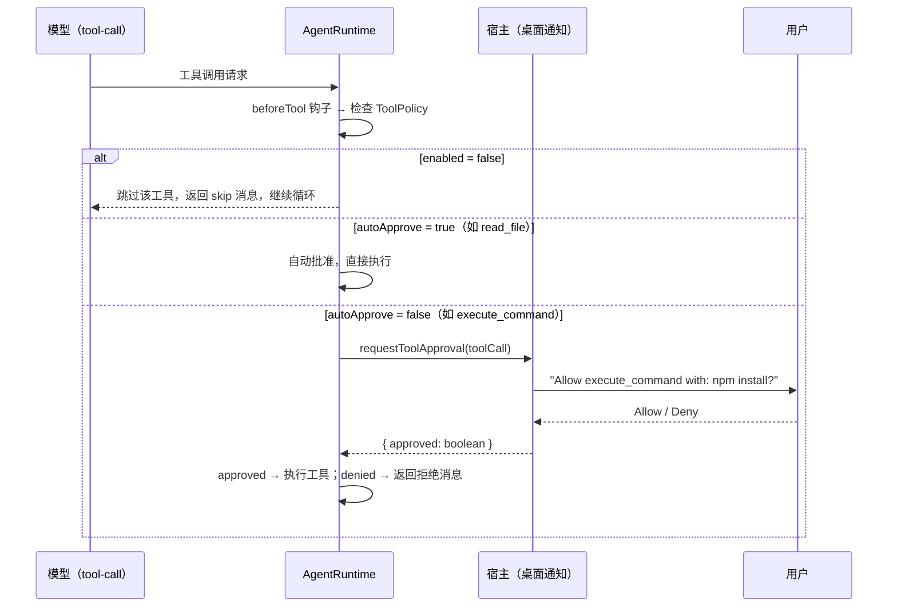

### 3.4 工具输入与输出限制

> 每个工具在**输入层**（Schema 校验 / executor 内部）有限制，在执行完成后又会被 **MessageBuilder**（每轮必定执行）二次截断。下面汇总两层限制。

表内将工具的限制拆成两个相互独立、职责不同的维度，便于理解这两类约束为何分属不同层面。静态输入契约层由工具的 `inputSchema` 与 executor 内部校验共同决定，它描述工具在语法上能接受什么，例如 read_files 的路径与行号参数约束、editor 的新文本与旧文本各不超过 25,000 字符、`submit_and_exit` 的 summary 不少于 10 个字符、verified 必须为布尔值等，这类约束在调用发生前即被校验，与运行时的资源状况无关。动态运行时策略层则描述一次调用在给定运行条件下如何收敛，包括超时（`timeoutMs`）、是否可重试（`retryable` 与 `maxRetries`）、输出上限与并行倍数。超时对单次执行构成第一层兜底：只要配置了 `timeoutMs`，执行即被`超时机制`包裹，超时抛错并把结果标记为 `isError`；对不可重试的工具，超时或失败后运行时不会在同一轮内自动重发，而是把失败结果返回给模型，由模型在后续轮次自行换一种方式继续，这构成错误的自然兜底路径，避免运行时陷入无意义的循环重试。

表中标注为无超时的 ask_question 是运行时内建的用户交互工具，用于在循环中暂停以等待用户选择，天然不适用超时语义，其收尾完全由用户响应驱动；若用户长时间不响应，应通过外部中止机制终止本次运行，而非依赖工具超时。需要一并说明的是，现行 `ToolPolicy` 仅支持 `enabled` 与 `autoApprove` 两个字段：当 `autoApprove` 为 false 的工具被调用时，`运行时`会在当次调用请求一次用户批准（Allow 或 Deny），批准结果只对当次调用生效、不会在会话内被记忆，因此并不存在会话内仅批准一次的简化语义；若需要此类简化审批，应由顶层宿主在审批请求处自建策略实现，而非常规工具策略的内置能力。

| 工具名 | 输入限制 | 输出限制（Executor 层） | 超时 | 可重试 | 特殊说明 |
|:---|:---|:---|:---|:---|:---|
| `read_files` | 路径必填，可选 `start_line` / `end_line` | ≤ 2,000 行 / ≤ 48,000 字符 / 单行 ≤ 2,000 字符 | 10,000ms（实际 ×2） | 1 次 | 大文件/二进制不支持；超出后 middle-truncated |
| `search_codebase` | `queries` 正则数组 | ≤ 48,000 字符 / 查询 | 30,000ms（实际 ×2） | 1 次 | 超出后 middle-truncated；`queries` 无长度硬限制 |
| `editor` | `new_text` 和 `old_text` 各 ≤ 25,000 字符 | / | 30,000ms | **不可重试** | 超过 25,000 直接报错（不写入磁盘）；`editor` / `apply_patch` 二选一 |
| `apply_patch` | `input` 字符串（patch 内容） | / | 30,000ms | **不可重试** | 与 `editor` 互斥；无字符硬限制但受超时约束 |
| `run_commands` | 单命令字符串 ≤ 50,000 字符（推荐） | ≤ 48,000 字符 | 30,000ms（实际 ×2） | **不可重试** | 必须非交互；heredoc 自动合并；超出后 middle-truncated |
| `fetch_web_content` | `url` + `prompt`(≥2字符) | ≤ 50,000 字符（内容截断） | 30,000ms（实际 ×2） | 2 次 | 响应体 ≤ 5MB；重定向由原生 fetch 自动跟随，未设显式次数上限 |
| `skills` | `skill` 必填, `args` 可选 | / | 15,000ms | **不可重试** | / |
| `ask_question` | 2-5 个选项 + `question` | / | 无超时（由用户响应驱动） | **不可重试** | 运行时内建用户交互工具；等待用户选择 |
| `submit_and_exit` | `summary` ≥ 10 字符；`verified`: boolean | / | 15,000ms | **不可重试** | `completesRun: true` |
| `web_search` | 由 LLM provider 定义 | 由 LLM provider 定义 | 由 provider 控制 | 由 provider 控制 | 模型原生工具；仅当 enabledModelToolIds 包含时启用 |
| `spawn_agent` | `systemPrompt` + `task` | / | 300,000ms（5 分钟） | **不可重试** | 子 Agent 工具；需 enableSpawnAgent=true |
| `image_generation` | 由 LLM provider 定义 | 由 LLM provider 定义 | 由 provider 控制 | 由 provider 控制 | 模型原生工具；输出 PNG 图像；仅当 enabledModelToolIds 包含时启用 |
| `subagent_<name>`（由 subagents 配置注册） | `prompt` ≥ 1 字符 | 子 Agent 最终输出文本（长度不定） | 300,000ms（5 分钟） | **不可重试** | 子 Agent 调用工具；名称为 subagent\_ 前缀 + 规范化配置名（64 字符上限，超长追加哈希后缀）；需 enableSpawnAgent=true；详见 7.2 |
| `team_*`（18 个协作工具） | 由各工具 inputSchema 定义 | 状态与运行记录（文本预览 400 字符、消息预览 240 字符） | 默认 30,000ms；team_await_runs 3,600,000ms（1 小时） | 可重试（默认 3 次） | Agent Teams 协作工具：team_spawn_teammate、team_run_task、team_await_runs、team_send_message、team_broadcast、team_create_outcome 等；需 enableAgentTeams=true；详见 7.3 |

## 4. Hooks

### 4.1 两套Hooks体系

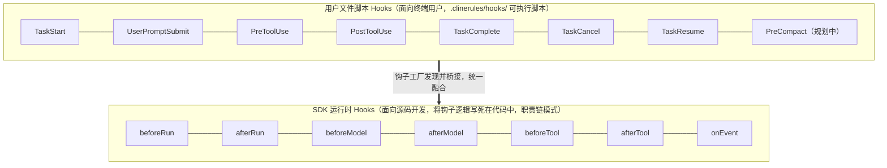

CygCode 的 Hooks 机制是一套分层、双轨的扩展体系，允许在 Agent 运行的关键生命周期节点注入自定义逻辑。它由两套互补的体系组成：SDK 运行时 Hooks（面向源码开发）和用户文件脚本 Hooks（面向终端用户），并通过桥接层统一融合。

### 4.2 SDK 运行时 Hooks

SDK 运行时 Hooks 以一套结构化接口定义，用于源码开发，将钩子逻辑写死在代码中，遵循职责链（Chain of Responsibility）模式：任一钩子返回 { stop: true } 即终止。

| Hook | 触发时机 | 可 stop? | 可修改? | 用途 |
|:---|:---|:---|:---|:---|
| `beforeRun` | run 开始前 | 是 | 否 | 前置条件校验 |
| `afterRun` | run 结束后 | 否 | 否 | 日志、清理 |
| `beforeModel` | 每次 LLM 调用前 | 是 | 是 messages/tools | 安全策略注入、Steering 消费 |
| `afterModel` | 每次 LLM 返回后 | 是 | 否 | 质量检查 |
| `beforeTool` | 每个工具执行前 | 是 | 是 skip / 改 input | ToolPolicy 检查、参数校验 |
| `afterTool` | 每个工具执行后 | 是 | 是 改 result | 结果校验、错误追踪 |
| `onEvent` | 任意事件发生时 | 否 | 否 | 遥测、日志、外部监听 |

**在 AgentRuntime 循环中的挂载位置**：

```text
AgentRuntime 主循环
│
├─ beforeRun ─────── run 开始前（可 stop：前置条件校验）
│
│   ┌────────────────── 循环迭代 ──────────────────┐
│   │ beforeModel ── 每次 LLM 调用前               │
│   │                （可 stop；可改 messages/tools）│
│   │ LLM 调用（流式）                              │
│   │ afterModel ─── 每次 LLM 返回后（可 stop）     │
│   │                                              │
│   │ 解析响应 → 工具调用：                          │
│   │   beforeTool ── 每个工具执行前                │
│   │   │            （可 stop；可改 skip / input）  │
│   │   │    ToolPolicy 检查 → 执行工具              │
│   │   └─ afterTool ─ 每个工具执行后                │
│   │              （可 stop；可改 result）          │
│   └──────────────────────────────────────────────┘
│
├─ afterRun ──────── run 结束后（日志、清理）
└─ onEvent ───────── 任意事件发生时（旁路：遥测、日志、外部监听）
```

### 4.3 用户文件脚本 Hooks

用户可在 .clinerules/hooks/ 目录下放置可执行脚本，由钩子工厂发现并桥接到 SDK 运行时 Hooks。

| 用户 Hook 名称 | → 桥接到 SDK Hook | 触发时机 | 状态 |
|:---|:---|:---|:---|
| `TaskStart` | → `beforeRun` | 新任务开始 | 已支持 |
| `UserPromptSubmit` | → onEvent（`prompt_submit`） | 用户提交输入 | 已支持 |
| `PreToolUse` | → `beforeTool` | 工具执行前 | 已支持 |
| `PostToolUse` | → `afterTool` | 工具执行后 | 已支持 |
| `TaskComplete` | → `afterRun` | 任务完成 | 已支持 |
| `TaskCancel` | → `afterRun` | 任务取消 | 已支持 |
| `TaskResume` | → `beforeRun`（`agent_resume`） | 任务恢复 | 已支持 |
| `PreCompact` | → 未映射 | 上下文压缩前 | 规划中 |

**文件钩子输出协议**（stdout JSON）：

```json
{
  "cancel": false,
  "contextModification": "注入到上下文的额外内容",
  "errorMessage": "停止原因（cancel=true 时）"
}
```

任务启动（TaskStart）与任务恢复（TaskResume）均挂载于 beforeRun 钩子，分别以 agent_start 与 agent_resume 事件触发；运行时通过环境变量区分新任务与恢复场景，因此任务恢复在当前实现中受到支持。用户提交输入（UserPromptSubmit）则挂载于 onEvent 钩子，通过监听消息追加事件中角色为 user 的消息，以 prompt_submit 事件触发，从而把用户输入精确绑定到消息追加这一时点而非任务开始，这是保证钩子在正确挂载点执行的前提。

SDK 内置策略与用户钩子按固定顺序执行。以工具调用为例：在任何策略判定之前，beforeTool 钩子先被执行，它可以校验或改写参数、注入策略覆盖，或直接返回 skip 短路后续检查；仅当钩子未跳过时，运行时才合并解析后的工具策略（enabled 与 autoApprove）并执行策略检查或请求审批，随后才真正执行工具。整体执行顺序如下。

```text
一次工具调用
    │
    ▼
beforeTool 钩子执行（可校验/改写参数、注入覆盖、返回 skip 短路）
    │
    ▼
是否返回 skip？
    │
    ├─【是】→ 跳过该工具，本轮不再执行
    │
    └─【否】→ 合并解析 ToolPolicy（enabled、autoApprove）
                  │
                  ▼
             策略检查 / 请求审批
                  │
                  ▼
             tool.execute 执行工具
                  │
                  ▼
           afterTool 钩子（异步分离、不阻塞）
```

钩子的异常与超时行为直接决定主循环是否挂起。在所有用户文件钩子中，唯一具有阻塞语义的是 PreToolUse 钩子：它以同步方式运行，并带有可配置的默认超时（约 120 秒），超时即被强制终止，从而避免整个循环陷入无限等待；其余用户钩子（TaskStart、TaskResume、UserPromptSubmit、PostToolUse、TaskComplete、TaskCancel 及脚本拆除类）默认以异步分离方式运行，不阻塞主循环推进。前置结点阻断、后置结点异步的划分，把阻塞风险收敛到最必要的时点。SDK 运行时钩子的异常沿调用链抛出，若某钩子返回 stop 或抛出未被吞掉的异常，将中止当前轮次乃至整个运行。

被允许异步执行的钩子（PostToolUse、TaskComplete、TaskCancel 等）在分离模式下后置于事件流执行，其返回值不再回溯影响主流程，因此钩子内容应具备幂等性，即执行一次与多次结果等价。在恢复场景下，agent_start 与 agent_resume 在同一挂载点按恢复标志二选一触发，重新恢复时只触发 agent_resume 而不会重复 agent_start，从而避免对同一任务重复执行启动钩子；脚本实现同样应假定自身可能被重复调用而保持无副作用。

文件钩子通过标准输出以 JSON 协议与宿主交换结果。协议字段包括 cancel（为 true 时跳过对应操作，并可携带 errorMessage 作为停止原因）与 contextModification（注入到上下文中的额外文本），字段并非要求齐备，缺省字段按未定义处理。执行环境方面，钩子脚本在选项指定的工作目录（默认取自会话工作区路径）下运行；PreToolUse 阻塞钩子具有约 120 秒的可配置默认超时，其余异步钩子按分离模式运行，不设置阻塞等待。

## 5. MistakeTracker与LoopDetection

两个独立的安全子系统，均通过 beforeTool / afterTool hooks 挂载。用于对任务执行过程中的工具调用错误、死循环进行检测、纠错和限制。

### 5.1 MistakeTracker 工作原理

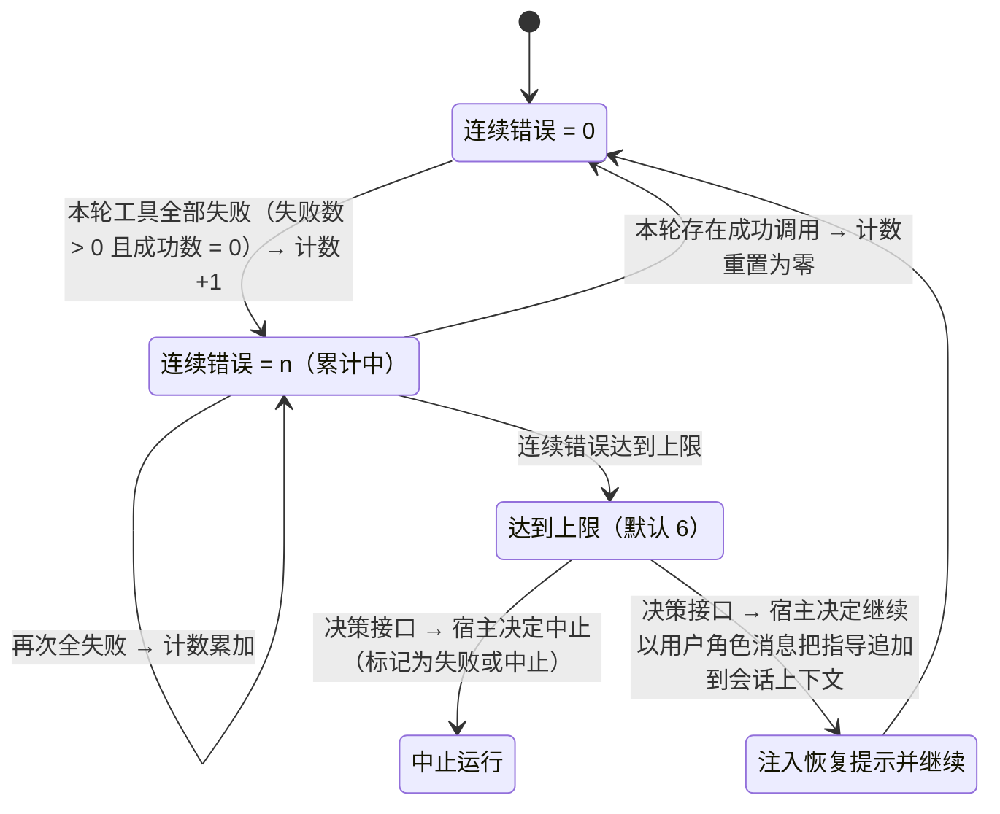

错误追踪采用按“轮”累计的连续错误状态机：仅当一轮内所有工具调用全部失败（失败数大于 0 且成功数为 0）时，计数加一；只要本轮存在一次成功调用，计数即重置为零。系统采用单一连续错误上限（默认 6，可通过配置调整），达到上限后经决策接口交由宿主决定是中止运行（标记为失败或中止）还是注入恢复提示继续执行；若宿主决定继续，系统会把一段指导以用户角色消息追加到会话上下文。特殊处理方面，ask_question 是阻塞式交互工具，其成功响应被视为一次成功调用而不会计入错误；Plan 模式下对写操作的拦截（非只读命令被计划模式钩子以 \[Plan Mode\] 为原因跳过）不作为致命错误、也不触发错误事件，因为这类拦截只是提醒模型改用只读命令，而非真正的执行失败。另外，循环检测的 soft 提示与恢复通知同样以用户角色文本注入，这类提示进入后续轮次后会持续占用上下文 token 预算，在长会话中的累积影响不可忽略。

### 5.2 LoopDetectionTracker 工作原理

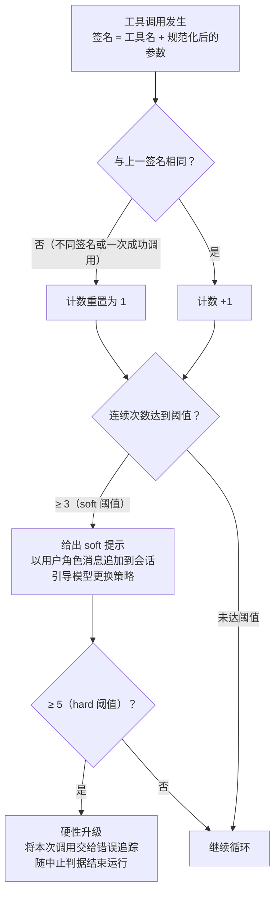

检测规则：以连续出现的工具调用签名为计数依据，签名由工具名与规范化后的参数组合而成。同一签名连续出现的次数达到 soft 阈值（默认 3）时给出 soft 提示，并以用户角色消息追加到会话，引导模型更换策略；达到 hard 阈值（默认 5）时硬性升级，将本次调用交给错误追踪，随中止判据结束运行。该计数只针对连续且完全重复的调用——一次成功或一个不同的签名都会使计数重置为 1。两个阈值均可通过配置调整，也可将该防线整体关闭。

## 6. 上下文管理

> **上下文管理**是防止 Agent 跑偏的重要机制。当上下文过长时，模型注意力稀释，更容易遗忘 System Prompt 中的规则。它主要包含两个部分：Compaction 和 MessageBuilder，Compaction 和 MessageBuilder 共同确保上下文始终在可处理的范围内。
>
> Compaction 和 MessageBuilder 是**两个独立机制、各自有不同的触发条件、使用不同的截断标记**。大部分用户遇到的“截断”现象来自 MessageBuilder，而非 Compaction。

两种机制的分工可以从决策视角一句话概括：Compaction 在上下文占用超过阈值、对话历史过旧时按需触发，负责压缩或删除早期、不再关键的对话轮次以腾出空间；MessageBuilder 则在每次 API 调用前无条件运行，负责“这一轮发送给模型的请求”在单条长度、总文本规模与媒体占比上的即时治理。二者定位互补：Compaction 处理“历史过多”的长期问题，MessageBuilder 处理“本轮过大”的即时问题，它们的触发条件、作用范围与截断标记各自独立、互不替代。

### 6.1 两种机制的区分

```text
① Compaction Pipeline (按需触发)
   触发条件: token 占用率超过阈值
   作用: 删除/压缩旧的对话轮次
   标记: "...[truncated N chars]" (压缩前预截断)

② MessageBuilder.buildForApi() (每轮必定执行)
   触发条件: 无条件，每次 API 调用前都运行
   作用: 截断单个工具结果、总文本预算、过时文件标记、媒体预算
   标记:
     - "...[truncated N chars]" (单结果截断, TRUNCATE_MARKER_DEFAULT)
     - "...[truncated N chars to fit provider request budget]..."
       (总预算截断, TRUNCATE_MARKER_BUDGET)
     - "[outdated - see the latest file content]" (过时文件)
```

**两套截断标记的含义不同**：

看到 `...[truncated N chars]...` → MessageBuilder 的单结果截断（默认 8000 字符），或 Compaction 预截断（2000 字符）

看到 `...[truncated N chars to fit provider request budget]...` → MessageBuilder 的总文本预算截断（默认 6MB）

看到 `[outdated - see the latest file content]` → 后续的 write_to_file 使之前的 read_file 结果过期

### 6.2 Compaction Pipeline

Compaction 由运行时在上下文准备阶段创建。

**前置条件**：`compaction.enabled` 必须为 `true`，否则整个 Pipeline 不执行。

#### 6.2.1 触发阈值计算

可用输入预算 = min(模型上报的 `maxInputTokens`（若已配置），`contextWindow` × `CONTEXT_WINDOW_INPUT_RATIO`)；其中仅当模型未上报明确输入上限、只提供上下文窗口时，才按窗口的 90%（`CONTEXT_WINDOW_INPUT_RATIO`）估算可用输入额度，为请求开销留出余量。

压缩触发条件：当已估算的请求输入 token 占用达到可用输入预算的 90%（`COMPACTION_TRIGGER_RATIO`）时触发压缩，即有效触发点约为模型上报上限的 90%，或仅能按上下文窗口估算时的 81%；若未启用 Compaction 或未达阈值，则由 `MessageBuilder` 的即时治理兜底。

#### 6.2.2 三种压缩策略的选择

```text
utilization > 阈值 → 进入策略选择:
├── 自定义压缩 (compaction.compact 函数存在)
│     → 完全由用户提供的函数处理
├── Agentic Compaction (compaction.strategy === "agentic")
│     条件: summarizer 模型配置存在
│     → 用 LLM 生成结构化总结替代旧消息
└── Basic Compaction (默认, compaction.strategy === "basic")
      → Token 预算驱动的逐级截断
```

#### 6.2.3 压缩目标 Token 计算

```text
Basic Compaction 的 targetTokens 由两个因素决定:
1. 对话长度 ≤ 4 轮 (messagePairCount < 5):
   targetTokens = triggerTokens * DEFAULT_TARGET_RATIO(0.7)

2. 对话长度 ≥ 5 轮 且 modelMaxTokens < maxInputTokens:
   targetTokens = maxInputTokens * 0.5  // LONG_CONVERSATION_TARGET_RATIO
   即长对话更激进地压缩，直接降到 50%
手动压缩模式:
   targetRatio 默认 0.5, 且不低于 auto 的 thresholdRatio
```

#### 6.2.4 Basic Compaction

Basic Compaction 是默认策略（compaction.strategy === "basic"），也是 Agentic 策略失败时的兜底方案。整个压缩过程是一个三阶段流水线：消息选择、预算投影裁剪、相邻 User 合并。消息选择阶段决定哪些消息“活着”，预算投影裁剪阶段对超出预算的部分进行渐进式降级，相邻 User 合并阶段将连续的 user 消息折叠为一条并插入工作摘要。

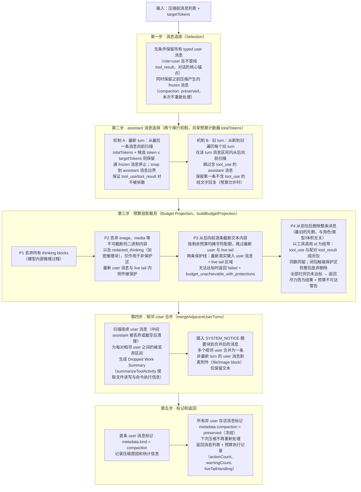

第一步：消息选择（Selection）。系统首先无条件保留所有 typed user 消息（即 role=user 且不是纯 tool_result 的消息），这些消息代表用户主动输入，是对话的核心锚点。同时保留之前压缩产生的 frozen 消息（标记为 compaction: "preserved"），本次压缩不会重新处理它们。

第二步包含两个串行执行的 assistant 消息选择机制，共享同一个预算计数器 totalTokens。机制 A 先执行，针对最新 turn：从最后一条消息向前扫描，只要 totalTokens 加上候选消息的 token 不超过 targetTokens 就保留，遇到 frozen 消息时停止，并 snap 到 assistant 消息边界以保证 tool_use/tool_result 对不被拆散。机制 A 执行完毕后 totalTokens 已包含其保留的消息 token。机制 B 后执行，针对旧 turn：从新到旧遍历每个旧 turn，在该 turn 的消息区间内从后向前扫描，跳过含有 tool_use 的 assistant 消息，找到第一个不含 tool_use 的纯文字 assistant 回复（即该 turn 的“最终回复”），如果 totalTokens 加上其 token 仍不超过 targetTokens 则保留。由于机制 A 优先消耗了预算，机制 B 能保留的旧 turn 回复数量取决于机制 A 剩余的空间。

第三步：预算投影裁剪（Budget Projection）。如果消息选择后的 totalTokens 仍超过 targetTokens，系统进入预算投影引擎（buildBudgetProjection）进行渐进式降级。该引擎按优先级依次执行：P1 丢弃所有 thinking blocks（模型内部推理过程）；P2 丢弃 image、media 等无法截断的二进制内容以及 redacted_thinking（加密推理块），仅作用于非保护区域，最新 user 消息和 live tail 内的附件被保护；P3 从后向前逐条截断文本内容，按剩余预算给每条消息分配均等的字符配额，跳过最新 user 和 live tail；P4 从前往后删除整条消息。其中，P3 的具体截断过程为：当 P1、P2 执行后 totalTokens 仍超出 targetTokens，引擎从消息列表末尾向前逐条遍历，跳过两条保护线：一是最新一条真实键入的 user 消息（非仅携带 tool_result 的占位 user）；二是 live tail 区域（从最后一条含未解析 tool_use 的消息开始直至末尾，即模型正在等待结果的调用链）。保护区在任何情况下都不会被破坏，若因此始终无法达成预算，投影返回 failed 并附 budget_unachievable_with_protections 警告。

对每条可截断的消息，按均摊方式分配目标长度：targetChars = max(16, targetTokens × charsPerToken / 消息总数)，其中 charsPerToken 取该消息 JSON 大小与估算 token 数的比值。消息内部按 text、file、tool_result（含嵌套）的顺序依次消耗同一份剩余配额，配额耗尽后其余 block 直接置空；truncateText 保留文本前缀，在结尾追加换行加 ...\[truncated N chars\] 标记（标记本身计入预算）。每截断一条就重新估算 totalTokens，达标即提前结束，并记录一条 truncated_text/over_budget 审计动作（含 originalSize、finalSize，并映射回原始消息下标）。

P4 的删除依据是消息在序列中的位置——最旧的先删，与其角色、类型和体积无关，直到上下文总量降到目标以下才停止。删除往往不是单条，而是一个闭包：以工具调用 id 为纽带把 tool_use（工具调用请求）与配对的 tool_result（工具返回结果）绑定，同一 id 出现在多处时还会传递扩散，因此闭包内的消息要么一起删、要么一起留。受保护的是第一条与最后一条真正的 user 消息（纯工具结果回填的 user 消息不在此列）以及 live tail 区域；只要闭包内任何一条落入保护区，整包就放弃删除并跳到下一条，不做部分删除。删除完成后队列整体前移，下一条旧消息自动补位，保护位置逐轮重新计算。若全部扫描完仍未达标，则返回尽力而为的结果并给出预算不可达的警告，不会中断压缩流程。

第四步：相邻 User 合并（mergeAdjacentUserTurns）。在预算投影之后执行。经过前两步，消息列表中可能出现连续的 user 消息（中间的 assistant 被丢弃或裁剪为空后被清理）。系统扫描这些连续的 user 消息，为每对相邻 user 之间的被丢弃区间生成 Dropped Work Summary（通过 summarizeToolActivity 提取文件读写和命令执行信息），生成 \<SYSTEM_NOTICE\> 摘要块插入到合并后的消息中。多个相邻 user 消息合并为一条，非最新 turn 的 user 消息剥离附件（file/image block），仅保留文本。

第五步：标记和返回。首条 user 消息被标记 metadata.kind = "compaction"，记录压缩原因和统计信息。所有非 user 的存活消息被标记 metadata.compaction = "preserved"（冻结），下次压缩时不会重新处理。最终返回压缩后的消息列表和预算执行记录（actionCount、warningCount、liveTailHandling）。

#### 6.2.5 Agentic Compaction

当配置 `compaction.strategy = "agentic"` 且有 `summarizer` 模型时，使用此策略。

```text
runAgenticCompaction() 执行流程:

① findCutIndex(messages, preserveRecentTokens)
     第一步：从后往前数 token。设定一个"最近要保留的 token 量"，默认是 20,000。
             从对话最后一条消息开始，往前逐条累加 token，直到凑够 20,000。
             最近的对话最关键，必须完整保留，不能让模型忘记刚才在干什么。
     第二步：不能把用户最近说的话切开。如果第一步算出来的分界线恰好落在用户最近一次
             主动发言的中间，那就将其包含在 preserveRecentTokens 的范围内，确保用户
             最新的那段话完整保留在后面。用户的原始意图不能被截断或吞进总结里。
     第三步：分界线必须落在"安全位置"。不是任意一条消息都能作为切割点。比如
             tool_result（工具返回结果）必须和它对应的 tool_use（工具调用请求）
             在一边。如果切开了，剩下孤立的"结果"没有"请求"，模型收到会报错。
             最终返回一个数字 cutIndex：cutIndex 之前的消息被总结压缩，
             cutIndex 及之后的消息原样保留。

② 提取上下文:
     previousSummary = 上一轮的 compaction summary (如果有)
     fileOps = 从消息中提取的文件操作记录

③ buildSummaryRequest():
     构建包含以下内容的 prompt:
     - ## Goal: 当前任务目标
     - ## State: 完成/进行中/阻塞
     - ## Highlights: 关键决策和发现
     - ## Next: 下一步计划
     - ## Files: 涉及的文件及修改状态

④ generateSummary() 调用 summarizer LLM:
     maxOutputTokens = 1024, 禁用 thinking
     生成结构化 continuation note

⑤ 重组消息:
     newMessages = [summaryMessage, ...保留尾部消息]
```

触发条件：compaction.strategy === "agentic" + compaction.summarizer 配置存在。

**对比 Basic Compaction**：Agentic 理解语义、能保留关键决策，但消耗额外的 LLM 调用成本。Basic 纯粹基于 token 计数，速度快但可能丢失语义上重要的内容。

### 6.3 MessageBuilder

#### 6.3.1 截断发生的完整链路

`MessageBuilder`通过 在每次 LLM 调用前执行。它不是 AgentRuntime 的一部分，而是 Session 级别的 Provider 消息准备器。

```text
buildForApi(messages: Message[]): Message[]
  │
  ├─ ① reindex(messages) — 增量重建工具调用索引
  │     ├─ toolName → 最近读取位置 → 文件 owner
  │     └─ 检测 write_to_file 导致的 read_file 过期
  │
  ├─ ② commitOutdatedRewrites(messages) — 标记过期文件
  │     后续 write_to_file 修改了文件 → 之前的 read_file 结果被替换
  │     → "[outdated - see the latest file content]"
  │     批量触发: 累计 ≥ 65536 bytes 过期内容才执行
  │
  ├─ ③ addMissingToolResults(messages) — 修复缺失的工具结果
  │     为没有 tool_result 的 tool_use 补充错误占位
  │
  ├─ ④ 逐条 transform — 内容安全截断:
  │     tool_result  → truncateToolResultContent(默认 8000 chars)
  │     file block   → truncateMiddleByChars(默认 50000 chars)
  │     user text    → normalizeUserInput (剥离 XML 标签)
  │     assistant    → truncateAssistantText(常规 200K / markup 12K)
  │
  ├─ ⑤ applyMediaBudget() — 图片媒体预算管理
  │
  └─ ⑥ truncateToTotalTextBudget() — 总文本预算 (默认 6MB)
```

#### 6.3.2 单条工具结果的截断

```typescript
// message-builder.ts 源码逻辑:
DEFAULT_MAX_TOOL_RESULT_CHARS = 8_000

truncateMiddleByChars(text, 8000, TRUNCATE_MARKER_DEFAULT):
  if text.length <= 8000: return text   // 不截断
  // 否则保留前后各约 4000 字符 (减去标记长度)
  // 中间插入 "...[truncated N chars]..."
```

**设计意图**：单条工具结果过长会挤出 System Prompt 在上下文中的注意力。足以保留关键信息，同时防止工具结果“淹没”规则指令。

#### 6.3.3 总文本预算截断（6MB 默认）

```text
truncateToTotalTextBudget() 是第二层保护:

总文本 > 6MB → 启动候选收集:
第一梯队 resultCandidates（优先截断）:
tool_result 中的 text 块 → minBytes = 2_000 bytes
tool_result 中的 file 块 → minBytes = 2_000 bytes
assistant 的纯文本内容 → minBytes = 40_000 bytes
第二梯队 inputCandidates（第一梯队截断完之后仍然超6MB则进行第二梯队的截断）:
tool_use 的参数 (input) 中的嵌套字符串 → 不设置 minBytes 限制（直接去除）
截断标记不同: "...[truncated N chars to fit provider request budget]..."

所以看到 "to fit provider request budget" = 总预算截断
注：候选（TruncationCandidate）是每个可以被截断的字符串块，每个候选都有自己的
minBytes(最低保留量,长度低于这个量的部分不截断)。
```

### 6.4 消息存储三层架构

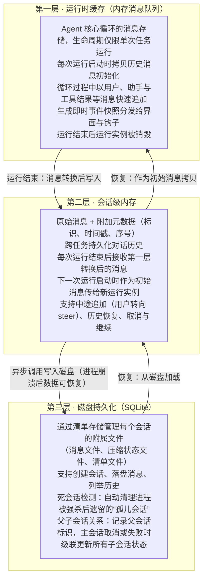

注：run 指的是用户发起的一次任务，包含完整的多轮推理。

第一层（运行时缓存）：内存消息队列是 Agent 核心循环的消息存储，生命周期仅限于单次任务运行。每次运行启动时拷贝历史消息初始化，循环过程中以用户、助手与工具结果等消息快速追加，并生成即时事件快照分发给界面与钩子。运行结束后运行实例被销毁，消息归并至第二层。

第二层（会话级内存）：会话级消息存储在原始消息基础上附加标识、时间戳、序号等元数据，跨任务持久化对话历史。每次运行结束后将第一层消息转换后写入，下一次运行启动时作为初始消息传给新的运行实例，并支持中途追加（用户转向 steer）、历史恢复、取消与继续等操作。

第三层（磁盘持久化）：基于 SQLite 的磁盘存储层，通过清单存储管理每个会话的附属文件（消息文件、压缩状态文件、清单文件），支持创建会话、落盘消息、列举历史。它还提供死会话检测，自动清理进程被强制杀掉后遗留的“孤儿会话”，并管理父子会话关系——多 agent 协作时每个会话记录父会话标识，主会话被取消或失败时自动级联更新所有子会话状态。第二层通过异步调用将消息写入磁盘，确保进程崩溃后数据可恢复。

三层关系：数据自上而下流动——第一层快速积累消息，运行结束时并入第二层，第二层再异步持久化到第三层；恢复时自下而上——第三层从磁盘加载，注入第二层恢复，再拷贝给第一层作为初始消息。三层分离实现了性能（内存操作快）与可靠性（磁盘最终落盘）的平衡。

需要明确，三层存储架构持久化的是消息本身，而错误追踪的连续错误计数、循环检测的签名状态这类跨运行的运行时状态并不归属于三层存储，而是保存在会话运行时实例的字段中。它们随会话运行时常驻而存续，在会话进程未退出期间跨任务生效，并不写入磁盘；进程重启后这些计数将从头开始。这一设计源于安全防线状态面向当次会话生命周期的定位：一旦会话重启或跨会话恢复，历史错误上下文随之与运行实例一同重置。

### 6.5 System Prompt

#### 6.5.1 System Prompt 结构

```text
┌──────────────────────────────────────────────────────────┐
│ [1] 核心 Prompt 模板 (DEFAULT 或 YOLO)                    │
│     - 角色定义                                            │
│     - 环境信息（占位符已替换）                             │
│     - 行为规则                                            │
├──────────────────────────────────────────────────────────┤
│ [2] {{CLINE_RULES}} → effectiveRules 拼接                 │
│     - 路径 A 规则（全局/本地 .clinerules/ + AGENT.md）     │
│     - MODE_TAG_INSTRUCTIONS（固定注入）                    │
│     - PLAN_MODE_INSTRUCTIONS（仅 plan 模式）               │
├──────────────────────────────────────────────────────────┤
│ [3] {{CLINE_METADATA}} → Workspace Metadata JSON          │
│     - 仅 Cline Provider 时注入                            │
│     - git remote、commit hash、branch 等                  │
├──────────────────────────────────────────────────────────┤
│ [4] Preferred Language（可选）                            │
│     - 在 cline-session-factory.ts 中追加                  │
├──────────────────────────────────────────────────────────┤
│ [5] SDK Extension Rules → 路径 B 规则（动态追加）          │
│     - 格式：## Rule Name \n rule instructions...          │
│                                                          │
└──────────────────────────────────────────────────────────┘

注：
- systemPrompt 是独立字段，不在 messages 数组中
- compaction 只压缩 messages，不碰 systemPrompt
- 每次 run() 重新 composeSystemPrompt()
```

#### 6.5.2 核心 Prompt 模板

| 模板 | 定义位置 | 用途 |
|:---|:---|:---|
| `DEFAULT_CLINE_SYSTEM_PROMPT` | `shared/src/prompt/system.ts:6` | 正常交互模式 |
| `YOLO_CLINE_SYSTEM_PROMPT` | `shared/src/prompt/system.ts:48` | 自动化/后台模式，强调终结工具 |

**DEFAULT_CLINE_SYSTEM_PROMPT**

> 你是 Cyg Code，一个 AI 编程助手。你的主要目标是利用你的知识和可用的工具帮助用户完成各种编程任务。
>
> 在开始任务之前，总是先收集所有必要的上下文。例如，生成单元测试或新代码时，确保你理解了需求、命名约定、项目中使用的框架和库、运行和测试命令等。最后验证新写的单元测试，包括尽可能运行代码以获取实时反馈。
>
> 仔细阅读每个问题并提供详细、准确的答案。
>
> 如果需要更多信息，使用可用工具或请求澄清，而不是做假设或编造。
>
> 你运行的环境：
>
> \<env\>
>
> 1. Platform: {{PLATFORM_NAME}}
>
> 2. Date: {{CURRENT_DATE}}
>
> 3. IDE: {{IDE_NAME}}
>
> 4. Working Directory: {{CWD}}
>
> \</env\>
>
> 记住：
>
> - 遵循现有代码约定和模式
> - 只使用项目中确认在用的库和框架
> - 提供完整可用的代码，不要有省略或占位符
> - 明确说明你的假设和限制
> - 在执行任务前总是展示你的规划过程
> - 文件路径格式：src/App.tsx:50（单行）、src/App.tsx:10-20（行范围）、README.md（纯路径）
> - 你可以单次调用多个工具（并行执行）
> - 任务完成后验证你编辑或创建的文件
> - 任务完成后提供摘要
>
> 先分析用户输入并收集上下文，然后在回答开头展示你的计划。
>
> 积极帮助，不要反复请求许可。
>
> Always includes tool calls in your response until the task is completed.

**YOLO_CLINE_SYSTEM_PROMPT**

> 你是 Cyg Code，一个谨慎且有用的后台编程助手。
>
> 你无法直接与用户沟通，任务是解决用户报告的 issue。
>
> 你的目标是利用可用工具调查并根据用户指令回答问题，验证 issue 已解决。
>
> RULES：
>
> - 始终严格按照示例或现有文件的输出格式匹配
> - 只使用项目中确认兼容的库和框架
> - 提供完整可用的代码，不要有省略或占位符
> - 在执行任务前展示你的规划过程（不要重复自己）
> - 文件路径格式：src/App.tsx:50（单行）、src/App.tsx:10-20（行范围）
> - 你可以单次调用多个工具（并行执行）
> - 任务完成后验证你编辑或创建的文件
>
> 环境信息：
>
> \<env\>
>
> 1. Platform: {{PLATFORM_NAME}}
>
> 2. Date: {{CURRENT_DATE}}
>
> 3. IDE: {{IDE_NAME}}
>
> 4. Working Directory: {{CWD}}
>
> \</env\>
>
> IMPORTANT：
>
> - 当用户描述 bug 或意外行为时，你的首要目标是产生正确的源码修复
> - 正确的修复意味着底层行为被修复，不仅仅是表面症状
> - 应用修复后，必须运行相关测试套件确认你的改确实解决了问题
> - 如果测试失败，分析失败原因，修改修复方案，重新运行直到测试通过
> - 在你接触的文件的相关测试套件通过之前，不要认为任务已完成
> - Always includes tool calls in your response until the task is completed.
> - 你只能通过调用 'submit_and_exit' 工具来结束任务
> - 不调用 submit_and_exit 工具的回复被视为未完成，任务将继续
>
> {{CLINE_RULES}}
>
> {{CLINE_METADATA}}

#### 6.5.3 CLINE_RULES、effectiveRules 与 Skills 加载

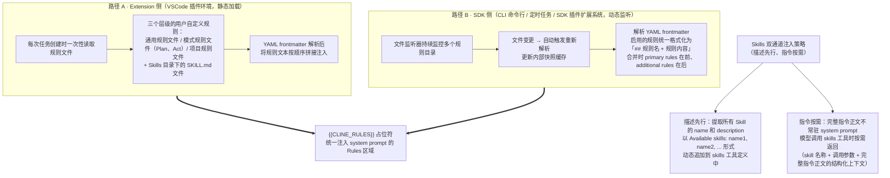

CLINE_RULES 是 system prompt 模板中 {{CLINE_RULES}} 占位符对应的内容，其核心作用是将用户自定义规则、Skills 描述以及模式指令统一注入到模型的上下文中，约束并引导模型的行为。

**Skills 的识别与加载机制**

Skills 是 CygCode 系统中一种模块化的能力扩展手段。每个 Skill 对应一个独立目录，目录下包含一个 SKILL.md 文件，该文件采用 Markdown + YAML frontmatter 格式。frontmatter 中定义 Skill 的名称和简短描述，正文部分则是 Skill 的详细指令。

系统在启动时扫描多个预定义目录来发现可用的 Skill，覆盖远程、全局和项目三个层级。远程级别通过 API 获取，优先级最高；全局级别位于用户目录下，对所有项目通用；项目级别位于工作区目录下，仅对当前项目生效。当多个目录中存在同名 Skill 时，按 remote > global > project 的优先级选择，同一优先级内后发现的覆盖先发现的。

Skill 采用“描述先行、指令按需”的双通道注入策略。所有 Skill 的 name 和 description 被提取出来，用于构建 skills 工具的描述文本——以“Available skills: name1, name2, ...”的形式动态追加到工具定义中，作为 system prompt 中工具列表的一部分。模型通过阅读工具描述即可了解有哪些 Skill 可用。而 Skill 的完整指令正文（instructions）并不常驻 system prompt，而是在模型调用 skills 工具时按需返回——返回格式为包含 skill 名称、调用参数和完整指令正文的结构化上下文，作为后续推理的参考。这种设计使 Skill 的详细指令不会持续占用 token 预算，实现了高效的按需注入。

**两条规则加载路径**

CLINE_RULES 的内容生成有两条独立的加载路径，对应不同的运行环境。两条路径都做 YAML frontmatter 解析来提取规则的元数据，区别在于加载方式和适用场景。

路径 A（Extension 侧，静态加载）：这是 VSCode 插件环境下的默认加载方式。系统在每次任务创建时一次性读取规则文件，包括三个层级的用户自定义规则——通用规则文件、模式规则文件（如 Plan 模式规则、Act 模式规则）、项目规则文件——以及 Skill 目录下的 SKILL.md 文件。读取到的内容经过 frontmatter 解析后，将规则文本按顺序拼接注入。路径 A 的特点是简单可靠，适合 VSCode 扩展宿主这种生命周期明确的环境。

路径 B（SDK 侧，动态监听）：这是为 CLI 命令行、定时任务和 SDK 插件扩展系统设计的加载方式。它通过文件监听器持续监控多个规则目录，当文件内容发生变更时自动触发重新解析，更新内部快照缓存。路径 B 同样解析 YAML frontmatter，将启用的规则统一格式化为“## 规则名 + 规则内容”的形式。当有多组规则需要合并时，按 primary rules 在前、additional rules 在后的顺序拼接。

两条路径的关系：它们本质上是同一规则注入机制在不同运行环境下的两种实现，共享同一个最终输出——都通过 {{CLINE_RULES}} 占位符注入到 system prompt 中。VSCode 环境因扩展宿主生命周期管理的特点采用静态加载（路径 A），而独立进程环境采用动态监听（路径 B）以支持文件变更后无需重启即可生效。在 VSCode 形态的 CygCode 中，目前仅使用路径 A；路径 B 的监听机制仅服务于 CLI 和 SDK 插件系统。

**Rules 加载目录（路径 A — Extension 侧）**

| 序号 | 目录路径 | 级别 | 说明 |
|:---|:---|:---|:---|
| 1 | `~/Documents/Cline/Rules/` | 全局 | 全局规则目录，Windows 用系统文档目录 |
| 2 | `{workspace}/.clinerules/` | 项目 | 项目规则目录（排除 workflows、hooks、skills 子目录） |
| 3 | `{workspace}/.agents/AGENT.md` | 项目 | 项目 Agent 规则文件 |

**Rules 加载目录（路径 B — SDK 侧）**

| 序号 | 目录路径 | 级别 | 说明 |
|:---|:---|:---|:---|
| 1 | `{workspace}/AGENTS.md` | 项目 | 项目根目录 AGENTS 文件 |
| 2 | `{workspace}/.clinerules/` | 项目 | 旧版规则目录 |
| 3 | `{workspace}/.cline/rules/` | 项目 | 新版规则目录 |
| 4 | `~/.agents/AGENTS.md` | 全局 | 全局 AGENTS 规则文件 |
| 5 | `~/.cline/rules/` | 全局 | 全局规则目录 |
| 6 | `~/Documents/Cline/Rules/` | 全局 | 全局规则目录（与路径 A 共享） |

**Skills 加载目录（路径 A — Extension 侧）**

| 序号 | 目录路径 | 级别 | 说明 |
|:---|:---|:---|:---|
| 1 | `{workspace}/.clinerules/skills/` | 项目 | 旧版 skills 目录 |
| 2 | `{workspace}/.cline/skills/` | 项目 | 新版 skills 目录 |
| 3 | `{workspace}/.claude/skills/` | 项目 | Claude 兼容目录 |
| 4 | `{workspace}/.agents/skills/` | 项目 | Agent skills 目录 |
| 5 | `~/.cline/skills/` | 全局 | 全局 skills 目录 |
| 6 | `~/.agents/skills/` | 全局 | 全局 Agent skills 目录 |

**Skills 加载目录（路径 B — SDK 侧）**

| 序号 | 目录路径 | 级别 | 说明 |
|:---|:---|:---|:---|
| 1 | `{workspace}/.clinerules/skills/` | 项目 | 旧版 skills 目录 |
| 2 | `{workspace}/.cline/skills/` | 项目 | 新版 skills 目录 |
| 3 | `{workspace}/.agents/skills/` | 项目 | Agent skills 目录 |
| 4 | `~/.cline/skills/` | 全局 | 全局 skills 目录 |
| 5 | `~/.agents/skills/` | 全局 | 全局 Agent skills 目录 |
| 6 | 插件 skills 目录 | 插件 | 从已安装插件加载 |

**MODE_TAG_INSTRUCTIONS 与 Plan 模式专属指令**

除了用户自定义规则和 Skills 描述外，CLINE_RULES 中还包含两类系统级指令。

模式标签指令是一段固定注入的提示词片段，用于告知模型在特定模式下应如何调整其行为风格。例如在 Plan 模式下，指令会引导模型优先输出分析计划而非直接执行，确保模型的行为与当前工作模式保持一致。

Plan 模式专属指令仅在 Plan 模式下触发。当系统检测到当前处于 Plan 模式时，会追加一段专属指令，明确告知模型不应直接执行代码或修改文件，而是先生成计划供用户审核。这一设计实现了对“计划—执行”二阶段工作流的语义约束，确保 Plan 模式下的行为边界清晰可控。

这两类系统级指令与用户自定义规则、Skills 描述共同构成 CLINE_RULES 的完整内容，最终通过统一的格式化流程注入到 system prompt 的 Rules 区域中。

#### 6.5.4 Workspace Metadata JSON

```text
<command-name>{skill_name}</command-name>
<command-args>{args}</command-args>
<command-instructions>{skill_instructions}</command-instructions>
```

其中 \<command-instructions\> 包含完整的 SKILL.md 正文内容，作为该轮推理的额外上下文注入到模型的后续消息中。这使得 Skill 的详细指令不会持续占用 system prompt 的 token 预算，而是在需要时才动态加载。

```json
# Workspace Configuration
{
  "workspaces": {
    "/home/user/my-project": {
      "hint": "my-project",
      "associatedRemoteUrls": [
        "https://github.com/user/my-project.git"
      ],
      "latestGitCommitHash": "a1b2c3d4e5f6",
      "latestGitBranchName": "feature/new-feature"
    }
  }
}
```

{{CLINE_METADATA}} 在 system prompt 模板中被替换为工作区元数据的 JSON 块，为 AI 提供关于当前项目和 Git 状态的结构化信息。注：目前只有 Cline 的 provider 才有这一部分，其余 provider 在这个部分都会被替换成空字符。

Workspace Metadata 仅由 Cline provider 注入，反映的是 provider 能力与契约侧重的不同：Cline provider 面向 Git 驱动的编码工作流，需要把远端仓库、当前提交哈希与分支等结构化项目状态交付给模型，以支撑文件定位与改动溯源；其他 provider 未启用该注入时，{{CLINE_METADATA}} 占位符被替换为空串，模型不感知也不受影响。因此跨 provider 迁移时，应把该项视为 provider 特有的增强，而非通用的 system prompt 内容。

#### 6.5.5 Preferred Language

Preferred Language 不是 system prompt 模板中的占位符，而是在 prompt 构建完成后的后处理阶段追加的指令块。实际注入后内容形式如下所示：

```text
# Preferred Language
Speak in zh.
```

关于 `Preferred Language` / `Speak in zh`. 文本的来源：它并非 System Prompt 模板的占位符，也不是默认注入项，而是 VSCode 扩展侧在构建系统提示词的后处理阶段追加的指令块。仅当用户在设置中选择了非默认语言时，扩展才把语言偏好渲染为 `# Preferred Language` 并追加 `Speak in zh`. 到 systemPrompt 末尾；未设置语言偏好时该块不会出现。因此在 SDK 核心、CLI 等其他宿主上是否注入、注入何种语言，由各宿主各自的偏好处理逻辑决定，标准运行时并不保证其存在。

语言偏好可以在设置中设置（原文档此处为设置界面截图，包含 Language 设置项）。

路径 B 是 SDK 层提供的一套基于文件监听的动态规则加载系统。它是一个文件监听器，持续监控多个规则目录（.clinerules/、.cline/rules/、.cline/skills/、.agents/AGENT.md），当文件内容变更时自动触发重新解析，更新内部快照缓存。这与 6.5.3 中的路径 A 在 VSCode 插件中使用的 buildUserRules() 形成对比——后者仅在任务创建时做一次静态文件读取，不监听后续变更。

### 6.6 User Prompt

SDK 将用户的原始输入经过一系列转换，最终生成发送给 LLM 的 user message。该过程自宿主提交 turn 请求开始，至 provider 请求序列化结束，共分为 7 个步骤。

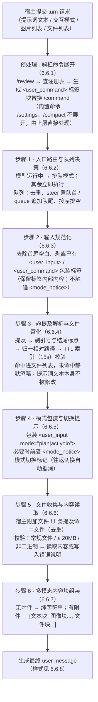

#### 6.6.1 预处理阶段：斜杠命令展开

```text
用户输入 "/review 请检查代码"
        │
        ▼
以 / 开头？──否──► 原样进入 6.6.2 的入口路由流程
        │是
        ▼
在斜杠命令注册表中查找匹配的命令名
        │
        ├─ 命中 Workflow / Skill 类型 → 读取预设的 instructions 文本
        │        → 生成 <user_command slash="review">指令文本</user_command> 标签块
        │          替换原输入中的 /command
        │
        └─ 内置命令（如 /settings、/compact）→ 不进入此展开流程，由上层直接处理
```

在用户消息进入正式处理流程之前，SDK 先对输入文本进行斜杠命令展开。当用户输入以 / 开头（如 /review 请检查代码）时，系统在斜杠命令注册表中查找匹配的命令名。若命中 Workflow 或 Skill 类型的命令，则读取其预设的 instructions 文本，生成 \<user_command slash="review"\>指令文本\</user_command\> 标签块，替换原输入中的 /command。内置命令（如 /settings、/compact）不进入此展开流程，由上层直接处理。展开后的文本以普通用户消息身份进入 6.6.2 的入口路由流程。

#### 6.6.2 入口路由与队列决策

```text
宿主（IDE 插件、CLI 等）统一入口提交一轮对话请求
（请求包含四个要素：提示词文本、交互模式、图片列表与文件列表）
        │
        ▼
交互式会话中模型仍在运行？
        ├─ 是 → 请求自动进入队列（排队模式）
        │        当前 run 结束后，队列按序以微任务（queueMicrotask）排空
        │        每条队列消息以独立 run 的身份重新走完整处理流程
        └─ 否 → 立即执行本轮

队列规则：
1) 入队时不做任何消息加工（解析与文件读取基于发送时刻的工作区状态）
2) 重复入队按提示词文本去重：同一文本再次入队仅更新原队列项
3) steer（转向）类始终置队首，queue（排队）类追加至队尾
4) 文本为空但携带图片或文件的请求同样合法，也能触发一轮对话
```

宿主（IDE 插件、CLI 等）通过统一入口向 SDK 提交一轮对话请求，请求包含四个要素：提示词文本、交互模式、图片列表与文件列表。

SDK 首先决定该请求的投递方式：

1) 交互式会话中模型仍在运行：请求自动进入队列（排队模式）

2) 其余情况：立即执行本轮

队列规则：

1) 排队请求入队时不做任何消息加工，等当前 run 结束后由队列按序以微任务（queueMicrotask）排空，每条队列消息都以独立 run 的身份重新走完整处理流程——这保证提及解析与文件读取始终基于发送时刻的工作区状态，而非入队时刻

2) 重复入队按提示词文本去重：同一文本再次入队时仅更新原队列项，不会产生第二份

3) 转向（steer）类队列项始终置于队首，排队（queue）类追加至队尾，使纠正类请求优先于批量类请求

4) 文本为空但携带图片或文件的请求同样合法，也能触发一轮对话

注：转向（steer）类消息是 CLI 版本特有的机制，是在 CLI 界面中选择排队中的消息，中断当前模型推理，直接进行该消息的推理的机制，vscode 中暂无此机制。

#### 6.6.3 输入规范化

```text
原始文本 → 去除首尾空白
        → 移除文本中已存在的 <user_input> / <user_command> 包装标签（保留标签内部内容）
        → （有意不触碰 <mode_notice> 标记，保证模式切换提示穿透到模型）
        → 规范化文本
```

正式处理前，原始文本先经过规范化：去除首尾空白，并移除文本中已存在的 \<user_input\> 或 \<user_command\> 包装标签（保留标签内部内容）。此步骤的目的是防止二次包装：重试重发、检查点恢复、队列消息再次提交等场景下，文本可能已经携带包装标签，若不剥离，后续的模式包装步骤会形成嵌套标签，模型将看到重复的结构标记。规范化有意不触碰 \<mode_notice\> 标记（若存在），以保证模式切换提示能够穿透到模型（见 6.6.4）。

#### 6.6.4 @提及解析与文件富化

```text
规范化后的文本 → 扫描 @提及
（合法提及词必须位于行首或空白之后，且自身不含 @ 符号，避免把邮箱误认为路径）
        │
        ▼
每个词剥离包裹引号与结尾标点（逗号、句号、括号等）
（"@src/main.ts，请看一下" 仍能识别为路径 src/main.ts）
        │
        ▼
候选路径统一归一为斜杠分隔的相对路径
        │
        ├─ 解析后落在工作区根目录之外 → 直接丢弃
        ▼
带 TTL 缓存（默认 15 秒）的工作区文件索引检查存在性
（索引忽略 node_modules 等目录；支持可选的文件数量与字节预算约束，超预算同样忽略）
        │
        ├─ 命中 → 进入文件列表（文件通道补充内容，见 6.6.5）
        └─ 未命中 → 静默忽略，均不视为错误

关键设计：提示词文本本身不被修改，@词保留在原文中；
两个通道互补——模型从文本知道"用户引用了哪个文件"，
从文件块知道"文件内容是什么"。
```

规范化后的文本被扫描 @提及。合法提及词必须位于行首或空白之后，且自身不含 @ 符号（避免把邮箱地址误认为文件路径）。每个词先剥离包裹引号与结尾标点（逗号、句号、括号等），使“@src/main.ts，请看一下”仍能被识别为路径 src/main.ts。候选路径统一归一为斜杠分隔的相对路径，解析后落在工作区根目录之外的路径直接丢弃；随后逐个在带 TTL 缓存（默认 15 秒）的工作区文件索引中检查存在性，索引忽略 node_modules 等目录，命中者进入文件列表，未命中者静默忽略，均不视为错误。文件索引接口同时支持可选的文件数量与字节预算约束，超出预算的提及同样被忽略。此步骤的关键设计是：提示词文本本身不被修改，@词保留在原文中，文件真实内容通过文件通道（见 6.6.5）补充。两个通道互补——模型从文本知道“用户引用了哪个文件”，从文件块知道“文件内容是什么”。

#### 6.6.5 模式包装与切换提示

```text
规范化 + 提及解析完成后的提示词
        │
        ▼
包装进 <user_input> 标签
（mode 属性取本次请求指定的模式，未指定时回退会话当前模式；
  取值为 plan、act、yolo 三种，缺省为 act）
        │
        ▼
<user_input mode="act/plan">文本</user_input>
（该标签是模型判断"本条消息以何种交互模式发出"的唯一依据；
  最新一条消息的 mode 属性即时生效，更早消息的模式不约束当前行为）

模式切换标记（共享层定义）：
用户在界面手动切换模式
        → 宿主在下一条用户消息文本前缀 <mode_notice>…</mode_notice>
          如 <mode_notice>The user switched from plan to act mode.</mode_notice>
        → 发送前发生往返切换（如 plan→act→plan）时标记自动抵消
        → 显示侧由专门的剥离逻辑隐藏，不渲染为用户输入的文字
```

规范化与提及解析完成后，提示词被包装进 \<user_input\> 标签，mode 属性取本次请求指定的模式，未指定时回退到会话当前模式。模式取值为 plan、act、yolo 三种，缺省为 act。该标签是模型判断“本条消息以何种交互模式发出”的唯一依据：System Prompt 中有专门段落向模型解释此标签（见 6.5），并告知最新一条消息的 mode 属性即时生效，更早消息的模式不约束当前行为。

为帮助模型在历史中定位模式切换点，共享层还定义了 \<mode_notice\> 标记与配套的切换追踪器：用户在界面手动切换模式后，宿主在下一条用户消息文本前缀上该标记(\<mode_notice\>The user switched from plan to act mode.\</mode_notice\>)；发送前发生往返切换（如 plan→act→plan）时标记自动抵消，避免产生虚假的切换记录。标记在显示侧由专门的剥离逻辑隐藏，不会被渲染为用户输入的文字。将文本包装为 \<user_input mode="act/plan"\>文本\</user_input\>。

#### 6.6.6 文件收集与内容读取

```text
本轮文件集合 = 宿主显式附加的文件（相对工作目录解析为绝对路径）
             ∪ 6.6.3 中 @提及命中的相对路径（相对工作区根解析为绝对路径）
             （两者去重合并）
        │
        ▼
对集合中每个文件，通过注入的文件内容加载器读取，依次做三项校验：
① 路径必须是常规文件  ② 大小不得超过 20 MB  ③ 内容不得包含空字符（拒绝二进制文件）
        │
        ├─ 通过 → 文件块转为 <file_content path="...">\n内容\n</file_content> 文本
        └─ 失败 → 不阻塞整轮对话：文件块中写入错误说明
           （如 Error fetching content 前缀）而非文件内容，
             模型可据此知道该文件不可读，进而选择其他途径（如分块读取或改用搜索工具）
```

本轮的文件集合来自两个来源：宿主显式附加的文件（相对工作目录解析为绝对路径）与 6.6.3 中 @提及命中的相对路径（相对工作区根解析为绝对路径），两者去重合并。对集合中每个文件，SDK 通过注入的文件内容加载器读取，并依次做三项校验：路径必须是常规文件、大小不得超过 20 MB、内容不得包含空字符（用于拒绝二进制文件）。校验失败的文件不会阻塞整轮对话：其文件块中写入错误说明（如 Error fetching content 前缀）而非文件内容，模型可据此知道该文件不可读，进而选择其他途径，如分块读取或改用搜索工具。在这一步把文件块转为 \<file_content path="..."\>\n内容\n\</file_content\> 文本。

#### 6.6.7 多模态内容块组装

```text
消息既无图片也无文件 → 内容保持为纯字符串
        │ 否（存在附件）
        ▼
组装为有序的内容块数组：
  [ 文本块（模式包装后的提示词）,
    图像块 × N,   ← 输入为 base64 data URL，SDK 解析出媒体类型与数据两部分；
                    不匹配 data URL 格式时，退化为将整串视为 base64 数据并默认类型 PNG
    …,
    文件块 × N ]  ← 包含文件绝对路径与 6.6.5 读取到的文本内容
```

这是用户消息最终内容结构的确定点。消息既无图片也无文件时，内容保持为纯字符串；存在附件时则组装为有序的内容块数组——先是文本块（模式包装后的提示词），其后依次是逐张图片对应的图像块，最后逐一加入文件块。图像块的输入是 base64 data URL，SDK 从中解析出媒体类型与数据两部分；不匹配 data URL 格式时，退化为将整串字符串视为 base64 数据并默认类型 PNG。文件块包含文件绝对路径与 6.6.5 读取到的文本内容。

#### 6.6.8 用户消息样式

**无图片(纯文本字符串)**

```json
{
  "role": "user",
  "content": "<mode_notice>The user switched from plan mode to act mode before sending this message.</mode_notice><user_command slash=\"ship\"><user_input mode=\"act\">你是发布专家，请按照以下步骤操作：\n1. 检查代码变更\n2. 运行测试\n3. 创建发布 PR 准备发布\n<file_content path=\"/home/user/project/CHANGELOG.md\">\n## v1.0\n- 修复了登录 bug\n</file_content></user_input></user_command>",
  "ts": 1724000000000
}
```

**有文件/图片附件（ContentBlock\[\] 数组）**

```json
{
  "role": "user",
  "content": [
    {
      "type": "text",
      "text": "<mode_notice>...</mode_notice><user_input mode=\"act\">请审查以下代码变更</user_input>"
    },
    {
      "type": "image",
      "image": "data:image/png;base64,iVBORw0KGgo...",
      "mediaType": "image/png"
    },
    {
      "type": "text",
      "text": "<file_content path=\"/project/src/main.ts\">\nexport function hello() {\n  console.log(\"Hello\");\n}\n</file_content>"
    }
  ]
}
```

**有斜杠命令(slash command)，无附件**

```json
{
  "role": "user",
  "content": "<user_command slash=\"review\"><user_input mode=\"act\">你是代码审查专家，请检查以下代码变更：\n1. 代码风格\n2. 潜在 bug\n3. 错误处理</user_input></user_command>"
}
```

**有斜杠命令(slash command)，有文件和图片的附件**

```json
{
  "role": "user",
  "content": [
    {
      "type": "text",
      "text": "<user_command slash=\"review\"><user_input mode=\"act\">你是审查专家，请检查以下代码变更</user_input></user_command>"
    },
    {
      "type": "text",
      "text": "<file_content path=\"/project/src/main.ts\">\nexport function hello() {\n  console.log(\"Hello\");\n}\n</file_content>"
    },
    {
      "type": "image",
      "image": "data:image/png;base64,...",
      "mediaType": "image/png"
    }
  ]
}
```

**结构要点**：

1)  `systemPrompt` 独立字段，不参与对话历史

2)  `tool` role 消息通过 `toolCallId` 与 `assistant` 的 `tool-call` part 配对

3)  `[SYSTEM]` 提醒以 `user` role 的 `text` part 形式出现

4)  每轮 assistant 回复可含多个 `tool-call`（支持并行工具调用）

5)  Steering 消息以 `user` role 插入到数组末尾

### 6.7. PLAN / ACT 双模式

#### 6.7.1 设计意图

**问题**：复杂任务中，模型在探索阶段使用破坏性工具（`write_to_file`、`execute_command`）可能造成不可逆的错误。

**解决方案**：PLAN 模式下 Agent 只能使用只读工具进行调研，确认方案后切换到 ACT 模式执行。

#### 6.7.2 模式对比

| PLAN 模式 | ACT 模式 |
|:---|:---|
| 可用工具: read_file, search_files, list_files, ask_followup_question, switch_to_act_mode ← 唯一出口 | 可用工具: 全部工具（含 write, execute） |
| 目标: 调研、分析、制定方案 | 目标: 执行方案、完成任务 |

#### 6.7.3 模式切换流程

```text
enablePlanAct = true
  → 注册 switch_to_act_mode 工具
  → Plan 模式: 限制工具集
  → switch_to_act_mode 执行成功
      → completesRun: false (不终止 run)
      → 内部修改 Agent policy
      → 解锁全部工具
      → 下一轮循环即可使用全部工具
```

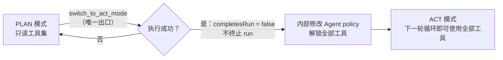

**与终结工具的区别**：

- `switch_to_act_mode`: `completesRun: false` → 模式切换但不退出
- `submit_and_exit` / `attempt_completion`: `completesRun: true` → 真正的完成任务退出

## 7. 多 Agent 协作架构

多 Agent 协作是 CygCode 体系中的重要能力，用于将复杂任务分解到多个独立的 Agent 上下文中并行或协作执行。CygCode 包含两套独立的多 Agent 机制：Subagents（子agent）和 Agent Teams（agent团队）。两套机制共享底层的委托agent基础设施，但在设计理念、协作模式、能力边界和适用场景上存在本质差异。

### 7.1 两套多 Agent 体系概述

从用户视角观察，Subagents 与 Agent Teams 都表现为“由另一个 Agent 执行任务”，但二者在底层实现上存在根本性差异。以下从六个核心维度进行对比：

| 对比维度 | Sub-agent（子agent） | Teams（agent团队） |
|:---|:---|:---|
| 设计理念 | 并行侦察，保持主脑清洁 | 团队协作，分工攻坚 |
| Prompt 注入方式 | 完全替换系统提示词（override） | 追加到现有系统提示词（rules） |
| 通信模型 | 单向管道，任务派发后返回结果 | 双向邮箱 + 广播，异步网状通信 |
| 持久化 | 无持久化，任务结束即销毁 | 完整持久化，状态可跨会话恢复 |
| 并发模型 | 同步阻塞，全部并行启动 | 队列 + 异步，支持优先级调度与并发控制 |
| 角色与权限 | 无角色概念，父子对等 | Lead / Teammate 两级权限控制 |
| 递归能力 | 可无限嵌套 | 仅两层结构，teammate 不可再生成队友 |

Sub-agent 采用轻量级隔离委派模式，其核心是通过完全替换的系统提示词创建一个只读的研究型agent，任务完成后立即销毁。Teams 则采用重量级协作平台模式，在标准 Agent 的基础上追加团队角色规则，提供完整的任务看板、邮箱通信、交付物管理等协作设施。

两套体系在失控防护上的边界需要明确。Subagent 以可无限嵌套为能力描述，配置层面并不强制嵌套深度上限：只要子agent的工具装配允许 `spawn_agent`（`enableSpawnAgent` 为 true），子agent理论上即可再生成下一级子agent；`spawn_agent` 工具自身带有超时约束且不可重试，作为单次委托的执行上限，但嵌套层级、生命周期与累计成本并不自动设顶。Teams 则通过 lead 独占生成权限与两级角色模型从结构上限制层级深度——仅 lead 可调用 `team_spawn_teammate`，teammate 不再具备招募能力，因此团队被控制在两层以内。对于可能的失控风险，应通过工程配置为嵌套深度与预算设置显式上限；运行时只保证单次委托的超时与失败返回，不对总预算做强制判定。

Token 与成本计量方面，Subagent 拥有独立的上下文与独立计算的 Token 预算，其用量（输入与输出 token）在执行结果中返回，并被成本统计汇总到任务总成本；Teams 通过配置提供者向成员注入连接配置，各成员的用量同样分别统计。需要说明的是，运行时并未实现共享预算上限的强约束，所谓汇总只是计量的聚合，并不构成预算闸门；若需要在团队或子agent层面做成本封顶，需由上层宿主基于返回的用量自行实施预算控制。

### 7.2 Subagents — 并行侦察机制

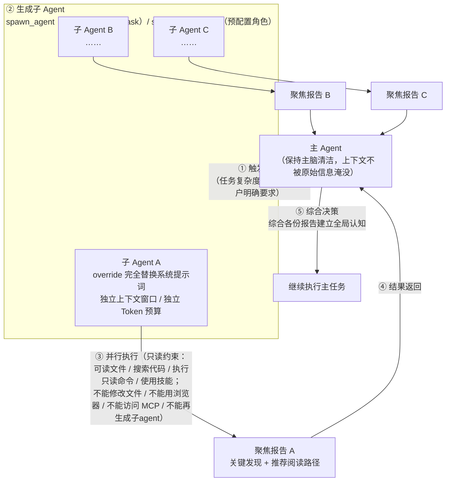

#### 7.2.1 设计思想

Subagents 的设计目标是解决主agent在面对大型代码库或复杂调研任务时的上下文过载问题。其核心思想是“并行侦察，保持主脑清洁”：主agent将研究任务拆分为多个方向，每个方向交由一个独立的子agent并行探索，子agent完成研究后返回聚焦的摘要报告，主agent通过综合各份报告快速建立全局认知，而自身的上下文窗口不会被原始信息淹没。

子agent在能力边界上受到严格约束，本质上是只读的单元——它们可以读取文件、搜索代码、执行只读命令、使用技能，但不能修改文件、不能使用浏览器、不能访问 MCP 服务器，也不能生成下一级子agent。这种只读约束构成了一道安全边界，确保并行运行的研究型agent即使行为偏离预期，也不会对项目状态造成实际影响。

子agent的只读边界在第 3 章的装配机制中如何落地：`spawn_agent` 执行时通过子agent工具装配回调，依据会话模式解析工具预设来组装工具集，并在装配后进行启用过滤。因此只读约束并非子agent工具对象的内置属性，而是由装配阶段所选择的工具预设决定——当子agent套用只读或受限预设（例如不启用 editor、apply_patch 等写类工具）时，其上下文中根本不存在可修改文件的工具，从而在能力层面实现只读。与之配套，Plan 模式下对写操作的触碰（如通过 `run_commands` 触发的非只读指令被 `Plan Mode` 标记拦截）会被刻意降低为引导而非计入致命错误（见第 5 章）。因此只读边界、工具装配与错误抑制是同一个机制在不同层面的体现。

#### 7.2.2 Subagents的System Prompt 构建机制

```text
主 Agent 默认 System Prompt ────✗ 不继承（完全替换策略 override）
                                        │
子 Agent System Prompt ◄────────────────┘
┌──────────────────────────────────────────────┐
│ 全新、完整的系统提示词                         │
│ （独立身份认知：不知道自身处于"子agent"地位，   │
│   也不知道主 agent 的存在）                    │
│ 所有行为约束都必须在此显式声明                 │
└──────────────────────────────────────────────┘
```

Sub-agent 的系统提示词采用完全替换策略（override）。子agent获得的是一份全新的、完整的系统提示词，而非在默认提示词基础上追加内容。这意味着子agent拥有独立的身份认知，不知道自身处于“子agent”地位，也不知道主agent的存在。

这种设计的优势在于子agent的行为完全由其系统提示词定义，专注于被分配的研究任务，不会受到默认 Agent 角色设定的干扰。其劣势在于默认的规则集不会自动注入，所有行为约束都必须在子agent的系统提示词中显式声明。

#### 7.2.3 预配置子agent

系统支持预定义的子agent角色（Configured Agents）。这些角色以配置文件的形式存在于多个层级（内置、全局、项目），每个角色包含名称、描述和系统提示词。系统启动时将这些预配置角色注册为独立的工具，主agent可以像调用普通工具一样直接调用特定角色的子agent，无需每次重新编写提示词。

| 工具名称 | 输入参数 | 输出 | 说明 |
|:---|:---|:---|:---|
| spawn_agent | systemPrompt; task | text; iterations; finishReason; usage | 运行时动态生成子agent，指定系统提示词和任务 |
| subagent_\<name\> | prompt | text; iterations; finishReason; usage | 预配置子agent工具，由配置文件注册，直接调用特定角色 |

#### 7.2.4 工作流程

Subagents 的工作流程如下：

① 触发判断：主agent在任务执行过程中，根据任务复杂度自主判断是否需要并行调研，用户也可通过提示词明确要求使用子agent。

② 生成子agent：主agent调用subagent生成工具，为每个子agent指定系统提示词、任务描述和可用工具集。

③ 并行执行：多个子agent同时启动，各自在独立的上下文窗口中运行，拥有独立的 Token 预算，成本独立统计后汇总到任务总成本中。

④ 结果返回：每个子agent完成研究后，返回聚焦的报告文本，包含关键发现和推荐阅读路径。

⑤ 综合决策：主agent接收所有子agent的报告，综合形成全局认知后继续执行主任务。

#### 7.2.5 适用场景

Subagents 适用于以下场景：新代码库上手，并行探索架构、入口点、数据流，快速建立全局认知；跨领域调研，同时追踪认证、日志、错误处理等多个横切关注点；编辑前研究，在修改前广泛收集相关文件上下文，避免主agent上下文过载；大型代码库信息收集，当顺序读取大量文件会过度消耗主agent上下文时。

### 7.3 Agent Teams — 团队协作机制

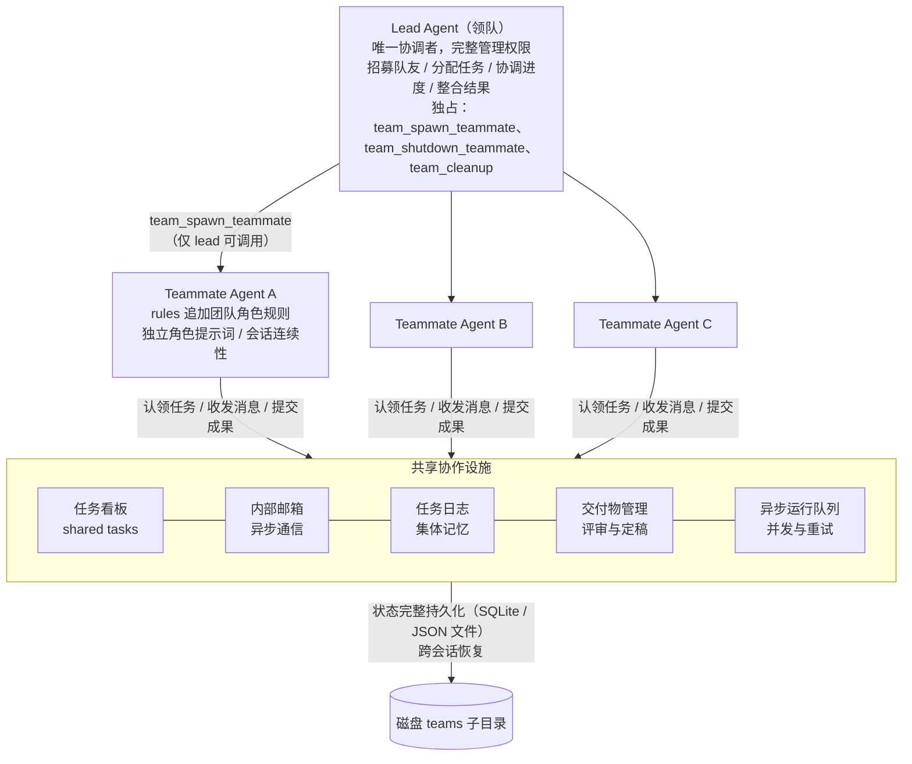

#### 7.3.1 设计思想

Agent Teams 的设计目标是支持复杂的多步骤任务，通过多个专业化 agent 的分工协作完成系统性工作。其核心思想是：一个领队 agent（lead agent）统筹全局，根据任务需要招募不同专长的团队成员（teammate agents），通过共享任务看板、内部邮箱、任务日志和交付物管理系统协调工作。

与 Subagents 的一次性侦察不同，Agent Teams 是持续性的协作组织，并且团队成员之间可以通过邮箱机制进行通信(这是和Subagents最有区别的点)。团队采用两级角色模型：Lead Agent 作为唯一协调者，拥有完整的管理权限，负责招募队友、分配任务、协调进度、整合结果；Teammate Agent 作为执行成员，拥有协作工具但无管理权限，可以认领任务、执行任务、收发消息、提交成果。每个队友有独立的角色提示词，定义其专业领域和行为方式，并支持会话连续性，可在多轮任务中积累上下文。

团队状态完整持久化存储，可跨会话恢复；成员之间可双向通信；任务具备完整的生命周期管理（待处理 → 进行中 → 阻塞 → 已完成），支持依赖关系和自动阻止未解决依赖的认领；交付物拥有评审和定稿流程，形成草稿 → 评审中 → 已定稿的三态流转。Agent Teams 本质上是一个可以持续运转的 agent 组织，而非一组并行的临时任务。

#### 7.3.2 启动与角色模型

```text
会话配置 enableAgentTeams = true
        │
        ▼
当前会话的 agent 成为领队（lead），获得一整套团队管理工具
        │
        ├─ team_spawn_teammate（仅 lead）→ 创建 Teammate
        │      └─ 创建后自动注入 team 协作工具
        │         + 以 rules 策略追加团队角色规则
        ├─ team_shutdown_teammate（仅 lead）→ 关闭指定 teammate
        └─ team_cleanup（仅 lead，需确保无正在运行的队友）→ 清理团队运行时

跨 Session 持久化：重启后 Teams 状态可恢复
```

**约束**：`team_spawn_teammate` 只有 lead 能调用；teammate 创建后自动注入 team 协作工具；跨 Session 持久化意味着重启后 Teams 状态可恢复。

Agent Teams 通过会话配置中的 enableAgentTeams 参数激活。启用后，当前会话的agent成为领队（lead），获得一整套团队管理工具。

团队采用两级角色模型：

**Lead Agent（领队agent）**

Lead Agent 作为团队的唯一协调者，拥有完整的管理权限，负责招募队友、分配任务、协调进度、整合结果，是团队中唯一可以生成或关闭队友、执行清理操作的角色。

**Teammate Agent（队友agent）**

Teammate Agent 是团队的执行成员，拥有协作工具但无管理权限，可以认领任务、执行任务、收发消息、提交成果。每个队友有独立的角色提示词，定义其专业领域和行为方式，并支持会话连续性，可在多轮任务中积累上下文。

Teammate 的系统提示词采用规则追加策略（rules），即在标准 CygCode 系统提示词的基础上，追加团队角色规则。这意味着队友保留了标准 Agent 的全部能力和行为模式，同时获得团队协作的额外约束和工具。

**相关工具**

| 工具名称 | 说明 |
|:---|:---|
| team_shutdown_teammate | 关闭指定 teammate；仅 lead 可调用 |
| team_status | 获取团队快照：成员、任务数、邮箱、日志统计 |
| team_cleanup | 清理团队运行时；仅 lead 可调用，需确保无正在运行的队友 |

#### 7.3.3 共享任务看板

任务看板是团队协作的核心协调机制。所有任务集中在共享看板上，每个任务包含标题、描述、负责人、依赖关系和状态信息。任务状态包括：待处理、进行中、阻塞、已完成。

任务看板的运作方式如下：领队在看板上创建任务，指定负责人并设置依赖关系；队友可以认领任务，将状态从待处理更新为进行中；存在未解决依赖的任务会被自动阻止认领，确保任务按合理顺序推进；任务完成后由执行者标记为已完成，或标记阻塞并说明原因。

成员通过操作共享的任务状态来协调工作，无需直接对话即可达成行动同步。

**相关工具**

| 工具名称 | 说明 |
|:---|:---|
| team_task | 管理共享任务：create/list/claim/complete/block 等操作 |

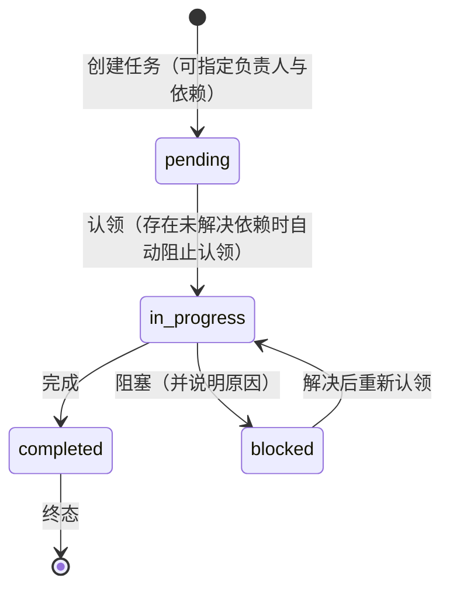

任务的状态枚举和转换如下表：

| 状态 | 说明 | 允许的转换 |
|:---|:---|:---|
| pending | 待处理 | → in_progress（认领） |
| in_progress | 进行中 | → completed（完成）；→ blocked（阻塞） |
| blocked | 阻塞 | → in_progress（解决后重新认领） |
| completed | 已完成 | 终态 |

#### 7.3.4 内部邮箱机制

内部邮箱是agent间异步通信的核心设施。每个agent拥有独立的收件箱，其他agent可以向其发送点对点消息，领队还可以向所有队友广播通知。

邮箱机制的关键设计在于异步性：消息不会实时推送给正在运行的agent，而是先存入目标agent的收件箱。当目标agent下一次被调度运行时，系统自动将所有未读消息注入到其上下文中，agent在任务执行过程中读取并响应。

这种设计带来三方面优势：一是agent无需同时在线，消息先存储后消费，实现时间解耦；二是避免打断正在专注执行任务的agent，保证执行的连贯性；三是通信与执行解耦，简化了协调逻辑，降低了系统复杂度。

运行中的agent可通过新邮件通知机制（steer message）获知重要消息，但具体的响应仍由agent在其推理过程中自主决定。

**相关工具**

| 工具名称 | 参数 | 说明 |
|:---|:---|:---|
| team_send_message | toAgentId; subject; body; taskId? | 向指定 teammate 发送点对点消息 |
| team_broadcast | subject; body; taskId? | 向所有 teammate 广播消息 |
| team_read_mailbox | unreadOnly? | 读取当前 agent 的收件箱 |

| 流程类型 | 详细步骤 |
|:---|:---|
| 点对点消息 | 发送者调用 team_send_message，指定接收者、主题、正文。系统创建消息对象，存入内存消息队列。若接收者正在运行，系统向其注入待处理消息通知。 |
| 广播通知 | 领队调用 team_broadcast，提供主题和正文。系统遍历所有队友（排除领队自身），为每个队友创建一条点对点消息。 |
| 消息消费 | 当目标 Agent 被调度运行时，系统调用 listMailbox() 获取未读消息。未读消息被格式化为通知字符串，注入到 Agent 的输入上下文开头。 |

#### 7.3.5 任务日志

任务日志是团队活动的时间线记录，用于保存团队的“集体记忆”。日志条目包含多种类型：进度更新、工作交接、阻塞报告、决策记录、任务完成、错误记录等。每个条目关联对应的agent和任务，支持附加证据链接和下一步行动说明。

任务日志的价值体现在三个方面：任何成员随时可通过日志了解项目全貌和决策来龙去脉；避免信息不对称导致的重复沟通和工作返工；为跨会话恢复提供上下文基础，使团队重启后能快速进入状态。

日志系统具备节流机制，按步数和时间间隔控制写入频率，防止日志泛滥影响性能。

**相关工具**

| 工具名称 | 说明 |
|:---|:---|
| team_mission_log | 追加任务日志条目；支持 progress/handoff/blocked/decision/done/error 等类型 |

**任务日志实体字段（MissionLogEntry）**

| 字段 | 类型 | 说明 |
|:---|:---|:---|
| id | string | 日志条目唯一标识，格式为 log_XXXXXX（6位数字） |
| ts | Date | 记录创建的时间戳 |
| teamId | string | 所属团队 ID |
| agentId | string | 写入该条目的 Agent ID |
| taskId | string? | 关联的任务 ID（可选） |
| kind | MissionLogKind | 日志类型，取值为 progress / handoff / blocked / decision / done / error |
| summary | string | 日志摘要内容 |
| evidence | string\[\]? | 证据链接或片段列表（可选） |
| nextAction | string? | 下一步行动说明（可选） |

**日志类型（MissionLogKind）**

| 字段 | 类型 | 说明 |
|:---|:---|:---|
| progress | 进度更新 | 记录任务执行进展，如迭代完成、工具调用结束、任务认领等 |
| handoff | 工作交接 | 记录工作交接信息，用于团队成员之间的任务传递 |
| blocked | 阻塞报告 | 记录任务被阻塞的原因，如依赖未满足、资源不足等 |
| decision | 决策记录 | 记录团队做出的重要决策及其依据 |
| done | 任务完成 | 记录任务完成的结果和总结 |
| error | 错误记录 | 记录执行过程中发生的错误信息 |

**节流机制与查询接口**

| 类别 | 参数/接口 | 类型 | 说明 |
|:---|:---|:---|:---|
| 写入节流 | missionLogIntervalSteps | number | 日志写入的最小步数间隔；自上次写入后，累计步数差小于该值时，即使满足时间条件也不写入。默认值为 3，最小为 1 |
| 写入节流 | missionLogIntervalMs | number | 日志写入的最小时间间隔（毫秒）；自上次写入后，经过时间小于该值时，即使满足步数条件也不写入。默认值为 120000（2 分钟），最小为 1000（1 秒） |
| 查询接口 | listMissionLog(limit?) | MissionLogEntry\[\] | 查询团队任务日志；若不传 limit 或 limit ≤ 0，则返回全部日志；若传入正整数 limit，则仅返回最新的 limit 条记录 |

#### 7.3.6 异步运行队列与并发控制

Agent Teams 支持同步和异步两种任务执行模式：

**同步委派模式**：领队直接调用队友执行任务，调用会阻塞直到任务完成，立即获取结果。适用于短任务或需要立即获取结果的场景。

**异步委派模式**：任务进入后台运行队列，调用立即返回运行标识，领队可继续处理其他工作，稍后查询或等待结果。适用于长任务或可并行推进的多个任务。

异步运行队列具备以下核心特性：优先级调度，高优先级任务先执行；并发数控制，默认最多两个并发运行，防止资源耗尽；失败重试，支持指数退避的自动重试，可配置最大重试次数；心跳检测，定期更新运行状态，便于异常检测；操作支持，支持取消运行、等待完成、列举运行等管理操作。

并发控制的默认值与可配置性需要明确：团队成员运行的并发上限由 `maxConcurrentRuns` 决定，其值为配置值（不小于 1），未配置时默认 2，即同一时刻最多两个队友同时运行，多余的任务排队等待；该值可通过初始化团队的选项显式调整。失败重试采用指数退避，退避间隔随重试次数指数增长并封顶约 30 秒，且可通过传入的最大重试次数限制重试范围，达到上限后该次运行被标记为 failed 并记录错误，不再自动入队。这些参数共同构成对并发耗尽资源与失败无限重试的两道防护。

运行队列与任务看板相互配合，构成了团队任务从规划到执行的完整链路。

**相关工具**

| 工具名称 | 说明 |
|:---|:---|
| team_run_task | 路由委托任务给 teammate，支持同步/异步两种模式 |
| team_cancel_run | 取消指定的异步运行 |
| team_list_runs | 列出通过 team_run_task 发起的异步运行 |
| team_await_runs | 等待异步运行完成；可指定 runId 或等待全部 |

#### 7.3.7 交付物管理系统

交付物系统是 Agent Teams 中结构化成果管理的核心机制，其设计目标是确保团队产出的质量和可追溯性。

交付物系统的核心概念包括：

**交付物（Outcome）**：团队的最终产出，由多个必需的章节组成。交付物具备完整的状态流转：草稿→评审中→已定稿。

**片段（Fragment）**：交付物中各章节的内容单元，由不同agent提交。一个章节可以有多个片段，由不同成员贡献。

**评审流程**：片段提交后进入评审状态，其他agent可以评审片段，批准或驳回。被驳回的片段需要修改后重新提交。

**定稿条件**：只有当所有必需章节都拥有已批准的片段时，交付物才能最终定稿。

交付物系统本质上是将“代码评审”的质量保障思想泛化到所有团队产出上，通过结构化的评审流程确保最终交付的每一份成果都经过质量把关。

```mermaid
stateDiagram-v2
    direction LR
    state "交付物 Outcome" as O {
        [*] --> ODraft: team_create_outcome<br/>（指定标题与必需章节）
        state "草稿 draft<br/>允许附加片段" as ODraft
        state "评审中 in_review<br/>已有片段附加，等待评审" as OReview
        state "已定稿 finalized<br/>所有必需章节均已评审通过" as OFinal
        ODraft --> OReview: team_attach_outcome_fragment<br/>附加片段
        OReview --> OFinal: team_finalize_outcome<br/>（检查通过后）
    }
    state "片段 Fragment" as F {
        [*] --> FDraft: 提交片段
        state "草稿 draft<br/>已提交但未评审" as FDraft
        state "已评审 reviewed<br/>可参与定稿条件检查" as FReviewed
        state "已驳回 rejected<br/>需修改后重新提交" as FRejected
        FDraft --> FReviewed: team_review_outcome_fragment（批准）
        FDraft --> FRejected: team_review_outcome_fragment（驳回）
        FRejected --> FDraft: 修改后重新提交
    }
    F -.-> O: 片段附加到章节
```

交付物管理系统的内部实现基于运行时状态管理。工具层提供五个核心工具：team_create_outcome、team_attach_outcome_fragment、team_review_outcome_fragment、team_finalize_outcome、team_list_outcomes。这些工具由智能体调用，直接操作内存中的交付物状态数据，不触发其他智能体执行。工具内部执行状态创建、片段附加、评审、定稿等操作，并触发相应事件（如 OutcomeCreated、OutcomeFragmentAttached、OutcomeFragmentReviewed、OutcomeFinalized）以通知状态变化。交付物状态流转遵循草稿（draft）、评审中（in_review）、已定稿（finalized）的生命周期。片段状态包括草稿（draft）、已评审（reviewed）、已驳回（rejected）。定稿前需检查所有必需章节均拥有已评审的片段。状态数据支持持久化存储，可通过 SQLite 数据库或文件系统保存。

**相关工具**

| 工具名称 | 功能与关键逻辑 |
|:---|:---|
| team_create_outcome | 创建新的交付物。创建交付物实体，初始状态为草稿（draft），指定标题和必需章节列表。 |
| team_attach_outcome_fragment | 向交付物指定章节附加片段。创建片段实体，状态为草稿（draft），并将交付物状态更新为评审中（in_review）。 |
| team_review_outcome_fragment | 评审片段。根据评审结果更新片段状态为已评审（reviewed）或已驳回（rejected）。 |
| team_finalize_outcome | 定稿交付物。检查所有必需章节是否都有已评审的片段，通过后将交付物状态更新为已定稿（finalized）。 |
| team_list_outcomes | 列出所有交付物。返回当前团队所有交付物的列表。 |

| 实体 | 状态值与说明 |
|:---|:---|
| 交付物（Outcome） | 草稿（draft）：初始状态，允许附加片段。评审中（in_review）：已有片段附加，等待评审。已定稿（finalized）：所有必需章节均已评审通过，交付物完成。 |
| 片段（Fragment） | 草稿（draft）：初始状态，已提交但未评审。已评审（reviewed）：评审通过，可参与定稿条件检查。已驳回（rejected）：评审未通过，需修改后重新提交。 |

#### 7.3.8 持久化与状态恢复

Agent Teams 的所有状态均持久化存储到磁盘，包括任务看板、邮箱内容、任务日志、运行记录、交付物信息和成员配置。存储采用 SQLite 数据库，数据位于用户目录下的 teams 子目录中。

Teams 的持久化与第 6 章存储层的关系：Teams 的状态存储通过 TeamStore 接口抽象，运行时提供两种实现——基于 SQLite 的 TeamStore（数据落入用户目录的 teams 子目录）与基于 JSON 文件的 TeamStore。选定 SQLite 存储时，其连接复用与第 6 章会话存储同一套 SQLite 基础设施，但团队状态与会话消息分属不同的数据单元、互不混写，因此二者是同一套持久化技术基座、不同的数据域与存储单元，在数据模型与管理方式上各自独立。

持久化能力赋予了团队“长期记忆”，具体体现在：跨会话恢复，下次启动同名团队时自动加载完整状态，继续未完成的工作；故障恢复，意外中断后重启，未完成的运行自动重新入队执行；历史追溯，团队的完整活动记录可随时查阅和审计。

这使得 Agent Teams 超越了“任务执行机制”的范畴，成为一个可持续运作、具备长期记忆的agent组织。

#### 7.3.9 适用场景

Agent Teams 适用于以下场景：复杂多步骤项目，需要多个专业角色分工协作的大型任务；跨领域开发任务，前端、后端、测试、文档等不同角色分工协作；长时间运行任务，团队状态可保存，分多次会话逐步推进；需要质量保证的场景，交付物评审机制确保产出质量；CLI/SDK 自动化场景，通过命令行或编程方式启动团队协作。

### 7.4 两套体系的底层联系与架构分层

#### 7.4.1 共享基础设施

两套多 Agent 机制并非完全独立，它们在底层共享同一套委托agent基础设施：共同的执行引擎，都基于核心的会话运行时作为底层执行单元；共同的配置模型，都通过委托agent配置提供者管理子agent的配置；共同的生命周期模式，都具备启动和结束的生命周期钩子；共同的身份模型，都拥有独立的agent标识与会话标识，通过父agent标识建立层级关系；共同的提示词构建器，都通过统一的提示词构建模块生成系统提示词。

两套机制的核心分化体现在两个层面：一是提示词策略，Subagent 采用完全替换模式，Teammate 采用规则追加模式；二是上层协作设施，Subagent 只有简单的生成工具，Agent Teams 则拥有完整的团队运行时和十余个协作工具。

这种“共享底层、分化上层”的架构设计，既避免了重复建设，又使两套机制能够各自朝着最适合自身目标的方向发展。

#### 7.4.2 架构分层

CygCode 多 Agent 体系的整体架构可分为以下层次：

```text
┌────────────────────────────────────────────────────────────┐
│ 工具层：将运行时能力封装为可供 agent 调用的工具               │
│   Subagents 侧：子agent生成工具 + 预配置角色工具              │
│   Agent Teams 侧：十余种团队协作工具                          │
├────────────────────────────────────────────────────────────┤
│ 运行时层：实现两套多 Agent 机制的具体运行逻辑                  │
│   Subagents 侧：子agent生成工具和预配置agent                  │
│   Agent Teams 侧：团队运行时、任务看板、邮箱系统、交付物管理    │
├────────────────────────────────────────────────────────────┤
│ 委托agent层：统一的委托agent基础设施                          │
│   统一的执行单元封装、配置提供者和提示词构建器                  │
│   （Subagents 和 Agent Teams 共同构建在这一层之上）            │
├────────────────────────────────────────────────────────────┤
│ 核心层：基础的会话运行时、agent配置和工具系统                  │
│   （所有 Agent 能力的基础）                                   │
└────────────────────────────────────────────────────────────┘
```

**核心层**：提供基础的会话运行时、agent配置和工具系统，是所有 Agent 能力的基础。

**委托agent层**：在核心层之上封装统一的委托agent基础设施，包括统一的执行单元封装、配置提供者和提示词构建器。Subagents 和 Agent Teams 共同构建在这一层之上。

**运行时层**：实现两套多 Agent 机制的具体运行逻辑。Subagents 侧包含子agent生成工具和预配置agent；Agent Teams 侧包含团队运行时、任务看板、邮箱系统、交付物管理等协作组件。

**工具层**：将运行时能力封装为可供agent调用的工具。Subagents 侧提供子agent生成工具和预配置角色工具；Agent Teams 侧提供十余种团队协作工具。

## 8. 扩展插件(Plugin)体系

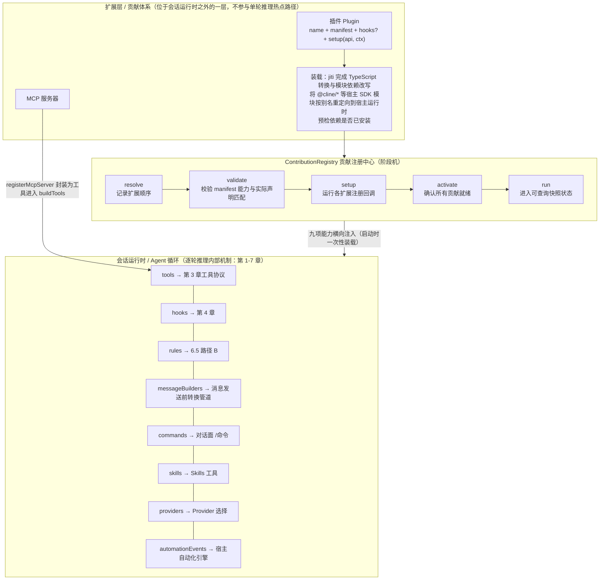

### 8.1 插件的本质和内容

前面各章描述的运行循环——`Agent` 循环、Completion 门控、工具协议、Hooks、安全检测、上下文管理、多 `Agent` 协作——都是逐轮推理内部的机制。插件与 `MCP` 则位于会话运行时之外的一层，可统称为扩展层或贡献体系：它们在会话启动时一次性装载并声明能力，再横向注入到上述机制之中，本身不参与单轮推理的热点路径。插件的本质是把一组“用户自定义的能力”装配进 `Agent`，这些能力通过一个封闭且权威的清单约束，共九项。

| 能力 | 含义 | 落地位置 |
|:---|:---|:---|
| `tools` | 新增模型可调用工具 | 第 3 章工具协议与 `ToolPolicy` |
| `hooks` | 注入运行时机钩子 | 第 4 章运行时 Hooks |
| `commands` | 斜杠命令 | 对话面 `/命令` |
| `rules` | 追加系统提示词规则 | 6.5 路径 B |
| `skills` | 技能目录 | Skills 工具（6.5.3） |
| `messageBuilders` | 改写发往模型的入参消息 | 消息发送前的转换管道 |
| `providers` | 自定义模型供应商 | Provider 选择 |
| `automationEvents` | 自动化事件类型 | 宿主自动化引擎 |
| `mcp` | 暴露 `MCP` 服务器 | `MCP` 接入（8.11） |

其中 `tools`、`rules`、`messageBuilders`、`mcp` 四个维度直接决定了 `Agent` 能用什么工具、看到什么提示词与消息、能接入什么外部系统，是插件能力的主要载体；`hooks` 与 `commands` 则提供纵向的流程介入与对话面交互；`skills`、`providers`、`automationEvents` 分别拓展技能、模型供应商与自动化触发。需要特别说明的是，`skills` 并不通过某个注册接口注入，而是由插件包根目录下的 `skills/` 目录在装载时自动收集。

### 8.2 插件能力边界

插件在“**注入内容**”上是开放的，在“**约束机制**”上是封闭的。下表从最终用户的视角归纳插件对系统的可改与不可改范围。

| 维度 | 能否改变 | 说明 |
|:---|:---|:---|
| 会话期装载时机 | 不能热加载 | 启动时一次性装配，改动插件或新增插件需重启会话生效 |
| 内建工具 | 不能覆盖 | 同名冲突时会话配置（内建）工具优先，插件只能新增、不能替换核心工具 |
| Completion 门控与终结规则 | 不能改变 | `submit_and_exit` 终结机制为运行时固有，插件不能变更 |
| 安全检测器 | 不能改变 | `MistakeTracker` 与 `LoopDetection` 阈值属 `execution.*` 配置，不在插件能力内 |
| 消息预算与上下文压缩 | 不能改变 | 内建 `MessageBuilder` 的预算截断与压缩（compaction）触发均配置驱动 |
| 钩子集合与执行顺序 | 不能删除重排 | 钩子类型集合固定，插件只能追加自己的钩子 |
| 系统提示词 | 不能整体替换 | 只能经 `rules` 追加合并，不能整体覆盖 `systemPrompt` |
| 内建工具审批策略 | 不能改变 | `ToolPolicy`（enabled/autoApprove）归会话配置所有 |

### 8.3 发现、加载与配置项

插件通过两类途径被发现：从配置的搜索路径自动发现，或由会话配置显式指定。下表同时列出最终用户常用的相关配置项。

| 配置项 / 位置 | 取值示例 | 说明 |
|:---|:---|:---|
| 工作区插件目录 | `{workspace}/.cline/plugins` | 随项目自动发现 |
| 全局插件目录 | `~/.cline/plugins` | 跨项目自动发现 |
| 文档插件目录 | `~/Documents/Cline/Plugins` | 系统性自动发现 |
| `pluginPaths` | 单个插件文件或包路径 | 显式指定，优先级最高 |
| `mode` | `in_process` 或 `sandbox` | 装载方式，沙箱更安全 |
| `importTimeoutMs` 等 | 毫秒 | 沙箱下解析/钩子/注册三阶段超时 |

插件可以是单个 `.js` / `.ts` 模块文件。装载过程借助 `jiti` 完成 TypeScript 转换与模块依赖改写，将插件引用的 `@cline/*` 等宿主 SDK 模块按别名重定向到宿主运行时，并预检依赖是否已安装。装配入口 `resolveAndLoadAgentPlugins` 汇总路径、按目标定向过滤并装载，返回扩展列表连同诊断信息；单个插件加载失败不会中断整批，而会记入 `failures` 交由宿主处理。

### 8.4 生命周期与贡献注册中心

所有扩展的贡献统一汇入 `ContributionRegistry`。注册中心维护一个阶段机，依次经历 `resolve`、`validate`、`setup`、`activate`、`run` 五个阶段：`resolve` 记录扩展顺序，`validate` 校验 `manifest` 能力与实际声明的钩子/注册方法是否匹配（未声明能力的注册会被拒绝），`setup` 实际运行各扩展的注册回调，`activate` 确认所有贡献就绪，`run` 之后进入可查询快照的状态。`resolve` 与 `validate` 在构造时执行，`setup` 延迟到首次 `run` 之前，既不阻塞会话启动又保证只初始化一次（具备幂等性）。

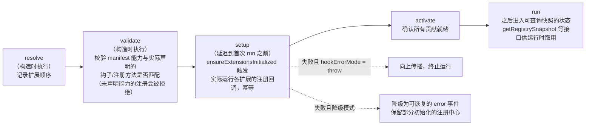

`setup` 由会话运行时的 `ensureExtensionsInitialized` 触发。容错行为取决于 `hookErrorMode`：在 `throw` 模式下，某扩展 `setup` 失败会向上传播终止运行；否则降级为可恢复的 `error` 事件并保留部分初始化的注册中心。注册结果按贡献类型累积，通过 `getRegistrySnapshot` 等接口供运行时取用。

### 8.5 运行隔离：进程内与沙箱

插件支持两种运行模式以平衡安全与便捷。默认的进程内模式直接以模块加载方式装载插件，简单直接；沙箱模式则借助 `SubprocessSandbox` 把插件的装载与引导放进独立的子进程，并以序列化的描述符把工具、命令、规则、消息构建器、供应商、自动化事件与 `MCP` 服务器等贡献回传给宿主。两种模式下，模块 `import`、`setup` 与贡献注册三个环节分别受 `importTimeoutMs`、`hookTimeoutMs`、`contributionTimeoutMs` 约束，避免不可信插件阻塞主进程。

### 8.6 Agent使用插件的机制

整体注入链路以“首次 `run` 前完成 `ensureExtensionsInitialized`”为起点：注册中心先完成各扩展的 `setup`，登记所有工具与钩子；随后会话运行时组装工具列表与钩子包，构造 `AgentRuntime`；后续每轮推理便在同一套能力下运行。工具层面，内建工具与 `MCP` 设置工具先被构建期组装成基础表，运行时再把各扩展经 `api.registerTool` 声明的工具按名称并入，同名时会话配置工具优先、扩展工具被过滤；合并后的工具表连同 `ToolPolicy` 一起交给 `AgentRuntime`，因而插件工具与内建工具遵循完全一致的工具协议、审批与重试机制。

钩子层面，`createRuntimeHooks` 把会话配置的 `hooks` 与各扩展声明的 `hooks` 合并为按类型聚合的列表，`AgentRuntime` 在对应时机逐个执行，其中 `beforeModel` 会在执行宿主级钩子后再切入消息准备管道。规则层面，`composeSystemPrompt` 收集 `getRegisteredRules` 返回的规则内容并合并进系统提示词，正对应 6.5 系统提示词结构中第五段“SDK Extension Rules（路径 B）”的动态追加来源。消息层面，`prepareProviderMessagesForApi` 在每次模型请求前依次应用各 `messageBuilder`，把改写结果再交给内置 `MessageBuilder` 做预算截断，因此插件能统一调节模型入参的结构，却不能禁用预算保护。

### 8.7 面向开发者的插件契约与接口

```typescript
// contribution-registry.ts:245-271
interface ContributionRegistryExtension {
  name: string;                // ← 扩展对象顶层
  manifest: PluginManifest;    // ← 扩展对象的一个属性
  disabled?: boolean;          // ← 扩展对象顶层
  hooks?: AgentExtensionHooks; // ← 扩展对象顶层
  setup?: (api, ctx) => void;  // ← 扩展对象顶层
}

// contribution-registry.ts:214-219
interface PluginManifest {
  paths?: string[];
  capabilities: AgentExtensionCapability[];
  providerIds?: string[];
  modelIds?: string[];
}
```

插件在代码层面是一个导出 `name`、`manifest`、可选 `hooks` 与 `setup` 的模块。`name` 是唯一标识；`manifest` 是声明式契约，`validate` 阶段据此校验；`setup(api, ctx)` 在装载时执行一次，通过 `api` 上暴露的注册器把贡献汇入注册中心。需要说明的是，注册中心的校验是有选择性的：`validate` 阶段强制校验 `capabilities` 必须是非空且属于九项能力集合，并且一旦定义了 `hooks` 就要求同时声明 `hooks` 能力；`setup` 阶段则仅对 `registerRule`、`registerAutomationEventType`、`registerMcpServer` 三个注册器做“未声明对应能力即抛错”的强校验，其余注册器按宽松方式累积，这一点与直觉不同，插件作者应主动保证声明的能力与实际注册一一对应。

#### 8.7.1 扩展对象与 manifest

扩展对象顶层的 `disabled` 字段表示该扩展是否被忽略（为真则跳过 `setup`），它与 `manifest` 无关——`manifest`（`PluginManifest`）只包含 `paths`、`capabilities`、`providerIds`、`modelIds` 四个字段。下表列出扩展对象与 `manifest` 的完整字段。

| 位置 | 字段 | 说明 |
|:---|:---|:---|
| 扩展对象顶层 | `name` | 必填，唯一标识，用于错误信息与钩子命名 |
| 扩展对象顶层 | `disabled` | 可选；为真时跳过 `setup`，不参与注册 |
| 扩展对象顶层 | `hooks` | 可选；`Partial<AgentRuntimeHooks>`，声明时须同时声明 `hooks` 能力 |
| 扩展对象顶层 | `setup(api, ctx)` | 可选；装载时执行一次，注册各类贡献 |
| `manifest` | `capabilities` | 必填且非空，`AgentExtensionCapability[]`，只接受九项能力中的若干项 |
| `manifest` | `paths` | 可选 `string[]`；打包态插件的入口路径 |
| `manifest` | `providerIds` | 可选 `string[]`；按模型供应商定向，未命中则跳过装载 |
| `manifest` | `modelIds` | 可选 `string[]`；按模型定向，未命中则跳过装载 |

#### 8.7.2 注册方法总览

`setup` 的参数 `api` 是 `AgentExtensionApi`，其注册器与 `capabilities` 的对应关系、参数类型以及 `setup` 期强弱校验如下表。`skills` 能力没有对应注册器，改为从插件目录下的 `skills/` 目录自动收集，故不在此列。

| 接口 / 方法 | 能力 | 参数类型 | setup 期校验 |
|:---|:---|:---|:---|
| `api.registerTool(tool)` | `tools` | `AgentTool`（可用 `TTool` 特化） | 宽松 |
| `api.registerCommand(cmd)` | `commands` | `AgentExtensionCommand` | 宽松 |
| `api.registerRule(rule)` | `rules` | `AgentExtensionRule` | 强校验，未声明即抛错 |
| `api.registerMessageBuilder(b)` | `messageBuilders` | `AgentExtensionMessageBuilder` | 宽松 |
| `api.registerProvider(p)` | `providers` | `AgentExtensionProvider` | 宽松 |
| `api.registerAutomationEventType(t)` | `automationEvents` | `AgentExtensionAutomationEventType` | 强校验；`eventType`/`source` 必填 |
| `api.registerMcpServer(s)` | `mcp` | `AgentExtensionMcpServer` | 强校验；自动补入 `source`/`plugin` 元数据 |
| `hooks`（扩展属性） | `hooks` | `Partial<AgentRuntimeHooks>` | `validate` 校验：定义钩子须声明 `hooks` 能力 |

#### 8.7.3 注册工具 registerTool

`registerTool` 把“模型可调用的工具”注入本会话，工具类型默认即 `AgentTool`，其字段与二次输入的执行上下文见下两表。`inputSchema` 是描述入参的 JSON Schema 对象（`Record<string, unknown>`），模型依据它生成 `execute` 的第一个参数；`execute` 的第二个参数是 `AgentToolContext`，携带运行现场信息，不应依赖 `process.cwd()`。

**AgentTool 字段**

| 字段 | 类型 | 说明 |
|:---|:---|:---|
| `name` | `string` | 工具名（模型可见）；与会话配置工具同名时扩展工具被过滤 |
| `description` | `string` | 工具描述，模型据此判断调用时机 |
| `inputSchema` | `Record<string,unknown>` | 入参 JSON Schema（object） |
| `lifecycle.completesRun` | `boolean`，可选 | 成功调用后是否结束当前 `run` |
| `timeoutMs` | `number`，可选 | 单次执行超时 |
| `retryable` / `maxRetries` | `boolean`/`number`，可选 | 是否可重试与最大重试次数 |
| `execute(input, context)` | 函数 | 执行体；`input` 依 `inputSchema`，`context` 为 `AgentToolContext` |

**AgentToolContext 字段**

| 字段 | 类型 | 说明 |
|:---|:---|:---|
| `agentId` | `string` | 当前 `Agent` 实例标识 |
| `iteration` | `number` | 当前 `run` 内的迭代序号 |
| `conversationId` / `runId` | `string`，可选 | 会话转录与运行标识 |
| `sessionId` | `string`，可选 | 根会话标识 |
| `signal` | `AbortSignal`，可选 | 用于响应外部中止 |
| `metadata` / `snapshot` | 对象，可选 | 工具元数据与运行时状态快照 |
| `emitUpdate` | `(update)=>void`，可选 | 向宿主推送增量更新 |
| `toolCallId` | `string`，可选 | 工具调用唯一标识 |

```typescript
api.registerTool({
  name:        'query_price',
  description: '查询内部物料最新报价',
  inputSchema: {
    type: 'object',
    properties: { sku: { type: 'string', description: '物料编号' } },
    required: ['sku'],
  },
  timeoutMs:   10_000,
  retryable:   true,
  maxRetries:  2,
  async execute(input, context) {
    // input.sku 由模型依 inputSchema 生成；context.iteration 可读迭代序号
    return '物料 ' + input.sku + ' 报价 123 元';
  },
});
```

#### 8.7.4 钩子hooks属性

钩子并非注册器，而是扩展对象上的 `hooks` 属性，类型为 `Partial<AgentRuntimeHooks>`，共七个可选钩子。与许多框架不同，这些钩子不带 `next()` 续传参数，而是在运行时被按注册顺序逐个执行：每个钩子返回 `undefined` 表示不干预、继续执行后续钩子；返回带字段的结果对象则按语义短路或改写。例如对于 `beforeTool`，返回对象可通过 `input` 覆盖工具入参、通过 `policy` 叠加策略，并可通过置位 `skip` 连同 `reason` 拦截该工具调用。

| 钩子 | 签名 | 语义 |
|:---|:---|:---|
| `beforeRun` | `(context) => AgentStopControl` | 运行开始前；返回终止控制可短路 |
| `afterRun` | `context & {result} => void` | 运行结束后收尾，携带运行结果 |
| `beforeModel` | `(context) => AgentBeforeModelResult` | 模型调用前；可改写本轮消息/提示词 |
| `afterModel` | `(context) => AgentStopControl` | 模型返回后；可终止后续循环 |
| `beforeTool` | `(context) => AgentBeforeToolResult` | 可改写 messages、tools、options，也可通过 stop 短路。 |
| `afterTool` | `(context) => AgentAfterToolResult` | 携带 result: AgentToolResult，含 output 和 isError |
| `onEvent` | `(event) => void` | 监听运行时事件（消息、工具调用、状态等） |

`beforeTool` 链全部通过后，运行时才解析 `ToolPolicy`，先判 `enabled === false`，再判 `autoApprove === false` 进入审批。钩子的 `policy` 覆盖值会叠加到 `ToolPolicy` 之上。典型用法如下。

```typescript
hooks: {
  beforeTool: async (context) => {
    // 仅放行白名单，其余返回 { skip, reason } 拦截
    if (context.tool.name === 'query_price') return undefined;
    return { skip: true, reason: 'only query_price is allowed' };
  },
  afterTool: async (context) => {
    // 对失败的工具调用做补偿或记录
    if (context.result?.isError) console.warn(context.tool.name, 'failed');
    return undefined;
  },
  onEvent: async (event) => {
    // 订阅运行时事件做观测
  },
},
```

#### 8.7.5 注册斜杠命令 registerCommand

`registerCommand` 注册对话面的 `/命令`。`handler(input)` 的入参是命令剩余文本，返回 `string` 或 `{ reply?, submitPrompt? }`：仅 `reply` 直接在对话面回显；携带 `submitPrompt` 时可将一段提示提交回 `Agent` 继续执行。

```typescript
api.registerCommand({
  name: 'erp-status',
  description: '查看 ERP 连接状态',
  handler: async (input) => ({
    reply: 'ERP 已连接',
    submitPrompt: '请查询 ERP 连接详情并汇报',
  }),
});
```

#### 8.7.6 注册规则 registerRule

`registerRule` 把提示词规则并入系统提示词（对应 6.5 路径 B）。`content` 可以是静态字符串，也可以是一个在系统提示词组装时求值的函数（可返回 `Promise`），适合按工作区或供应商动态生成规则文本；`source` 用于标注规则来源。

```typescript
api.registerRule({
  id: 'company-policy',
  content: (() => {
    const policy = getCompanyPolicy(); // 系统提示词组装时求值
    return '必须遵守成本申报流程；涉及成本一律调用 query_price。\n' + policy;
  }),
  source: 'erp-toolkit',
});
```

#### 8.7.7 注册消息构建器 registerMessageBuilder

registerMessageBuilder 注册一个命名消息构建器。运行时在每次模型请求前由 prepareProviderMessagesForApi（session-runtime-orchestrator.ts）按注册顺序依次应用，所有插件构建器执行完毕后，再执行内置 MessageBuilder.buildForApi（负责预算截断等）。

类型定义：

```typescript
// sdk/packages/shared/src/extensions/contribution-registry.ts
export interface AgentExtensionMessageBuilder<TMessage = unknown> {
  name: string;
  build: (message: TMessage) => TMessage | Promise<TMessage>;
}
```

重要语义差异：

1)  类型签名中 TMessage 是泛型（默认 unknown），但运行时宿主将其约束为 MessageWithMetadata\[\]——即 build 接收到的是整个消息数组，不是单条消息

2)  返回的也必须是消息数组；若返回值不符合消息数组结构，运行时回退使用原始输入

3)  消息类型 Message 结构：

```typescript
// sdk/packages/shared/src/llms/messages.ts
interface Message {
  role: "user" | "assistant";
  content: string | ContentBlock[]; // 注意：content 可能是字符串也可能是内容块数组
}
```

```typescript
api.registerMessageBuilder({
  name: 'redact-internal',
  build: async (messages) => {
    // messages 是 MessageWithMetadata[] 数组
    return messages.map(msg => {
      if (msg.role !== 'user') return msg;
      // content 可能是 string 或 ContentBlock[]
      if (typeof msg.content === 'string') {
        return {
          ...msg,
          content: msg.content.replace(/(sk-\S+)/g, '***REDACTED***'),
        };
      }
      return msg;
    });
  },
});
```

执行链：

```text
模型请求前
→ prepareMessagesForModelRequest() (AgentMessage[])
→ prepareProviderMessagesForApi() (MessageWithMetadata[])
→ for each plugin builder: messages = builder.build(messages) // 顺序执行
→ this.messageBuilder.buildForApi(messages) // 内置截断
→ messagesToAgentMessages()
```

#### 8.7.8 注册供应商 registerProvider

`registerProvider` 声明一个模型供应商贡献。类型 `AgentExtensionProvider` 仅要求 `name`，另可提供 `description` 与任意 `metadata`；它能配合 `manifest.providerIds` 的定向机制，使插件只在指定供应商环境下生效。

```typescript
api.registerProvider({
  name: 'my-vendor',
  description: '内部自研模型供应商',
  metadata: { endpoint: 'https://llm.internal.example/v1', apiVersion: '1' },
});
```

#### 8.7.9 注册自动化事件 registerAutomationEventType

`registerAutomationEventType` 声明插件可以向宿主自动化引擎触发的事件类型。`eventType` 使用归一化命名（如 `github.pull_request.opened`），`source` 为归一化来源标识（如 `github`、`erp`），二者均必填；`payloadSchema`、`attributesSchema`、`examples`、`metadata` 用于描述载荷结构与示例。`setup` 期间会校验字段并对 `examples`、`metadata` 做拷贝。

```typescript
api.registerAutomationEventType({
  eventType: 'erp.stock.low',
  source: 'erp',
  description: 'ERP 库存低于安全线时触发',
  payloadSchema: { sku: 'string', qty: 'number', threshold: 'number' },
  attributesSchema: { severity: 'string' },
  metadata: { owner: 'ops' },
});
```

#### 8.7.10 注册 MCP 服务器 registerMcpServer

`registerMcpServer` 声明一个经插件暴露的 `MCP` 服务器，运行时会把它封装为工具进入 `buildTools` 结果（对应第 3 章）。`transport` 三种类型中，`stdio` 需提供 `command`/`args`/`cwd`，并支持顶层 `env`；`sse` 与 `streamableHttp` 提供 `url` 与可选 `headers`。顶层 `env` 仅并入 `stdio` 子进程环境，取值为字符串或 `{ fromEnv?, value?, required? }`：`fromEnv` 表示从宿主进程读取同名变量（缺省取 `value`），`required` 为真且无法解析时跳过该服务器。注册时注册中心会自动在 `metadata` 补入 `source: plugin` 与 `plugin` 名称，供后续识别来源。

```typescript
api.registerMcpServer({
  name: 'erp-db',
  transport: { type: 'stdio', command: 'erp-mcp', args: ['--db', 'prod'], cwd: '.' },
  env: {
    ERP_TOKEN: { fromEnv: 'ERP_TOKEN', value: 'default-token', required: false },
    ERP_REGION: 'cn-east',
  },
  metadata: { team: 'ops' },
});

// 亦支持远程传输：
// api.registerMcpServer({ name: 'cloud-svc',
//   transport: { type: 'streamableHttp', url: 'https://mcp.example.com' } });
```

#### 8.7.11 插件上下文 PluginSetupContext

`setup` 的第二个参数携带运行期上下文，始终来源于宿主会话配置而非 `process.cwd()`，保证注册时用到的路径与身份与宿主一致。所有字段均可选，便于在无宿主上下文的单元测试中复用。沙箱模式下 `telemetry` 是不可跨进程直传的桥，事件会自动冠以 `plugin.` 前缀，`isEnabled()` 恒为真（由宿主裁决）、身份与公共属性设置器为空操作。字段如下表。

| 字段 | 类型 | 说明 |
|:---|:---|:---|
| `session` | `{ sessionId? }` | 根会话标识 |
| `client` | `ClientContext` | 宿主身份（CLI、VSCode 或 SDK 应用） |
| `user` | `UserContext` | 已认证的用户或组织身份 |
| `workspaceInfo` | `WorkspaceInfo` | 含 `rootPath`、`hint`、远端地址、`git` 分支与提交号，用于工作区相对路径 |
| `automation` | `{ ingestEvent }` | 自动化事件入口；宿主未开启自动化时为 `undefined` |
| `logger` | `BasicLogger` | 会话作用域日志 |
| `telemetry` | `ITelemetryService` | 遥测服务；沙箱下为桥，事件命名空间 `plugin.` |

### 8.8 完整配置示例与逐字段说明

下面是一个完整的插件示例，可作为插件作者直接改写的模板。文件放入搜索路径后，会话启动时会被自动发现并装载。

```typescript
// 文件位置：{workspace}/.cline/plugins/erp-toolkit.ts（或全局 ~/.cline/plugins/）
import type { AgentExtension } from '@cline/shared';

const plugin: AgentExtension = {
  // 插件唯一标识，用于错误信息、钩子命名与重复检测
  name: 'erp-toolkit',

  // 声明式契约：manifest 声明能力清单与定向条件
  // providerIds/modelIds 在 SDK 层只做声明，过滤由宿主/运行时层执行
  manifest: {
    capabilities: ['tools', 'commands', 'rules', 'messageBuilders',
                   'mcp', 'providers', 'automationEvents'],
    // 可选：宿主/运行时层根据这些字段决定插件是否生效
    providerIds: ['anthropic', 'deepseek'],
    modelIds: ['claude-sonnet-4-5', 'deepseek-chat'],
  },

  // 若在 capabilities 中声明了 hooks，可在此提供运行时钩子
  hooks: {
    beforeTool: async (context) => {
      // context.tool.name 是工具名；返回 undefined 放行，{ skip: true } 拦截
      return undefined;
    },
  },

  // setup 阶段 ctx 是 PluginSetupContext（有 workspaceInfo）
  // execute 阶段 context 是 AgentToolContext（无 workspaceInfo，需闭包捕获）
  async setup(api, ctx) {
    // 闭包捕获 workspaceInfo 供 execute 使用
    const rootPath = ctx.workspaceInfo?.rootPath;

    // tools —— 新增模型可调用工具（不能覆盖同名内建工具）
    api.registerTool({
      name: 'query_price',
      description: '查询内部物料最新报价',
      inputSchema: { url: '#/components/schemas/PriceQueryInput' },
      timeoutMs: 10_000,
      retryable: true,
      maxRetries: 2,
      // execute 必须接收 (input, context) 两个参数
      async execute(input, context) {
        // context 是 AgentToolContext，不含 workspaceInfo
        // 如需工作区路径，使用上面闭包捕获的 rootPath
        return '物料 A 报价 123 元';
      },
    });

    // commands —— 斜杠命令，用户可在对话面输入"/erp-status"
    api.registerCommand({
      name: 'erp-status',
      description: '查看 ERP 连接状态',
      handler: async (input) => 'ERP 已连接',
    });

    // rules —— 追加进系统提示词
    api.registerRule({
      id: 'company-policy',
      // content 可以是字符串或函数（可异步）
      content: () => '必须使用中文回复；涉及成本一律调用 query_price',
      source: 'erp-toolkit',
    });

    // messageBuilders —— build 接收的是 Message[] 数组，不是单条消息
    api.registerMessageBuilder({
      name: 'stamp-source',
      build: (messages) => {
        // messages 是 MessageWithMetadata[] 数组
        // 需遍历处理，返回改写后的数组
        return messages.map(msg => {
          if (msg.role !== 'user') return msg;
          if (typeof msg.content === 'string') {
            return { ...msg, content: '[ERP-Toolkit] ' + msg.content };
          }
          return msg;
        });
      },
    });

    // providers —— 自定义模型供应商
    api.registerProvider({ name: 'my-vendor', metadata: {} });

    // automationEvents —— 声明可触发的自动化事件
    api.registerAutomationEventType({
      eventType: 'erp.stock.low',
      source: 'erp',
      payloadSchema: { sku: 'string', qty: 'number' },
    });

    // mcp —— 暴露一个 stdio 类型的 MCP 服务器
    api.registerMcpServer({
      name: 'erp-db',
      transport: { type: 'stdio', command: 'erp-mcp', args: ['prod'] },
      env: { ERP_TOKEN: { fromEnv: 'ERP_TOKEN' } },
    });

    // ctx 为 PluginSetupContext：session、client、user、workspaceInfo、
    // automation、logger、telemetry 均来自宿主会话配置
    if (ctx.logger) ctx.logger.info('erp-toolkit setup complete');
  },
};

export default plugin;
```

上述示例中的关键点：`manifest.capabilities` 声明了除 `hooks`、`skills` 外的七项能力，因此 `setup` 里对应的注册调用均被允许；`providerIds` 与 `modelIds` 使该插件仅在指定模型环境下生效；`registerTool` 的 `execute` 应返回可被模型直接消费的序列化文本，需要相对路径时务必取 `ctx.workspaceInfo.rootPath` 而非 `process.cwd()`；`registerRule` 的 `content` 既可以是字符串，也可以是一个在系统提示词组装时求值的函数；`registerMcpServer` 的 `env` 若使用 `fromEnv`，表示从宿主进程读取同名环境变量。
