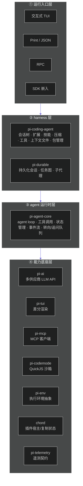
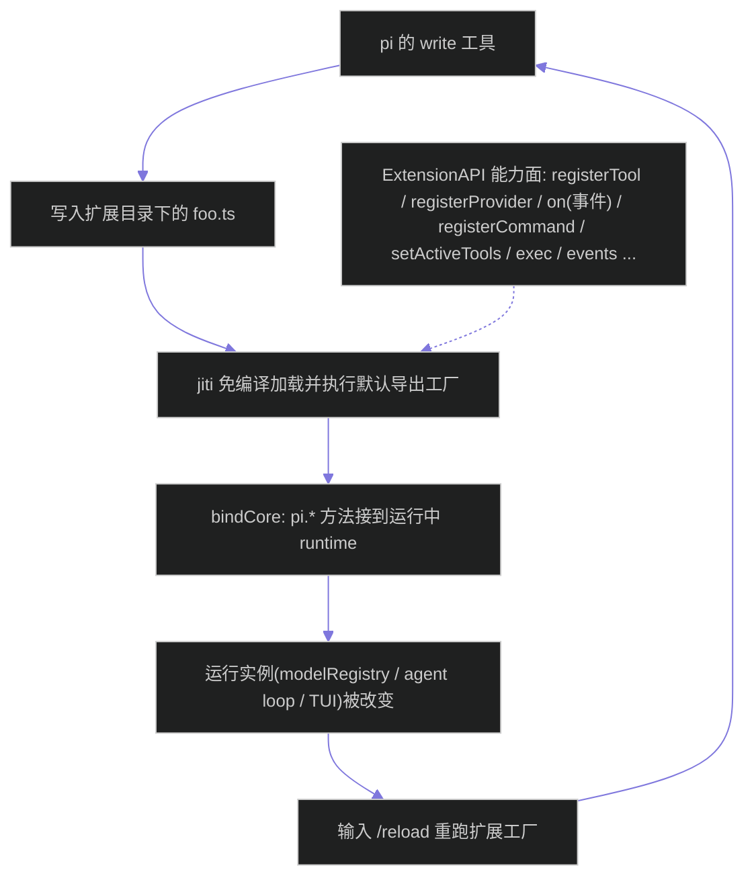
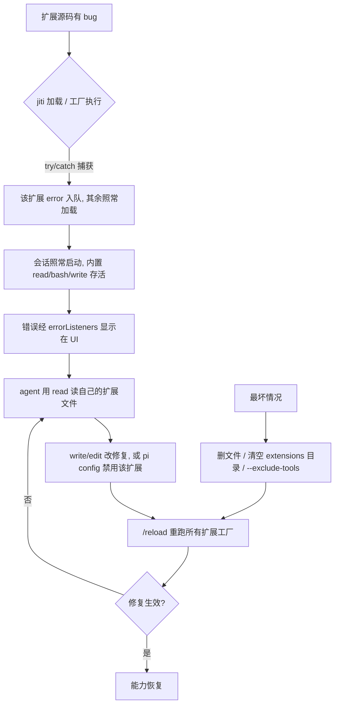
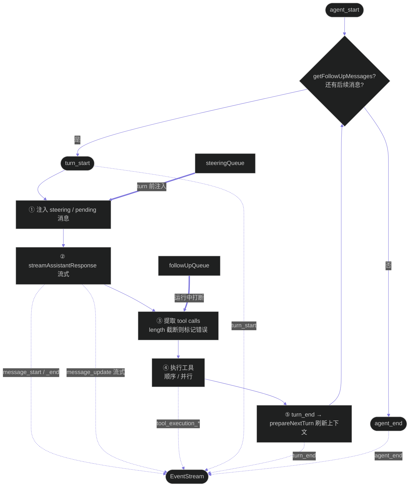
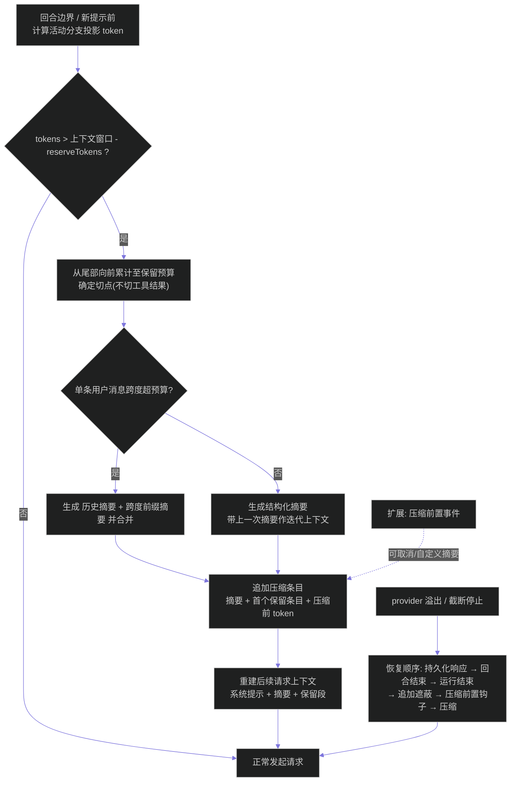

# pi Agent Harness：极简内核 + 深度可改造的 Coding Agent

> 调研对象：`earendil-works/pi` —— 一个以"刻意做减法"为核心主张的终端 coding agent harness。
>
> 本文聚焦三个问题：**它是什么形态的东西**、**它的运行机制如何**、**它与主流 Agent 的本质区别在哪**。
>
> 数据采集时间：2026-08-02，机制描述于 2026-10 依仓库现状复核修订。行文以机制为单位，不引用具体源码路径；涉及"官方主张"与"当前实现"不一致处，均以现状为准并显式说明。

---

## 目录

1. [项目速览](#1-项目速览)
2. [整体形态：它不是产品，是 harness](#2-整体形态它不是产品是-harness)
   - [2.1 分层与包结构](#21-分层与包结构)
   - [2.2 四种运行形态](#22-四种运行形态)
   - [2.3 交互模式](#23-交互模式)
3. [核心设计理念："我们没有建造什么"](#3-核心设计理念我们没有建造什么)
   - [3.1 六项刻意缺失及其论证](#31-六项刻意缺失及其论证)
   - [3.2 自扩展：让 agent 改造自己](#32-自扩展让-agent-改造自己)
   - [3.3 上下文工程作为第一性目标](#33-上下文工程作为第一性目标)
4. [运行机制拆解](#4-运行机制拆解)
   - [4.1 agent loop 与事件流](#41-agent-loop-与事件流)
   - [4.2 工具执行与拦截点](#42-工具执行与拦截点)
   - [4.3 上下文管理：系统提示、上下文文件与技能](#43-上下文管理系统提示上下文文件与技能)
   - [4.4 会话树与记忆](#44-会话树与记忆)
   - [4.5 压缩机制](#45-压缩机制)
   - [4.6 扩展系统：进程内 vs 进程外](#46-扩展系统进程内-vs-进程外)
   - [4.7 MCP、代码模式与延迟工具加载](#47-mcp代码模式与延迟工具加载)
   - [4.8 多 agent 机制](#48-多-agent-机制)
   - [4.9 持久化 harness 与执行环境](#49-持久化-harness-与执行环境)
   - [4.10 底座：差分渲染 TUI 与多供应商 LLM 抽象](#410-底座差分渲染-tui-与多供应商-llm-抽象)
5. [与其他 Agent 的本质区别](#5-与其他-agent-的本质区别)
6. [用 T1–T4 检验 pi](#6-用-t1t4-检验-pi)
7. [独特性总结](#7-独特性总结)
8. [局限性与风险](#8-局限性与风险)
9. [参考来源](#9-参考来源)

---

## 1. 项目速览

| 项目 | 内容 |
|------|------|
| 仓库 | `github.com/earendil-works/pi` |
| 官网 | `pi.dev` |
| 许可 | MIT（完全开源） |
| 语言 | TypeScript（npm workspaces monorepo） |
| 创建时间 | 2025-08-09 |
| 热度 | 82,017 stars / 10,140 forks（2026-08-02 快照，引用前建议复核） |
| 主要作者 | Mario Zechner（`badlogic`，libGDX 作者，3462 commits）、Armin Ronacher（`mitsuhiko`，Flask/Jinja 作者，456 commits） |
| 主体 | Earendil Inc. |
| 官方定位 | "There are many agent harnesses, but this one is yours." |

一句话概括：**pi 把"coding agent 应该内置什么功能"这个问题反过来回答了——它内置得极少，但把改造自身的能力开放到了极致。**

需要提前说明一点版本现状：pi 的演进速度很快，仓库在 2025 年底做过一次包拆分，其后又把若干原本"刻意不建"的能力以内置扩展的形式补回（详见 3.1）。因此本文在描述"官方主张"时会同时给出"当前实现"，两者不一致处以实现为准。

---

## 2. 整体形态：它不是产品，是 harness

### 2.1 分层与包结构

pi 不是一个单体 CLI，而是一组可独立使用的 npm 包。它们构成一个**四层心智模型**：运行入口层、harness 层、agent 运行时层、能力底座层。理解这四层，比记住包名更重要——它决定了 pi 既能当成品工具用，也能当基础设施用。



按层次归位，各包的职责如下：

| 层次 | 包 | 职责 |
|------|----|------|
| 运行入口 | —— | 由 harness 层对外暴露 TUI / Print / JSON / RPC / SDK 五种使用方式 |
| harness | `pi-coding-agent` | 交互式 coding agent 的完整参考实现：会话树、扩展、技能、压缩、内置工具、上下文文件、包管理 |
| harness | `pi-durable` | 另一条路线：可重启的持久化 harness，会话/任务/文档/子代理（标注 experimental） |
| agent 运行时 | `pi-agent-core` | agent loop、工具调用、状态管理、事件流、转向与追问队列 |
| 能力底座 | `pi-ai` | 统一多供应商 LLM API、流式、认证/OAuth、模型目录 |
| 能力底座 | `pi-tui` | 差分渲染终端 UI 框架 |
| 能力底座 | `pi-mcp` | MCP 客户端（stdio 与 streamable HTTP） |
| 能力底座 | `pi-codemode` | QuickJS 沙箱，供代码模式执行脚本 |
| 能力底座 | `pi-env` | 执行环境抽象（本地/远程/容器） |
| 能力底座 | `chord` | 可热重载插件宿主、复制状态、JSON 链路 RPC |
| 能力底座 | `pi-telemetry` | 供应商中立遥测契约与适配器 |

关键含义：

- 只想要一个**跨厂商 LLM SDK** → 单用 `pi-ai`；
- 想自己写一个形态完全不同的 agent → 用 `pi-agent-core` 提供的 `agentLoop()`；
- 想要现成的编码 agent → 用 `pi-coding-agent`；
- 想要可重启、多会话、带任务图的 agent 基础设施 → 用 `pi-durable`。

CLI 只是这套工具箱最上层的**参考实现**，而不是唯一形态。这与"CLI 即产品本体"的主流 agent 有根本区别。

### 2.2 四种运行形态

| 模式 | 命令 | 用途 |
|------|------|------|
| 交互式 | `pi` | 完整 TUI 体验 |
| Print / JSON | `pi -p "query"` / `--mode json` | 脚本化调用、事件流消费 |
| RPC | `pi --mode rpc` | stdin/stdout 上的 JSONL 协议，供非 Node 语言集成 |
| SDK | `createAgentSession()` | 嵌入自有应用 |

RPC 模式使用严格的 LF 分隔 JSONL 帧（官方特别警告不要用 Node `readline`，因为它会在 JSON 载荷内部的 Unicode 分隔符处错误断行）。真实案例：OpenClaw 项目选择基于 pi 而非 Claude Code SDK 构建。

### 2.3 交互模式

交互形态上 pi 有几个不常见的设计：

- **消息队列区分"转向"与"追问"**：`Enter` 发送 steering 消息，在当前助手回合的工具调用结束后立即送达，可打断后续工具；`Alt+Enter` 发送 follow-up，等 agent 全部干完再送达。这是把"插话"和"排队"在协议层分开。
- **`!command` / `!!command`**：前者执行 shell 并把输出送给模型，后者执行但不送给模型。用户对上下文有直接开关。
- **会话树导航**：`/tree` 可跳到历史任意一点继续，所有分支存在同一个 JSONL 文件里。
- **导出与分享**：`/export` 导出 HTML 或 JSONL，`/share` 上传后给出可渲染链接（默认走私有 gist，配置 Radius 后走 Radius artifact）。

---

## 3. 核心设计理念："我们没有建造什么"

pi 官网有一个专门板块叫 **"What we didn't build"**。同类项目通常罗列功能，pi 罗列的是**放弃**——并为每一项给出替代路径。这是理解 pi 的钥匙。

### 3.1 六项刻意缺失及其论证

下表左半是官方主张，右半是**当前实现的修正**——其中两项主张已在版本演进中被部分推翻，阅读时需特别注意。

| 缺失项 | 官方论证 | 替代路径与当前实现 |
|--------|----------|-------------------|
| **No MCP** | MCP server 把全部工具描述塞进每次会话的上下文。作者实测 Playwright MCP 有 21 个工具、13.7k tokens，"还没开始干活就吃掉 7–9% 的上下文窗口" | 主张仍针对"默认把 MCP 工具全量灌进上下文"。**但当前已内置可选的 MCP 扩展**：支持 stdio / streamable HTTP、OAuth、项目级与用户级配置，并引入**暴露分级**（直接暴露 / 延迟加载 / 仅代码模式可见 / 隐藏），使"不占上下文"成为可配置项，而非唯一选项 |
| **No sub-agents** | "你对子代理在做什么零可见性。这是黑箱套黑箱。" 并行派多个子代理实现功能被作者视为反模式 | 内核仍不建。**当前官方提供两条可选路径**：一是 `subagent` 扩展示例，以独立 `pi` 子进程运行、上下文完全隔离；二是 `pi-durable` 内置的进程内子代理（持久化、可后台、可重启续跑）。此外仍可用 tmux 拉起多个 pi 实例 |
| **No plan mode** | 让模型在不改文件的前提下和你一起想清楚，通常就够了 | 把计划写进 `PLAN.md` 文件；官方提供 plan-mode 扩展示例 |
| **No permission popups** | "其他 coding agent 的安全措施大多是安全戏剧。一旦 agent 能写代码又能跑代码，基本就结束了。" 读数据、执行代码、网络访问这三者无法既全给又安全 | 跑在容器里（官方给出三种模式：微 VM 扩展、纯 Docker、策略化沙箱）；或用扩展自建确认流，官方提供 permission-gate、protected-paths 等示例 |
| **No built-in to-dos** | "待办清单通常让模型更糊涂而不是更清楚。它增加了模型必须追踪和更新的状态，也就增加了出错机会。" | 用 `TODO.md` 文件；官方提供 todo 扩展示例 |
| **No background bash** | 后台进程管理增加复杂度，且可观测性差 | 用 tmux，完全可观测、可直接交互 |

这六项的共同逻辑不是"做不出来"，而是**这些能力被下沉到了扩展层**。官方仓库直接提供了 subagent、plan-mode、permission-gate、sandbox 等 **70 余个单文件扩展示例加 9 个示例目录**——**你可以拥有这些功能，只是不由内核替你决定形态**。

需要诚实指出的是，"MCP" 与 "sub-agents" 这两项主张已随版本演进松动：前者被内置扩展补回，后者由 durable 包以另一套模型（进程内、可持久化）实现。这恰恰印证了 pi 的一贯逻辑——**内核保持极简，能力从扩展层长回来**。

作者原话概括了整个哲学：

> "if I don't need it, it won't be built. And I don't need a lot of things."

以及对现状的批评：

> "过去几个月里，Claude Code 变成了一艘宇宙飞船，其中 80% 的功能我用不上。系统提示和工具还每次发版都改，这会破坏我的工作流、改变模型行为。"

### 3.2 自扩展：让 agent 改造自己

这是 pi 最反常识、也最容易被低估的一点。README 称其为 "self extensible coding agent"，官网表述为：

> "Pi isn't a sealed product. If you need a command, tool, provider, workflow, or UI tweak, just ask Pi to build it. It will customize itself on the fly. Have Pi manipulate itself in place, hit `/reload`, and keep going."

它的实现并不神秘，而是**几个既有能力的组合恰好闭环**：



这一闭环的每一步都有对应实现，但为保持本文机制视角，下面只讲机制、不指路径。

#### 3.2.1 机制：扩展如何被加载、接线、生效

**1. 扩展就是普通 `.ts` 文件，免编译加载。** 加载器用 `jiti` 直接运行 TypeScript——**没有构建步骤、没有 `tsc`/打包**，改完保存即可被加载。模块的**默认导出必须是一个工厂函数**：

```ts
export default function (pi) {
  // pi 就是 ExtensionAPI
}
```

**2. 扩展在哪里被发现。** 按三处路径发现（同一级目录，不递归）：项目级 `cwd/.pi/extensions/`、全局 `~/.pi/agent/extensions/`、以及显式配置的路径。发现规则：`extensions/*.ts`（或 `*.js`）直接加载；子目录需有 `index.ts`/`index.js`，或用 `package.json` 的 `pi.extensions` 字段声明入口。

**3. 扩展拿到的 `ExtensionAPI`（即 `pi` 对象）能力面极宽**，按用途大致分组：

| 类别 | 方法（节选） | 能做什么 |
|------|--------------|----------|
| 生命周期订阅 | `pi.on(event, handler)` | 订阅约 40 个生命周期事件名；handler 可**改写/替换**消息、`block` 工具、注入或修改请求头 |
| 注册能力 | `registerTool` / `registerCommand` / `registerShortcut` / `registerFlag` | 给模型加新工具、加斜杠命令、加快捷键、加 CLI 参数 |
| 改模型层 | `registerProvider(name, config)` / `unregisterProvider` / `registerVirtualModel` / `registerMcpServer` | 注册或覆盖模型供应商（自定义 `baseUrl`/`apiKey`/`api`/`models`/OAuth）、注册虚拟模型路由、注册 MCP server |
| 改运行态 | `setActiveTools` / `setModel` / `setThinkingLevel` | 改当前生效的工具集、切换模型、调思考等级 |
| 改渲染 | `registerMessageRenderer` / `registerMarkdownTransformer` / `registerEntryRenderer` | 自定义消息/Markdown/条目渲染 |
| 动作 | `sendMessage` / `sendUserMessage` / `appendEntry` / `exec` / `events` | 发消息、执行 shell、写非上下文条目、向扩展间通信的 EventBus 发事件 |

**4. 等价于"改源码运行"的关键在接线。** `bindCore()` 把这些 API 方法**直接接到运行中的 runtime 实现**上。也就是说，扩展里调一次 `pi.registerProvider(...)` / `pi.setActiveTools(...)`，效果等同于你打开框架源码、在对应位置插入这行代码后重新运行 —— 但无需动框架、无需重启进程。加载阶段排队的 provider 注册会在 `bindCore` 时一次性 flush；`bindCore` 之后注册立即生效，**连 `/reload` 都不需要**。

**5. 扩展能复用框架自身。** 加载器通过虚拟模块与别名把 `pi-agent-core`、`pi-ai`、`pi-tui`、`pi-coding-agent`、`typebox` 等暴露给扩展。因此扩展可以复用框架的类型与辅助函数，甚至包裹、替换内置实现（例如继承内置编辑器写一个 Vim 键位编辑器）。

#### 3.2.2 热重载：`/reload` 重跑扩展工厂

输入 `/reload` 后的流程是：发出 `session_shutdown`（reason=reload）→ 重置 provider、重载 settings 与资源 → 以"包含全部扩展工具"的模式重建运行时 → **重新发现并执行所有扩展工厂** → 发出 `session_start`（reason=reload）→ 重新拉取技能/提示模板/主题路径。

一句话：**改一个 `.ts` 扩展文件 → 输入 `/reload` → 立即以新逻辑运行，进程不重启**。

#### 3.2.3 一个最小可运行的例子：给自己加一个工具

假设你想让 pi 能查天气。在全局扩展目录新建一个文件：

```ts
import { defineTool } from "@earendil-works/pi-coding-agent";

export default function (pi) {
  pi.registerTool(
    defineTool({
      name: "current_weather",
      label: "Current Weather",
      description: "Get the current weather for a city",
      // 参数用 TypeBox / JSON-Schema 形态描述
      parameters: {
        type: "object",
        properties: { city: { type: "string" } },
        required: ["city"],
      },
      async execute(_id, { city }, _signal, _onUpdate, _ctx) {
        const r = await fetch(`https://wttr.in/${encodeURIComponent(city)}?format=3`);
        const text = await r.text();
        return { type: "text", content: text };
      },
    }),
  );
}
```

然后输入 `/reload`（或重启 pi），之后你（或模型）就能说"查下北京天气"，模型会调用 `current_weather` 工具。

同样的方式还能做更多——都是"形式化地改造框架"：

- **覆盖模型供应商**：`pi.registerProvider("anthropic", { baseUrl: "https://你的代理", api: "anthropic-messages", apiKey: "$MY_KEY" })`，把请求转到自建网关，无需改任何源码。
- **进程内拦截（hook 的进程内版本）**：`pi.on("tool_call", (e) => { if (e.toolName === "bash") e.input.command = e.input.command.replace("rm -rf", "echo blocked"); })` 在工具执行前就地改写参数；或 `pi.on("before_agent_start", (e) => { e.systemPrompt = e.systemPrompt + "\n始终用中文回复。"; })` 每轮注入指令。这正是"进程外 hooks 做不到"的那类事——你能改 `agent loop` 与上下文本身，而不只是在生命周期点打补丁。

#### 3.2.4 闭环：agent 改写自己

把上面的零件拼起来，就是 pi 所谓的 "self extensible" 的本质：

```
pi 有 write 工具                                    ──┐
扩展就是扩展目录下的普通 .ts 文件                     ──┤
扩展由 jiti 直接运行 TS，无需编译                     ──┼──→ agent 能写出自己的新能力
扩展 API 类型契约就在包内，agent 能 read 它           ──┤  并当场 /reload 生效
/reload 可热重载扩展                                 ──┘
```

你不需要 fork 仓库、不需要发 PR、不需要懂构建系统。让 pi 读扩展 API 的类型契约，在扩展目录下写一个 `.ts`，`/reload` 即可。如果它自己来完成这件事——用 `write` 写扩展文件、用命令触发 `/reload`——就形成了"agent 就地改造自己、继续往下干"的闭环。

对比来看：Claude Code 的 hooks 是**进程外**的，只能在预设生命周期点上拦截，改不了 TUI、改不了 agent loop、替换不了内置工具。pi 的扩展是**进程内 TypeScript**，能注册/覆盖工具（包括覆盖内置的 `read`/`bash`）、注册 provider、替换编辑器与整个 UI、改写上下文、接管压缩逻辑。

这是"改配置"和"改程序"的区别。

### 3.2.5 边界、风险与自举排错

"等价于改源码"这句话需要精确化：**只在框架刻意暴露的接缝处才等价于改源码**，并非能改写任意代码。理解这条边界，才能说清"改出 bug 怎么办"。

**能改什么（ExtensionAPI 暴露的接缝）**。扩展拿到的 `ExtensionAPI` 是一份被裁剪过的能力清单：`registerTool` / `setActiveTools`（可把内置 `read`/`bash` 移出激活集）、`registerProvider` / `unregisterProvider`、`on(event)`（订阅约 40 个生命周期事件名，handler 内能改消息、`block` 工具、改请求头）、`registerCommand` / `registerShortcut` / `registerFlag`、覆盖 UI 渲染器、改模型与思维等级、`exec` 跑命令。这些调用被 `bindCore()` 直接接到运行中的核心对象上——所以调一次 `pi.registerProvider`，效果等同于在框架源码对应位置插这行后重新构建。**这就是"等价于改源码"的真实含义：在接缝处。**

**改不到什么（不 fork 动不了）**。agent loop 的控制流语义、TUI 的差分渲染算法本身、会话持久化格式、provider 归一化的内部逻辑——这些被编译进包，API 没有改写入口。要动它们只能 **fork 仓库 → 改源码 → 自己 build → 从源码跑**。那才算"改所有代码"，但属于 fork，不是产品内自扩展。

**坏扩展不会让 pi 起不来——设计上就防了一层**：

- **逐扩展隔离**：每个扩展的加载是独立 `try/catch`，工厂抛错只返回错误而不冒泡；批量加载器把错误收进错误列表后继续加载其余扩展。结果：**一个扩展炸了，只有它自己没注册上，会话照样启动**。
- **错误不静默**：扩展错误经错误监听器推给 UI 显示，agent 和用户都看得到。
- **内置工具永不被连坐**：`read`/`bash`/`write` 由框架核心注册，坏扩展在工厂阶段就抛错、什么都没注册，内置工具毫发无损——**agent 永远保留 read/write/bash 用于自救**。

**恢复路径（从软到硬）**：

1. **agent 自举排错**：错误已显示 → agent 用 `read` 打开自己的扩展文件 → 用 `write`/`edit` 改好 → `/reload` 重跑所有扩展工厂。jiti 按需编译，语法错在加载期即被 catch，不会跑到一半崩；agent 还能用 `bash` 先做类型检查再 `/reload`。
2. **资源式禁用**：扩展作为"资源"管理，`pi config` 交互界面可 enable/disable 某个扩展（Tab 切作用域），不删文件即可关掉坏的。
3. **CLI 黑名单**：启动时 `--exclude-tools` / `-xt` 直接禁用某些工具名。
4. **清目录**：删掉扩展目录下的坏文件或整目录清空；pi 核心是普通 npm 包，不依赖任何扩展也能跑。



一句话：**自扩展是"在框架留好的钩子上贴插件"，不是"把整个程序当橡皮泥捏"；坏一个插件因逐扩展隔离 + 内置工具兜底而不会让 pi 起不来，agent 恰好能用仅存的 read/write/bash 把坏插件改好再 `/reload`——这就是它"自己 debug 自己"的闭环。**

### 3.3 上下文工程作为第一性目标

pi 的极简不是美学偏好，而是为了**把上下文窗口的控制权交还给用户**：

- 系统提示 + 工具定义合计 **< 1000 tokens**（作者自述，含工具定义；另有社区测算称仅系统提示约 200–300 tokens，口径不同，引用时需注明）。作为对比，第三方测算 Claude Code 的系统提示约 14k tokens。
- 默认内置工具只有四个：`read`、`write`、`edit`、`bash`（另有可选的 `grep`、`find`、`ls`、`powershell`）。作者判断："这四个工具就是一个高效 coding agent 的全部所需。模型知道怎么用 bash，也在 read/write/edit 这类工具上被训练过。"
- `SYSTEM.md` 可**整体替换**默认系统提示，`APPEND_SYSTEM.md` 可追加；项目指令文件 `AGENTS.md` 则承载项目级上下文（详见 4.3）。
- 压缩逻辑可被扩展完全接管（按主题压缩、代码感知摘要、换个模型做摘要都行）。
- 扩展可在每轮之前注入消息、过滤历史、实现 RAG 或长期记忆。

作者对现有工具最尖锐的批评正在此处：

> "现有的 harness 让这件事极其困难甚至不可能——它们在你背后注入东西，而这些东西甚至不在 UI 里显示。"

---

## 4. 运行机制拆解

> 以下各小节以机制为单位描述 pi 的运行方式，覆盖上下文管理、记忆、压缩、多 agent 与完整 loop，不引用具体源码路径。

### 4.1 agent loop 与事件流

`pi-agent-core` 的循环是一个**可观测的事件流**，而不是黑箱。一次带工具调用的 `prompt()` 会产生：

```
prompt("读 config.json")
├─ agent_start
├─ turn_start
│   ├─ message_start / message_end     { userMessage }
│   ├─ message_start                   { assistantMessage with toolCall }
│   ├─ message_update ...              流式增量
│   ├─ message_end
│   ├─ tool_execution_start            { toolCallId, toolName, args }
│   ├─ tool_execution_update           { partialResult }  工具可流式回报
│   ├─ tool_execution_end              { toolCallId, result }
│   ├─ message_start / message_end     { toolResultMessage }
│   └─ turn_end                        { message, toolResults }
├─ turn_start                          下一回合：模型对工具结果作出反应
│   └─ ...
└─ agent_end
```

两个值得注意的设计：

- **消息类型可扩展**。`AgentMessage` 通过 TypeScript declaration merging 支持自定义角色（如 `notification`），再由 `convertToLlm()` 决定哪些进入真正发给 LLM 的消息序列。**UI 层消息与 LLM 层消息被显式分离**。
- **`message_end` 是屏障**。用 `Agent` 类时，助手消息处理完才开始工具预检，因此 `beforeToolCall` 看到的状态一定已包含那条发起调用的助手消息。低层 `agentLoop()` 不保证这一点——它只保证事件顺序，不等待异步处理落定。

pi 的循环是一个**双层循环**结构：

- **外层循环（turn 层）**：控制"轮次是否因后续消息而继续"。每轮结束前轮询 `getFollowUpMessages()`——若用户在外层追加了输入，循环不退出而是继续。
- **内层循环（工具层）**：处理单次 turn 内的工具调用与转向消息，直到"无待处理消息 且 无可执行工具调用"才退出内层。
- **工具执行**：支持 `sequential`（逐个、可中途 abort）与 `parallel`（并发执行、结果按原序整理）；若 `stopReason === "length"`（输出 token 超限），所有 tool call **直接标记为错误不执行**，避免残缺参数。
- **停止判定**：`error` / `aborted`、`shouldStopAfterTurn` 钩子、内层无 tool call 且无 pending 且外层 follow-up 为空、全部 tool result `terminate:true`（仅结束内层）。
- **事件流**：以 `agent_end` 为终结，全程广播 `agent_start → turn_start → message_* → tool_execution_* → turn_end → agent_end`；`Agent` 类作为有状态封装层，消费事件、维护转录，并通过转向队列 / 追问队列对外暴露注入 API——这就是"运行中不打断地影响后续对话"的实现底座。



### 4.2 工具执行与拦截点

```
模型返回 toolCall
  ↓
tool_execution_start
  ↓
参数按 TypeBox schema 校验
  ↓
beforeToolCall  ──→ 可返回 { block: true, reason } 直接拦截
  ↓
execute()        parallel 默认并发 / sequential 串行
  ↓
afterToolCall   ──→ 可改写结果、可返回 { terminate: true }
  ↓
tool_execution_end → toolResult 消息
```

细节：

- 并行模式下**完成事件按完成顺序发出，但持久化的 toolResult 消息仍按助手源顺序排列**——保证会话文件可复现。
- 单个工具可用 `executionMode: "sequential"` 强制整批串行。
- `terminate: true` 只有在**该批次所有工具结果都终止**时才真正跳过后续 LLM 调用，混合批次照常继续。
- 工具抛异常即视为失败（`isError: true`）；官方明确要求不要把错误信息当作正常内容返回。

在 harness 层，上述 loop 由会话运行时（`AgentSession`）编织起来，它 owns 一个会话、其模型与工具、排队消息、压缩状态与扩展运行时。其机制要点：

- **入口**：`prompt()` / `skill()` / `promptFromTemplate()` 检查会话处于 idle 后建立本轮状态并驱动 loop。
- **工具接线**：构造时把工具去重后存入表，`activeToolNames` 决定启用集；每个工具在调用时自动拿到已解析的上下文（cwd、会话管理器、模型注册表、UI 句柄等）。`beforeToolCall` / `afterToolCall` 钩子可阻断或修改结果。
- **上下文每回合重建**：每轮取"活动分支投影 + 工具上下文 + 系统提示（字符串或函数动态生成）"合成新快照，并绑定当轮生效的工具集。这就是"下一回合重算上下文"。
- **持久化延迟刷盘**：非 idle 阶段的变更不直接写，而是推入待写队列，在 `turn_end` / `agent_end` 时按顺序 flush（消息、模型变更、压缩记录、分支导航等）。

### 4.3 上下文管理：系统提示、上下文文件与技能

pi 的上下文不是"一个大字符串"，而是**每回合按需重新组装的投影**。组装源有五类。

**其一，系统提示。** 提示被拆成若干带标签的 section（`preamble` 为无标签文本，其余以同名标签包裹，便于模型把后续增量更新对号入座），组装顺序大致为：基础规则 → 工具说明与 guideline → 用户追加文本 → 项目上下文 → 技能描述 → 工作目录。工具说明由当轮选中的工具集决定；被声明为"隐藏"的工具不出现在工具清单与规则里，只能经其它工具触达。section 结构会作为系统消息的一部分**写进会话记录**，因此提示变更可被转录、可被扩展观测。

**其二，项目上下文文件。** 框架在目录树中向上发现项目指令文件，候选顺序为 `AGENTS.override.md` → `AGENTS.md` → `AGENTS.MD` → `CLAUDE.md` → `CLAUDE.MD`，命中后包成带路径标签的 `<project_instructions>` 注入。与之并列的是两个"整体替换 / 追加"入口：`SYSTEM.md`（整体替换默认提示前缀）与 `APPEND_SYSTEM.md`（追加），项目级位于 `<cwd>/.pi/`，全局位于 `~/.pi/agent/`。这两类文件的区别在于：`AGENTS.md` 是**注入的项目上下文**，`SYSTEM.md` / `APPEND_SYSTEM.md` 是**系统提示本身的改写**。

**其三，技能。** 技能是带 YAML frontmatter 的 `SKILL.md`（或根 `.md` 文件），由文件系统递归发现，frontmatter 含 `name`（须匹配父目录名）、`description`（必填）与 `disable-model-invocation` 等字段；非法元数据产出诊断警告而非崩溃。**完整技能正文按需加载**，默认只把名称与描述清单放进系统提示；模型需要时才被引导去读正文，正文以带 name 与 location 属性的 XML 块注入为普通 prompt。这是"渐进式披露"的落地：能力下沉到可被模型检索的文本，而非硬编码工具。

**其四，消息投影。** 会话树是权威存储，但发给模型的是**活动分支**经 `convertToLlm()` 转换后的消息序列——UI 层消息（如自定义角色、通知）与 LLM 层消息被显式分离，未通过转换器的条目根本不进请求。

**其五，每回合重建。** 会话运行时在"准备下一轮"阶段刷新快照：重取活动分支、重算系统提示、重绑当轮生效的工具集，然后才进入下一回合。这意味着"工具集变化"与"上下文变化"是在回合边界被声明的，而不是在流式过程中。扩展可在 `context` / `context_with_system` / `before_agent_start` / `before_provider_request` 等事件里改写消息、替换系统提示或注入内容。

### 4.4 会话树与记忆

会话以 **JSONL 树结构**存储，每条记录带 `id` 和 `parentId`：

```
session.jsonl（单文件内含全部分支）
  entry(id=1, parent=null)   用户提问
   └ entry(id=2, parent=1)   助手回答
      ├ entry(id=3, parent=2)   分支 A  ← /tree 可跳回此处
      └ entry(id=7, parent=2)   分支 B
```

- `/tree`：原地跳到任意历史点继续，分支间自由切换，全部历史保留在一个文件里。
- `/fork`：从某条用户消息切出**新会话文件**。
- `/clone`：把当前活动分支复制成新会话。

这是与"线性会话 + resume"模型的实质区别：pi 的历史是**可导航的树**，不是可回放的磁带。

机制要点：

- **存储即 JSONL**：每个会话对应一个 `.jsonl` 文件，首行为会话头（含版本号、工作目录、可选父会话），其后**每行一个树条目**，只追加、绝不修改历史行。加载时全量解析进内存镜像，后续读操作基于内存数组。
- **树由 `id` / `parentId` 隐式表达**：条目自身携带父指针，从任意叶子沿 `parentId` 上溯即达根；不同条目可共享同一 `parentId` → 多分支。另有一个"当前叶子"游标标记活动分支顶端。
- **分支 = 移动游标**：把游标指向历史某节点并写入一条导航条目，此后新条目以该节点为父，即从历史某点开出新枝。取分支时沿父指针上溯至根或**最近的压缩点**。
- **压缩点折叠旧历史**：压缩条目含摘要与"首个保留条目"指针；组装上下文时只保留压缩点之后的条目，旧历史被摘要替代，但**树结构不丢**。另有"分支摘要"条目标记从某点分叉的总结。
- **上下文遮蔽**：除压缩外，还有一类**遮蔽**条目，可在投影中用空替换覆盖某条历史而不删除它——与压缩的区别在于，压缩是"用摘要替代"，遮蔽是"让某条记录在发给模型时消失"。两者都不改动原始历史行。
- **条目类型不止消息**：除用户/助手/工具结果外，还有模型变更、思考等级变更、用量记录、自定义条目等，它们参与会话记录但不一定进入模型上下文。

**记忆机制**需要单独说明，因为 pi 内核**没有独立的长期记忆特性**——没有跨会话的全局记忆库，也没有语义检索。所谓"记忆"由三种显式机制承担。

第一是**会话树本身**。会话即记忆：树结构保存全部历史，可导航、可回溯、可分支。记忆的"可检索性"由 `/tree` 导航与分支摘要提供，而非语义召回。这是 pi 与"记忆库型" agent 的根本差异——它选择让记忆**可导航**，而不是**可语义召回**。

第二是**非上下文条目**。`pi.appendEntry()` 允许扩展把不属于模型上下文的数据写进会话（自定义角色），用于 UI 状态、审计、扩展间协作。这类条目**不进入 LLM 请求**，属于"记录但不喂给模型"的记忆。

第三是**外部结构化状态**。持久化 harness 提供 typed JSON 文档，把结构化状态与转录一同原子提交，支持"可回溯历史"与 fork 策略；代码模式则提供按会话维度的键值存储，fork 时看到的是入口时刻的快照。此外，`AGENTS.md` 与 `SYSTEM.md` 是"人写的持久指令"，本质是**启动期注入的长期记忆**。

因此，若要为 pi 补长期记忆，正确做法是写一个扩展，在 `before_agent_start` / `context` 事件里按需注入检索结果。

### 4.5 压缩机制

pi 有**两套**摘要机制：**压缩**（上下文超阈值或 `/compact` 时摘要旧消息）与**分支摘要**（`/tree` 导航时把离开的分支摘要后接到新分支上）。二者共用结构化摘要格式，并**累积追踪文件操作**（读过的文件、改过的文件），生成摘要的请求**禁用 prompt-cache 写入**，因为这类一次性请求几乎不会被复用。

**触发条件**：`上下文 token > 上下文窗口 - reserveTokens`，`reserveTokens` 默认 **16384**，为模型响应预留空间。检查发生在多个位置：多回合运行中，在工具结果落盘、下一条助手响应开始前的"准备下一轮"阶段；新用户提示前；以及低层运行结束后的**最终溢出恢复**。若完成的工具批次已终止运行且无排队消息需要响应，则跳过回合间检查。也可手动触发 `/compact [instructions]`。

**执行步骤**：从会话投影尾部向前累计 token 估算，直到达到 `keepRecentTokens`（默认 **20000**）确定切点；收集上一个保留边界（或会话起点）到切点之间的消息；把**上一次的摘要作为迭代上下文**一并发给 LLM 生成结构化摘要；追加压缩条目（含摘要与"首个保留条目"指针）；会话据此重建后续请求的上下文。

**关键规则**：

- 切点只能落在用户消息、助手消息、bash 执行消息或自定义消息上，**绝不切在工具结果上**——工具结果必须与它的工具调用同进退。
- 重复压缩时，摘要范围从**上一次压缩的保留边界**开始，而非压缩条目本身，这样上次幸存的消息会再次进入摘要，避免信息在多次压缩中被逐层稀释。
- **拆分用户消息跨度**：当单个用户消息跨度本身就超过保留预算，切点会落在该跨度内部的助手消息上，此时生成**两份摘要**（历史摘要 + 该跨度前缀摘要）再合并。
- **溢出与截断恢复**：provider 报上下文溢出、或过早出现 `length` 停止原因时，可选择一次"压缩并重试"。恢复严格保留原有生命周期与队列顺序：先持久化最终助手响应 → 触发回合结束 → 触发运行结束 → 为选中的尝试追加遮蔽 → 若为溢出/截断则跑压缩前置钩子并在成功时追加压缩 → 再以全新一次运行重试。若恢复压缩失败或被取消，则保留遮蔽、不追加压缩、也不安排内部重试。带工具调用的截断响应会保留其**合成的失败工具结果**，并走普通工具/队列调度，而不是强行结束运行。

**扩展接管**：压缩前置事件可取消或提供自定义摘要，可拿到待摘要消息、拆分前缀消息、上一次摘要、提取出的文件操作、压缩前 token 数、首个保留条目与生效设置，以及触发原因（手动 / 阈值 / 溢出）。官方示例演示用另一个更便宜的模型做摘要。另有压缩失败事件用于把尝试与终态配对，以及树导航前置事件，可在 `/tree` 之前取消导航或提供自定义分支摘要。

**配置**（全局或项目 settings）：`compaction.enabled`（默认 true）、`reserveTokens`（16384）、`keepRecentTokens`（20000），以及按 `provider/modelId` 精确匹配的 **modelOverrides**——让同一套 harness 同时适配 32k 与 1M 上下文窗口。`reserveTokens` 还影响摘要输出上限（受模型最大输出 token 封顶），因此它不只是触发阈值。持久化 harness 另提供后台压缩的提前量参数，使压缩在到达阻塞阈值前就开始准备。



### 4.6 扩展系统：进程内 vs 进程外

扩展是导出默认工厂函数的 TypeScript 模块，由 jiti 直接运行、无需编译：

```typescript
export default function (pi: ExtensionAPI) {
  pi.registerTool({ name: "deploy", ... });
  pi.registerCommand("stats", { ... });
  pi.on("tool_call", async (event, ctx) => { ... });
}
```

可订阅的事件覆盖近乎全部生命周期，约 40 个事件名，聚合为 32 个事件族：项目信任、资源发现、MCP 服务器变更、会话（开始/关闭/压缩前/压缩失败/树导航前）、上下文（含"带系统消息的上下文"）、缓存预热决策、供应商请求前/请求头前/响应后/流事件、agent 开始/结束/落定前/已落定、UI 提示开始/结束、回合开始/结束、消息开始/更新/结束、工具执行开始/更新/结束、模型选择、思考等级选择、用户 bash、原始输入、工具调用（可阻断）、工具结果（可改写）。

可覆盖的对象包括：**内置工具**（注册同名即覆盖）、**模型 provider**、编辑器、状态栏、页脚、浮层、Markdown 渲染。

扩展 / 技能 / 提示模板 / 主题可打包成 **Pi Package**，经 npm 或 git 分发：

```bash
pi install npm:@foo/pi-tools
pi install git:github.com/user/repo@v1
```

安全边界由**项目信任（project trust）**机制承担：交互式启动时，若项目含本地设置或项目级技能且无既往决定，pi 会先询问。在信任决定作出之前，只加载上下文文件与用户级/CLI 扩展，项目级扩展与设置一律不加载。非交互模式（`-p`、`json`、`rpc`）不弹窗，改用默认信任策略。需要更强的隔离时，官方给出容器化路径：微 VM 扩展、纯 Docker、策略化沙箱三种模式。

需要区分的是：**扩展本身不是"权限系统"**。README 明确说明 pi 不含用于限制文件系统、进程、网络或凭证访问的内置权限系统，默认以启动它的用户与进程权限运行；进程内扩展拥有与 pi 相同的操作系统权限。因此"信任模型 + 容器化"才是它的安全边界，而非弹窗式授权。

> **这就闭环了第 3.2 节的"自扩展"**：agent 有 write 工具 → 写出 `.ts` 扩展 → `/reload` 重跑加载器 → 新能力（覆盖内置工具、注册 provider、替换 UI、接管压缩）当场生效。扩展能力在代码层面**等价于改源码**，这是它与 Claude Code 进程外 hooks 的本质区别。

### 4.7 MCP、代码模式与延迟工具加载

这三项是"工具如何进入模型上下文"这一问题的三种不同答案，也是 pi 在"上下文预算"上最集中的工程体现。

**MCP（内置可选扩展）**。pi 可连接 MCP server（stdio 或 streamable HTTP），把其工具与资源暴露给模型。配置分用户级与项目级两个文件，项目级仅在项目被信任后读取；同名时项目条目覆盖用户条目。工具命名统一为 `mcp__<server>__<tool>` 形式，非法字符替换为下划线，冲突时加哈希后缀。认证支持 header 注入与 OAuth；旧的 SSE 传输不支持，官方建议改用 streamable HTTP。

关键在于**暴露分级**：每个 server 及其工具可分别设置暴露级别，可选"直接暴露给模型""延迟加载（先不出现在工具清单，需要时再载入）""仅代码模式内可见""完全隐藏"。默认倾向是**不把全部 MCP 工具塞进上下文**——这既回应了原作者"工具描述吃掉上下文"的批评，也让 MCP 从"必须全量注入"变成"可精细调度"。

**代码模式（codemode）**。模型不直接调用工具，而是写一段 JavaScript，在 **QuickJS 沙箱**里把工具当作函数调用。沙箱没有 Node API、文件系统、网络与定时器，脚本只能经工具与内置模型对象触达外部。核心价值是**上下文压缩**：只有脚本的输出回到模型，脚本内部的多次工具调用、以及被过滤掉的大结果都不进上下文；因此脚本可以并行跑一批调用、在沙箱内筛掉噪音再只回传结论。

脚本还带来两项能力：一是**跨调用持久化**——提供按会话维度的 `store(key, value)` / `load(key)` 保存小 JSON 值；二是**工具自省**——脚本可枚举全部可调用工具、按关键词排序检索、读取某工具的描述与类型声明、按命名空间（例如某 MCP server）聚合查看。非 LLM 模型（分类器、图像生成）也以沙箱内对象的形式暴露，供脚本直接调用。

**延迟工具加载（tool search）**。当工具集很大（典型场景是 MCP server 的几十上百个工具）时，可以让工具先处于"延迟"状态：不出现在模型的工具清单里，但仍可被调用。模型通过一个检索工具按相关度搜索并**显式载入**匹配项，载入后在该分支持续可见（包括压缩之后）。这与代码模式的"自省"配合，构成"大工具集按需浮现"的组合。

三者的关系可以这样理解：**MCP 解决"能力从哪来"**，**延迟加载解决"什么时候把工具告诉模型"**，**代码模式解决"调用过程要不要进上下文"**。它们共同把"工具面"从静态清单变成可调度的动态资源。

### 4.8 多 agent 机制

pi 内核不内置多 agent 编排，但官方提供**两条互不相同的可选路径**，它们的差别不在"能否并行"，而在**上下文与状态的隔离方式**。

**路径一：子进程式子代理（官方扩展示例）**。它的核心特征是**每个子代理跑在独立的 `pi` 子进程里**，因而拥有**完全隔离的上下文窗口**。子代理定义是带 frontmatter 的 markdown（名称、描述、可用工具、模型），从用户级目录（默认加载）与项目级目录（仅在显式开启且项目可信时加载）发现；模型缺省时继承派发会话的模型与思考等级。工具支持三种模式：**单个**、**并行**（有任务数与并发上限，每个任务的模型可见输出有体积上限）、**串联**（用占位符把上一步输出喂给下一步）。配套提示模板把 scout → planner → worker → reviewer 编成可复用工作流。安全模型值得注意：它**默认只加载用户级 agent**，因为项目级 agent 是"仓库可控的提示"，等同于让被审查的仓库提供指令。

**路径二：进程内子代理（持久化 harness 内置）**。核心抽象是**任务拥有的子会话**：子代理是一条由某个任务拥有的会话，父方在提交事务中创建它，随后通过句柄驱动它。它带来子进程方案没有的若干性质：

- 子会话初始**复制父会话的 agent 配置**（模型、扩展、工具、工作目录），随后可单独改写（例如换更便宜的模型、移除子代理能力以免无限递归）；
- **所有权是级联的**：中止调用会中止子代理，调用失败亦然，父方只有在子方空闲后才空闲；
- **后台边界**：以"后台锚点任务"创建的会话构成边界，其拥有的工作**不受父方中止影响**，也不占用父方的忙碌状态——这使"常驻子代理"成为可能；
- **可重启续跑**：子会话与父会话共享持久化存储，进程崩溃后重新打开即可从断点继续；重放安全的调用在重启后会复用同一个子会话，而不是新建；
- **任务图可观测**：整个会话的活任务可渲染成一张图（含所有权边、状态、是否后台、是否被标记中止），供任务面板或调试使用。

官方给出两个产品级示例：前台子代理（调用方返回子代理的答案，UI 经调用详情挂到子会话并把其事件缩进打印）与后台常驻子代理（spawn / 转向 / 等待 / 停止 / 列出，子代理的答案经后台上报任务回投为父方的追问输入，请求 ID 保证重启不重复投递）。

两条路径的分工可以概括为：**要进程边界与上下文硬隔离、要"防火墙式"委派，用子进程式子代理**；**要子代理共享持久化存储、要后台常驻、要重启续跑、要任务级可观测性，用进程内子代理**。此外还有最原始的一条——用 tmux 拉起多个 pi 实例，完全可观测、可直接交互。

### 4.9 持久化 harness 与执行环境

`pi-durable` 是另一条 harness 路线（官方标注 experimental），它与 `pi-coding-agent` 的关键差异是**"提交先落盘，再展示"**：会话、模型轮次、工具调用与自定义状态在呈现之前先被提交到存储，因此进程在轮次中途死掉后，重新打开存储即可从断点续跑。

其机制要点：

- **会话 = 不可变条目转录**。条目类型包括用户消息、助手响应、工具结果、系统提示变更、重置以及使用者自定义类型；模型只看到最近一次重置之后的条目。
- **文档（documents）**。与转录并列存放的 typed JSON 状态，在提交中一并原子修改；内置文档承载每个会话的 agent 选择、供应商会话身份、运行中的生成与工具、排队提交与花费统计。使用者也可定义自己的文档，并选择"只保留最新"或"可回溯"、以及 fork 时从初始值还是当前值开始。
- **任务与任务图**。任务是有持久状态机的单元，每步保存检查点；一次模型生成本身就是一个内置任务，它拥有其工具调用对应的工具任务、等待它们完成、再把运行交给下一次生成。任务可拥有子任务并以"等待"状态挂起，支持"全部落定"与"首个失败即中止其余"两种策略；中止自底向上执行。
- **重置与交接**。重置开启新上下文：模型不再看到更早条目，但它们仍留在存储里；重置可携带一段"交接说明"，把要做的事以自然语言交给新上下文。
- **子代理**。见 4.8 路径二。
- **错误语义**。存储错误会终结整个 harness（所有挂起的等待一并失败），而一次非法读取只失败该次调用，使用者自己的代码（任务阶段、工具、钩子、提交回调）只失败自己那一单元。
- **存储后端**：内存、SQLite、JSONL 目录、Cloudflare Durable Object 四种，均通过同一套一致性测试；SQLite 与 JSONL 核心不依赖 Node API，可在 Bun 或边缘运行时上跑。

与之配套的是**执行环境抽象**（`pi-env`）：工具、提示渲染与运行时都通过一个按调用构建的环境对象触达外部世界，环境接收会话 ID、agent 的工作目录与已提交的读取结果。这让"每个会话一个目录"或"每个会话一个容器"成为同一种配置；内置实现覆盖本地进程、远程与容器场景。工具仅通过该环境接触文件与进程，因此隔离边界可以下沉到环境实现，而不必改工具本身。

### 4.10 底座：差分渲染 TUI 与多供应商 LLM 抽象

**TUI 差分渲染**。pi 的 TUI 不做全屏重绘，只把变化的行/区域写入终端：

- **组件树结构**：UI 元素实现 `render(width)` 返回"每行一条"的字符串数组，由容器聚合并调度。
- **区域级合成**：合成函数把浮层（弹窗、提示）**精确嵌入基础行的指定列区间**——前后段拆分并隔离样式——只改对应列，不动整行。
- **硬件光标独立定位**：可聚焦组件在光标处输出零宽标记序列，框架仅扫描**可见视口**计算坐标后剥离标记、移动硬件光标——光标对齐不触发全屏重绘。
- **渲染节流**：渲染请求合并到下一 tick；非强制模式有最小间隔（毫秒级），防止高频重绘；输入与尺寸变化触发按需失效重绘。
- 综合效果 = **失效范围（仅重渲染变更组件）+ 行合成 + 视口裁剪 + 请求合并** → 等效"只写变化区域"。

**多供应商 LLM 抽象**。`pi-ai` 采用**容器 + 适配单元**的分层设计：

- **注册**：容器工厂创建 `id → provider` 的集合，provider 工厂从配置片段（id / name / auth / models / api）构建标准 provider；内置厂商工厂与自定义 `models.json` 走同一入口。使用者也可直接向容器注入 provider。
- **归一化**：每个 provider 必须实现统一的流式接口，返回统一的事件流；单个 provider 可通过其 `api` 字段路由到不同底层实现（如 anthropic-messages、openai-completions、google-generative-ai）。容器在流式入口校验归属供应商、解析认证后委托——**上层业务以同一套代码面向任意厂商**。
- **模型目录**：静态基线 + 可选的动态拉取（并发刷新、缓存、离线保留）；只把凭证完整的模型列为可用。
- **认证是一等公民**：provider 强制含认证配置（API key 或 OAuth）；认证解析产出请求头与 baseUrl；OAuth 在过期前复用、过期则刷新并写回凭证存储；登录/登出管理生命周期。错误统一包装后上浮，不裸崩。
- **虚拟模型**：扩展可注册"虚拟模型"，把某个模型名映射为按规则路由到真实模型（例如按任务复杂度选档），使模型选择本身也可被编程。

---

## 5. 与其他 Agent 的本质区别

pi 常被拿来和 Claude Code、Codex 比较，但三者不在同一个"品类"里。下面从定位、能力边界、运行机制、适用场景四个维度拆解，最后给一张横向总表。

### 5.1 定位差异

- **pi 不是"产品"，是 harness（工具骨架）**。它把自己的内核压到极简，把"长成什么样"交给扩展与上下文文件。作者原话：pi 是一台"可以被改写的引擎"，而不是一台"出厂即定型的产品"。
- **Claude Code 是开箱即用的编码产品**（常被形容为"宇宙飞船"）：功能完整、默认行为丰富、面向直接使用者。
- **Codex 是云端异步代理**：你提交任务、它离线跑、返回结果，定位在"批量 / 异步执行"而非"交互式搭档"。

### 5.2 能力边界差异

pi 的边界由"**刻意不建什么**"定义（见第 3 章）：内核不含 MCP 工具注入、不含 sub-agents 编排、不含 plan mode、不含 permission 弹窗、不含内置 todos、不含 background bash。但需要注意两点修正：**MCP 已以内置可选扩展补回**（且带暴露分级），**sub-agents 已由官方两条路径提供**（子进程示例与进程内持久化实现）。也就是说，pi 的"能力"不靠外接协议堆出来，而靠**进程内扩展**——注册同名即覆盖内置工具、可替换 provider / UI / 压缩逻辑，代码层面等价于改源码。

- Claude Code：以 **MCP** 接入外部能力，以 **hooks**（进程外脚本）做拦截与增强——能力强但扩展受进程边界约束。
- Codex：工具集相对固定，运行在沙箱内，扩展空间偏向"配置"而非"改写内核"。

### 5.3 运行机制差异

- **pi**：agent loop 是**可观测的事件流**；会话是**可导航的树**；上下文工程是第一性目标——默认系统提示极简，可经 `SYSTEM.md` **整体替换**；压缩阈值、保留策略、摘要模型均可配置或被扩展接管。
- **Claude Code**：以 **hooks** 在进程外拦截生命周期事件；上下文含大量内置指令；会话模型偏线性（resume 而非 tree）。
- **Codex**：云端调度、沙箱执行、批处理语义，强调"提交—返回"而非"边聊边改"。

### 5.4 适用场景差异

| 场景 | pi | Claude Code | Codex |
|------|----|------------|-------|
| 想要开箱即用的编码助手 | 需自配 | 强项 | 部分 |
| 想把 agent 深度嵌入自有产品 / 工作流 | 强项（SDK / RPC / 进程内扩展） | 受限（进程外 hooks） | 受限 |
| 想让 agent 自己改造自己（自扩展研究） | 唯一闭环 | 否 | 否 |
| 批量异步生成 / 修复任务 | 可（headless 模式） | 弱 | 强项 |
| 严格权限管控的企业环境 | 弱（信任模型 + 自建容器化） | 弹窗 + 策略 | 沙箱隔离 |

### 5.5 横向总表

| 维度 | pi | Claude Code | Codex |
|------|----|------------|-------|
| 定位 | harness / 可改写引擎 | 编码产品 | 云端异步代理 |
| 扩展方式 | 进程内扩展 ≡ 改源码（jiti `.ts`） | 进程外 MCP + hooks | 配置 / 沙箱 |
| 上下文 | 默认极简，可整体替换；工具面可延迟加载 | 含大量内置指令 | 任务式 |
| 会话模型 | 可导航树（tree） | 线性 + resume | 批处理 |
| MCP | 内核默认不注入；可选内置扩展 + 暴露分级 | 一等公民 | 视实现 |
| sub-agents | 内核不建；扩展示例（子进程）/ 持久化 harness（进程内）可选 | 支持 | 视实现 |
| 权限弹窗 | 无（project trust + 容器化） | 有 | 沙箱隔离 |
| 运行形态 | TUI / Print / JSON / RPC / SDK | CLI | 云端 API |

> 对比详证参见 [[claude-code-harness]] 与 [[codex-harness]]；"harness" 的定义与判定条件见 [[harness-definition]]。

## 6. 用 T1–T4 检验 pi

[[harness-definition]] 提出 harness 的四项必要条件（T1–T4），用以判定"一个东西到底是不是 agent harness"。pi 逐项对照如下：

- **T1 · 工具与外界交互**：满足。pi 有完整的工具注册 / 执行 / 拦截体系（见 4.2），并通过 TUI / Print / JSON / RPC / SDK 五种形态对外暴露，工具调用是事件流的一等公民。
- **T2 · 持久状态与会话**：满足。会话以 JSONL 树结构持久化（见 4.4），`id`/`parentId` 构成可导航历史，`/tree`、`/fork`、`/clone` 提供分支与回溯——远超"线性 + resume"。持久化 harness 进一步提供可重启续跑与任务图。
- **T3 · 可配置 / 可编程 / 可扩展**：不仅满足，而且是 pi 的**最强项**。进程内扩展在代码层面等价于改源码（见 4.6），`SYSTEM.md` / `APPEND_SYSTEM.md` / `AGENTS.md` 可改写或注入上下文（见 4.3），技能与扩展可打包为 Pi Package 分发。
- **T4 · 安全边界**：满足，但**默认最弱**。pi 用 project trust 机制承担安全边界——交互式启动时询问是否信任项目级扩展；非交互模式改用默认信任策略；更强隔离依赖容器化（微 VM / Docker / 策略化沙箱）。相比 Claude Code 的显式 permission 弹窗，pi 把安全更多交给"你信任什么"的治理模型，灵活但默认偏松。

结论：pi 满足 T1–T3 且 T3 超出预期，T4 满足但默认配置下是三者里最"信任用户"的一个。

## 7. 独特性总结

把前面的点收拢，pi 的独特性集中在三句话：

1. **极简内核 + 自扩展闭环**：它没有试图"什么都为用户造好"，而是给 agent 一个 `write` 工具，让 agent 自己写出 `.ts` 扩展、`/reload` 热重载、当场生效——能力边界由使用者动态定义。
2. **进程内扩展 ≡ 改源码**：这是它相对 Claude Code 进程外 hooks 的本质区别。你能覆盖内置工具、替换 provider、接管 UI 与压缩，而不仅是"在边界上挂个脚本"。
3. **可观测、可导航、可重写**：事件流可订阅、会话树可回溯、上下文可整体替换——三者共同让 pi 既是"运行时"也是"可编程对象"。

一句话：**"我们没有建造什么"比"我们建造了什么"更定义 pi。** 它是一个把成长权交还给使用者的 harness。

## 8. 局限性与风险

任何架构都有取舍，pi 的取舍带来的风险同样明确：

- **安全默认偏松**：信任模型依赖用户判断，没有强制 permission 弹窗；非交互模式靠默认信任策略兜底，误配置可能加载不可信项目级扩展。pi 自身也明确不含内置权限系统，安全须靠容器化与代码审查补齐。
- **扩展生态仍年轻**：star 数高但核心贡献集中在少数维护者，外部扩展生态处于早期，长期治理与可持续性待观察。
- **主张与实现存在漂移**：MCP 与 sub-agents 这两项"刻意不建"已以内置扩展与持久化 harness 的形式补回，说明"极简内核"的边界并非固定——这意味着基于"缺失清单"做的架构判断会随版本失效，需要定期复核。
- **自扩展是双刃剑**：agent 能改自己，意味着一旦扩展逻辑出错或被注入恶意指令，影响面等同于改源码——需靠 project trust 与代码审查兜底。
- **学习曲线**：深度定制要求懂 TypeScript 扩展 API 与 harness 接线，对只想"开箱即用"的用户不友好。
- **部分能力仍在实验状态**：持久化 harness 被官方标注为 experimental，API 可能在不通知的情况下变更。
- **单仓库 / 小团队治理风险**：高度依赖核心作者方向，路线变更对个人用户影响大。

---

## 9. 参考来源

**官方一手资料**

- 仓库：`https://github.com/earendil-works/pi`（README、各包 README、`docs/` 下的 extensions / compaction / sessions / mcp / codemode / packages / sdk 等文档）
- 官网：`https://pi.dev`（"What we didn't build" 板块、四种模式说明）
- 作者长文：`https://mariozechner.at/posts/2025-11-30-pi-coding-agent/`（完整设计论证）
- 反 MCP 论证：`https://mariozechner.at/posts/2025-11-02-what-if-you-dont-need-mcp/`
- 包文档：`pi-agent-core` README（agent loop、事件流、工具执行语义）、`pi-durable` README（持久化、任务图、子代理）
- RFC：`https://rfc.earendil.com/keyword/pi/`

**数据核对**

- GitHub API（2026-08-02 快照）：82,017 stars / 10,140 forks / 创建于 2025-08-09 / MIT / TypeScript
- 贡献者排名：`badlogic` 3462、`mitsuhiko` 456、`christianklotz` 122
- 机制复核：2026-10 对本地克隆（`earendil-works/pi`，`@earendil-works/pi-coding-agent` 1.3.0）逐项核对，覆盖包结构、事件清单、压缩阈值、会话条目类型、内置工具集、MCP 扩展、子代理两条路径

**社区交叉验证**

- 多篇第三方评测一致确认"四工具内核 + 六项刻意缺失"的架构描述
- 系统提示 token 量：作者自述 "below 1000 tokens"（含工具定义）；部分社区文章称约 200–300 tokens（仅系统提示，口径不同）；Claude Code 约 14k tokens 为第三方测算，非官方数字，引用时需注明口径
