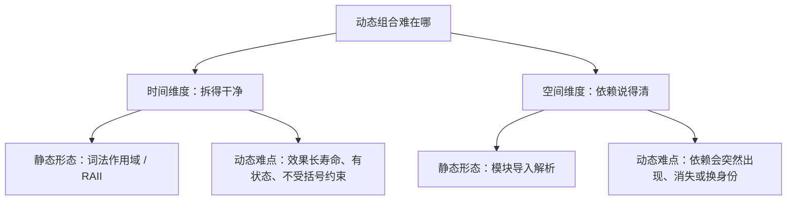
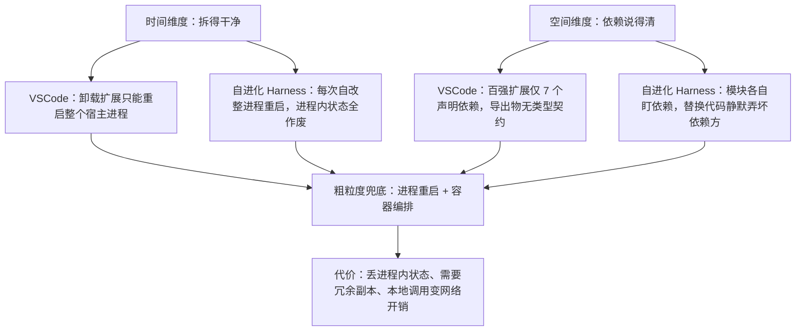
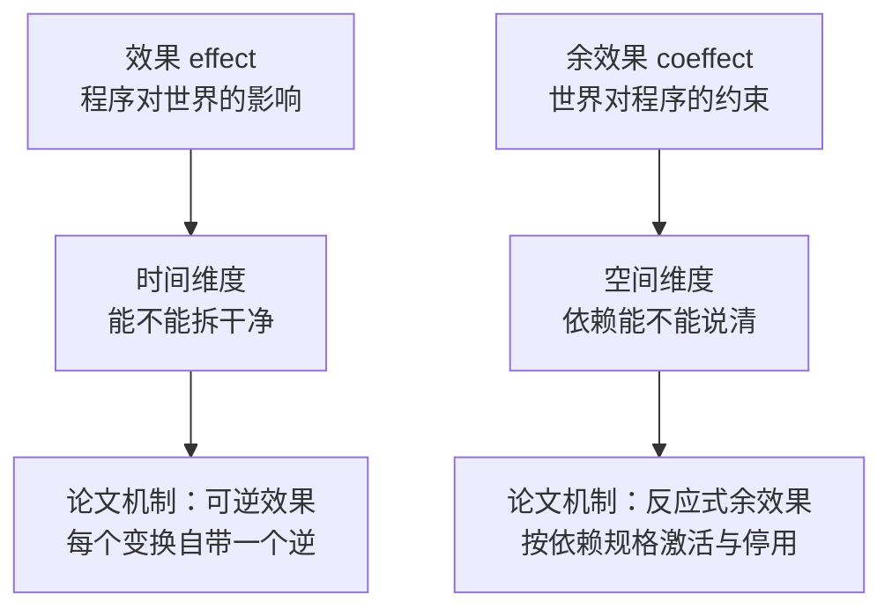
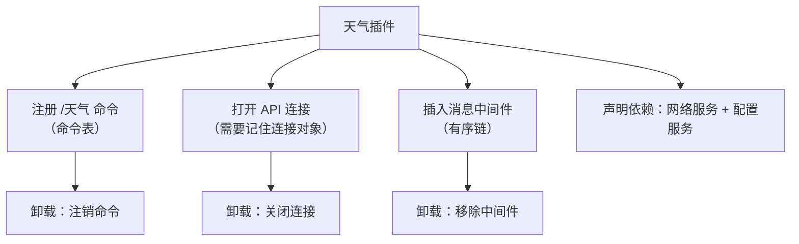
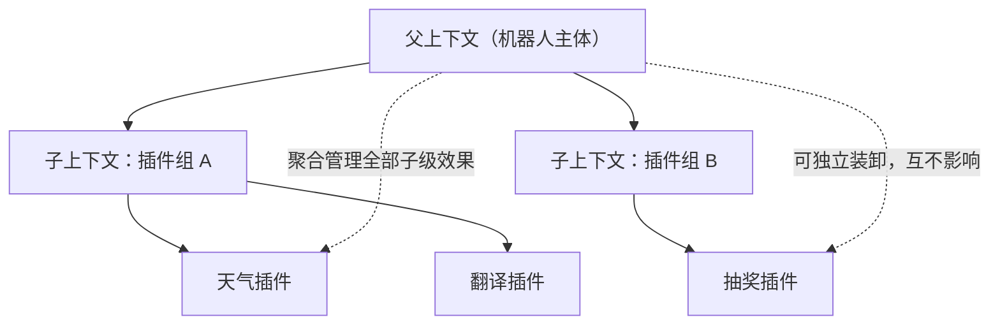
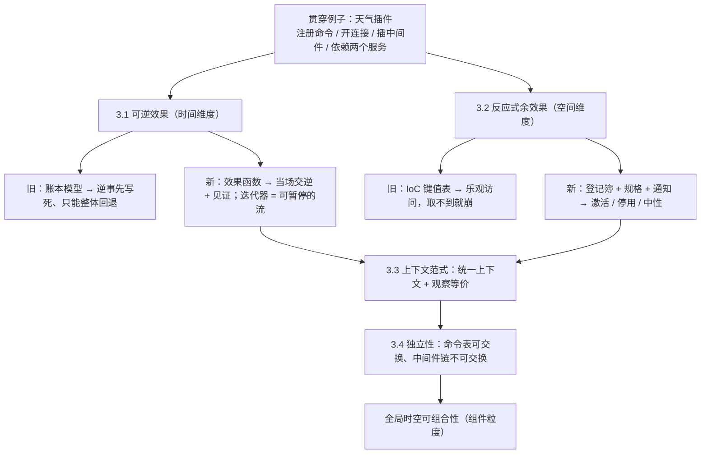

# A Programming Paradigm for Spatiotemporal Composability（时空可组合性的编程范式）

## 论文基本信息

- **论文标题**: A Programming Paradigm for Spatiotemporal Composability
- **中文译名**: 时空可组合性的编程范式
- **作者**: Yifan Shi（北京大学 / DeepSeek-AI）、Wei Zhang（北京大学）、Tianyi Cui（DeepSeek-AI）
- **发表**: arXiv:2608.25512v1，2026 年 8 月
- **篇幅**: 正文 92 页
- **学科定位**: 程序语言理论（effect / coeffect system、操作语义、元理论）＋ 工程实现（Cordis 框架）
- **核心主张**: 把原本只在编译期生效的 effect 与 coeffect 概念提升为运行期机制，为"动态组合"补上一套语言无关的形式化基础
- **本篇笔记进度**: 已整理第 1–3 章（2026-10-16）；第 4 章及以后待补充

### 阅读地图

| 章节 | 主题 | 本笔记状态 |
|------|------|-----------|
| 第 1 章 | 动态可组合性的两个维度与动机案例 | ✅ 已整理 |
| 第 2 章 | 预备知识：效果系统与余效果系统 | ✅ 已整理 |
| 第 3 章 | 可逆效果与反应式余效果、上下文范式 | ✅ 已整理 |
| 第 4 章 | 动态组合演算（component / fiber / 元理论） | ⬜ 待补充 |
| 第 5 章 | 实现：Cordis 核心库、组件加载器、热模块替换 | ⬜ 待补充 |
| 第 6 章 | 讨论：系统边界与开放问题 | ⬜ 待补充 |

---

## 一、技术背景（第 1 章）

### 1.1 问题的起点：组合方式正在变

软件工程的本职工作是"组合"——把简单部件拼成复杂系统。但传统组合是**静态**的：函数调用、模块导入、类继承，在编译期就把线路接死，程序跑起来之后这张接线图不会再变。理论界为这种静态组合准备了很成熟的形式化工具。

而现代软件越来越多要求**动态**组合：插件想装就装、想卸就卸，AI Agent 的组件随时可能被改写。麻烦在于，动态组合几乎没有理论基础，实践里只能靠"重启"这种粗粒度手段。作者要回答的就是：动态组合到底难在哪，以及需要什么样的抽象才能管住它。

### 1.2 两个维度：全文的地基

作者把"动态组合难在哪"拆成两条**互不重叠**的线，这是全文最重要的划分。

**时间可组合性（temporal composability）——拆得干净。** 组件装上时往往顺手做了很多事：申请资源、打开连接、注册事件回调、改全局配置、起定时器。等它被卸下，这些事必须被完整、安全地撤回。不是"大致清理一下"，而是留下隐患就算失败。因此系统必须能记住它做过的每一笔改动，并能按正确顺序倒着收回。

**空间可组合性（spatial composability）——依赖说得清。** 组件不是孤岛，它要用别人提供的东西。它得能明确声明"我需要某个服务在场"，系统得能发现并解析这些需求，还得在对方出现、消失、换代时让依赖它的组件跟着启动或停下。

这两条线在静态场景里其实天天见：

| 维度 | 它管什么 | 静态场景的形态 | 动态场景的难处 |
|------|---------|---------------|---------------|
| 时间可组合性 | 组件拆掉后，环境要恢复原样 | 词法作用域（RAII：出了大括号自动释放） | 效果变成"长寿命、有状态"，且不再受某段代码的括号约束，可能在组件卸载很久之后仍在活动 |
| 空间可组合性 | 组件之间谁依赖谁，要说得清、能响应 | 模块导入解析（一行 import，编译期查清） | 依赖是活的：会中途冒出来、中途消失，甚至换个身份（名字没变，但背后已是另一个实现） |



这两个维度是**正交**的：一个组件可以拆得干净却依赖说不清，也可以依赖清晰却卸不干净。论文第 3 章的两套机制正是分别对应它们。

### 1.3 四个动机案例

#### 案例一：VSCode 插件系统（时间维度缺失）

VSCode 把所有扩展塞进同一个 extension host 进程。扩展可以动态安装，但**装完卸不掉**：一旦它的 `activate` 跑过，想禁用或卸载它，只能重启整个宿主进程，所有扩展一起遭殃。

- 不含代码的扩展（主题、快捷键、代码片段）可以随时卸掉；但装机量前 100 的扩展里有 **87 个含可执行代码**，也就是说绝大多数都得走重启这条路。数据取自 2026-06-09 的 VSCode Marketplace 快照。
- VSCode 确实提供了 `deactivate` 钩子，但它只是宿主进程退出时的优雅关闭回调，支撑不了实时卸载。更关键的是，它把"清理"写在 `deactivate`、把"创建"写在 `activate`，**违反关注点局部性**——谁负责收尾一眼看不出来，清理是否完整也无法验证。

#### 案例二：同一个例子的另一半（空间维度缺失）

VSCode 提供了 `extensionDependencies` 字段来声明扩展间依赖，但几乎没人用——前 100 个扩展里**只有 7 个**声明了对非内置扩展的依赖。根因不在开发者，而在 API 形态：

- 扩展通过命令、视图、语言特性这些固定的**扩展点**向宿主贡献能力，是"往宿主上挂"，而不是彼此对接；
- 扩展之间互访**没有结构契约**：`extensions.getExtension(...).exports` 返回的是 `any`，依赖方无法依赖一个被检查过的接口。

作者强调这不是 VSCode 独有，而是插件系统的通病，只是程度不同。

#### 案例三：自进化的 Agent Harness（把后果放大）

今天一个 Agent 背后有一整套运行时 Harness 在撑：组合工具套件与执行环境、治理权限与沙箱、维护会话状态与持久化、做上下文管理与记忆、编排 subagent 与多智能体工作流、对外暴露接口。作者设想未来这套 Harness 会**一边持续服务请求，一边生成并部署对自身组件的修改**——模型自己合成可复用工具已经是这个方向的窄化前身。而每一次这样的修改，本身就是一次动态组合实例。

这里缺失两个维度的后果比 VSCode 严重得多：

- 缺时间可组合性：每次自改都要整进程重启，进程内累积的状态（缓存、连接、部分计算）全部作废；这种频率下累计的不可用时间相当可观，在跑的任务反复被打断；最糟的情况是，一次写坏的自改把"用来救命的那个进程"本身弄没了。
- 缺空间可组合性：每个模块得自己盯着它依赖的模块出现、消失、换身份并临时应付；而粗暴的替换策略可能静默弄坏依赖方，或引入只在重载那一刻才暴露的循环依赖。

#### 案例四：为什么现状能维持——粗粒度兜底及其代价

因为有一个**粗粒度兜底**：操作系统在进程粒度提供时间可组合性（大不了重启进程），容器编排在服务粒度提供空间可组合性（服务依赖交给编排器）。大多数软件就靠这个容忍细粒度能力的缺失。

但代价是实打实的。时间上，每次重启丢弃全部进程内状态，重建要几秒到几分钟，这期间要保可用就得开冗余副本，等于用资源去补"没法只恢复单个组件"的窟窿；空间上，容器级编排表达不了**同一地址空间内组件之间**的依赖，还把本该是本地函数调用的交互推到了网络上。而现代系统的组合粒度越来越细，这种**粒度错配**正是问题所在。



### 1.4 作者的切入点与五条贡献

作者的关键观察是：上面两个维度，恰好对应学术界已有的两套理论——**效果系统（effect systems）** 对应"环境被怎么修改"，**余效果系统（coeffect systems）** 对应"对环境有什么要求"。只是过去这两套理论只在编译期、词法固定的作用域里使用。

论文的做法是把效果提升为**运行期可逆模型**、把余效果提升为**响应式依赖解析机制**，从而得到一套语言无关的动态可组合性形式基础。第 1 章列出的五条贡献：

| # | 贡献 | 位置 | 建立了什么 |
|---|------|------|-----------|
| 1 | 可逆效果（revertible effects） | §3.1 | 每个上下文变换自带一个运行时持有的显式逆，跟踪与恢复都保持可组合 → **局部时间可组合性** |
| 2 | 反应式余效果（reactive coeffects） | §3.2 | 组件以"规格"声明所需余效果，每次上下文变化被分类为 activating / deactivating / neutral，驱动组件激活与停用 → **局部空间可组合性** |
| 3 | 上下文范式（context paradigm） | §3.3 | 效果上下文与余效果上下文统一为单一上下文类型，每次效果与余效果都经由它中介；中介诱导出一个观察等价，不同组件的效果在该等价下达到独立 |
| 4 | 动态组合演算 | §4 | 把两套机制收进"组件"概念并给出操作语义；元理论把时空可组合性从单个组件抬升到任意交错的多组件系统 |
| 5 | Cordis 实现 | §5 | 时空可组合性的元框架：核心库实现形式模型（效果跟踪 + 余效果解析），外加带配置协调与热模块替换的声明式组件加载器 |

---

## 二、技术内容详解（第 2 章：两件现成工具）

第 2 章是预备知识，把后面要用的两件工具讲清楚，并说明它们为什么不够用。这两件工具可以理解为一对**方向相反的账本**。


### 2.1 效果系统：程序"动了世界什么"

普通类型系统回答"这段代码算出来的东西是什么类型"。但光知道"吐出什么"不够，因为你不知道它顺手干了什么。**效果系统**就是在结果类型之外再补一条说明：这段代码除了算出结果，还会对世界做什么——读文件、写日志、抛异常、改全局变量、发网络请求。这条说明的取值来自一个称为**效果代数**的结构。

它主要有两条实现路线：

| 路线 | 大白话解释 | 经典代表 | 典型例子 |
|------|-----------|---------|---------|
| **单子路线**（monadic effects） | 把"会出错""会改状态""会碰外部世界"这类事情本身做成一个带规则的盒子。你写的是盒子里面的普通计算，盒子的规则负责把额外影响按顺序串起来、把边界管好 | Moggi（用范畴论建模计算效果）、Wadler（在 Haskell 中推广） | 表示"可能没有结果"的 Maybe、表示"随身带可变状态"的 State、表示"要跟外界打交道"的 IO |
| **代数效果路线**（algebraic effects） | 不预先规定动作怎么实现，只声明"有这么几个动作"，比如"读状态""写状态"。写代码的人放心调用，不关心背后是什么，最后由一个**处理器**给这些动作下定义——可以当真读写，也可以解释成打日志、解释成测试用的假数据 | Plotkin & Power（代数操作决定单子，效果接口与实现解耦）、Plotkin & Pretnar（effect handlers） | Koka、Eff、OCaml 5 都采纳了这条路线，取舍各有不同 |

代数效果的处理器有一个巧妙之处：它拿到的不只是动作的参数，还拿到"这个动作之后剩下的那半截计算"。于是它能决定这半截算不算、算几次——**一次都不算**就变成异常中断，**算一次**是正常流程，**算多次**就变成协程、回溯搜索这类效果。所以异常、协程、随机选择能被塞进同一个框架。

### 2.2 余效果系统：程序"需要世界给什么"

**余效果**是效果的对偶（dual），但它丰富的不是"结果类型"，而是**上下文**。它说明这段代码对外界有什么要求：要访问哪些资源、要持有哪些权限、要依赖哪些服务。

一句话对照：**效果是程序欠世界的账，余效果是世界欠程序的账。**

| 路线 | 大白话解释 | 经典代表 |
|------|-----------|---------|
| **余单子路线**（comonadic coeffects） | 把一个"环境"打包成一个既能取用、也能嵌套展开的结构。它既能表示"依赖一个固定不变的环境"，也能表示"依赖一串随时间变化的数据" | Uustalu & Vene（首次用 comonad 组织依赖上下文的计算，作为 Moggi 单子框架的对偶）、Petricek 等（把 coeffect 提升为上下文依赖的统一静态分析） |
| **分级路线**（graded coeffects） | 给每个变量标一个"用量刻度"：完全不用、正好用一次、最多用几次、随便用多少次。刻度之间的组合运算分别对应顺序组合与平行组合 | Gaboardi 等（用预序半环作为余效果代数，把效果与余效果结合起来） |

分级路线不只是记账。它能做精确的资源管理，能分析"输入的一点点变化会影响输出多少"（敏感性分析），还能做信息流控制——比如标上"用户数据"的东西不许流到"对外发送"的地方。

### 2.3 两件工具与两个维度如何对上

到这里就接上了，这也是第 2 章的落脚点：



- **效果对应时间维度**：因为"拆得干净"本质上就是要求这些改动可以被撤回，而"有状态、会持久改变环境"的正是效果所描述的那类行为；撤销这种变换，就要求它容许一个逆。
- **余效果对应空间维度**：因为"依赖说得清"里说的依赖，正是余效果所描述的东西；管理依赖，就是拿每一条需求去跟环境实际提供的东西对上号。

### 2.4 缺口：静态工具够不着动态场景

真正的缺口在于，这两件工具都是**静态工具**：

- 效果只在"括号圈定好的范围"里被追踪，最后由编译期的处理器结清；
- 余效果的说明也只针对"运行前就确定好的上下文"做检查。

而动态组合要的是：这些保证对"跑着跑着才来的组件"也成立，对"一直在变的上下文"也成立。**固定的括号圈不住一个部署之后才加载的插件；编译期也猜不到运行期配置里才冒出来的依赖。**

因此作者要的不是"在类型上多贴几个标签"，而是一次视角转换：把效果和余效果这些概念**实体化（reify）**——做成运行期真能拿着操作的东西，让运行时自己去建立那些原本只有编译期才能给出的保证。这就是第 3 章"可逆效果 + 反应式余效果"要完成的事。

---

## 三、技术内容详解（第 3 章：可逆效果与反应式余效果）

第 2 章说明了两件工具，但它们过去都只是**编译期的类型标注**。第 3 章做的事情，是把这些标注**搬进运行期**，变成运行时能拿在手里操作的东西——论文称之为把上下文**实体化（reify）**。

一句话概括这一章的路线：**用"账本"解决时间维度（拆得干净），用"登记簿 + 分类"解决空间维度（依赖说得清），再把两者合成一个统一的上下文，让多个组件能安全地交错运行。**

### 3.0 贯穿全章的例子

我们只用一件事做例子：**给聊天机器人装一个"天气插件"**。

这个插件装载时会做四件事：往**命令表**里注册一个 `/天气` 命令；打开一条到天气 API 的**网络连接**；往**消息处理中间件链**里插入一个中间件；并且它必须等到**网络服务**和**配置服务**都已经在场，才能真正开工。卸载时，这四件事都得干净撤回。



下面每一节都拿这个例子看：**原来的做法怎么处理、会出什么问题，现在提出的做法怎么改。**

### 3.1 可逆效果：把"拆得干净"变成运行期保证

这一节对应**时间维度**。

#### 原来的做法：一本账本（效果上下文）

原来的思路很朴素：把"当前环境状态"和"到目前为止攒下的所有撤销操作"打包成一个二元组——前者是**账面现状**，后者是一摞**撤销凭据**。这个二元组叫**效果上下文（effect context）**，配两个动作：**track**（记账，把一笔改动连同它的逆一起登记进去）和 **recover**（冲账，把整摞凭据一次跑完，回到起点）。

放到例子上：插件装载时，账本依次记下"注册了命令""开了连接""插了中间件"三笔，凭据堆成三张；卸载时 recover 把三张按后进先出跑一遍，环境回到初始状态。

#### 它的问题：两个毛病

**第一个毛病，逆必须事先写死。** 撤销"打开连接"，你得知道**打开的是哪一条连接**才能关掉它——而"哪一条"是**动手那一刻**才知道的。可这个模型要求你**在动手之前**就把逆当成参数传进去，于是你只能写一个"关闭某某连接"的逆，其中"某某"是事先猜的。每次拿到的连接都不一样，这个写死的逆多半对不上。

**第二个毛病，撤销只能整体来。** 假设你只想**撤掉中间件、保留那条连接**（连接要交接给下一个插件继续用），账本模型做不到——recover 一执行就把三张凭据全部跑完，命令和连接也跟着一起被撤掉了，你没有"只撤其中一笔"的选项。

#### 现在的做法：效果函数（当场交逆 + 见证）

论文的修补正好对应这两个毛病，而且做得非常对称。

针对毛病一，**让每笔改动在动手时当场把自己的逆交出来**，而不是事先约定：

```
原来的账本模型：  打开连接（逆 = 关闭固定那条）    ← 逆是事先猜的
现在的效果函数：  (conn, undo) = 打开连接()        ← undo 现场生成，永远对得上
```

这个"输入状态、输出新状态加一个逆"的形状，论文叫**效果函数（effect function）**。注意它对逆的要求被**故意放宽**了：只要求这个逆在"它自己动手的那个状态"上管用，不要求在任何状态都管用——正是这个放宽，才允许"每个状态用不同的逆"。随逆一起交出来的那份"我这个逆确实能撤回我自己"的保证，叫**见证（witness）**，本质上是一张随货附带的保证书。

针对毛病二，**让"撤销"这一步也返回一个逆**。这样撤销本身就变成了可以被单独跟踪、也能被再次撤销的效果：既能挑着撤（只撤中间件、留下连接），也能"撤销刚才那次撤销"（也就是 redo）。做和撤，形状完全一样。

#### 一串改动：效果迭代器

真实插件做的不是一笔改动，而是一串。论文把它做成**效果迭代器（effect iterator）**：一次执行一步，每步吐出"新状态 + 逆 + 还有没有下一步"。这个结构就是主流语言里的**生成器 / yield**。论文证明：**按相反顺序回退，每一步的逆刚好遇到"当初自己动手时的那个状态"**，也就是天然的后进先出（LIFO），不需要额外条件。

#### 这一节的产出：局部时间可组合性

判据是：一个组件做过的每一串效果，凭据都能把它带回起点；倒着撤时，每个逆都遇到自己当初动手的状态。之所以说"局部"，是因为**它只管这一个组件自己的效果**，还没管多个组件交错执行——那留给 3.4。

### 3.2 反应式余效果：把"依赖说得清"变成运行期保证

这一节对应**空间维度**。

#### 原来的做法：传统依赖注入容器

老办法是把依赖做成一张简单的键值表：组件想要什么就直接 `get` 出来用。代表就是传统的**控制反转（IoC）容器**。

放到例子上：天气插件装载时**直接伸手去取"网络服务"**。可如果网络服务这时还没起来，取不到，就当场报错崩掉。这就是"**乐观访问**"：先伸手，拿不到再失败。想不崩，插件作者只能自己写轮询、或到处塞"服务在不在"的判断——**检测"东西到没到"这件事，被推给了每个组件自己去干**。

#### 现在的做法：登记簿 + 规格 + 通知

论文把这张键值表形式化成**余效果上下文（coeffect context）**——一张**服务登记簿**，键是依赖名，值是提供的服务，每个键还绑定确定的值类型。两个动作是 `get`（取用）和 `set`（登记一个服务，并返回"下架它"的逆）。

这里有一处漂亮的**协同**：`set` 的形状恰好就是 3.1 的**效果函数**，所以**登记依赖天然可逆**——插件卸载时，它登记过的东西会被自动、成组地撤销。论文概括为：**依赖操作就是效果，效果就是可逆的。**

光有登记簿不够。论文给每个组件配一份**规格（specification）**——一张需求清单（例子里就是"网络服务、配置服务"）。登记簿上定义**满足判定**：清单里每个键都在册才算满足。最关键的是：**每次登记簿发生变化，就拿这份清单核对一次**，核对结果叫**通知（notify）**：

| 结果 | 什么时候出现 | 系统怎么做 |
|------|-------------|-----------|
| **激活 activating** | 之前不满足，现在满足了 | 插件开工（执行它的效果） |
| **停用 deactivating** | 之前满足，现在不满足了 | 插件收工（撤销它的效果） |
| **中性 neutral** | 满足状态没变 | 什么都不做 |

这就是"**反应式（reactive）**"的全部含义：不是轮询，而是**每次变化都被分类，分类驱动启动与停止**。注意"停用"和"激活"是对称的——正是 3.1 那套可逆效果在背后干活，插件停工时才能把自己做过的事干净撤回。

#### 三者的形式

把三者放到一起看，它们是三个不同角色的东西，别混在一起：

| 角色 | 论文里的名字 | 在例子里是什么 | 谁提供 |
|------|-------------|---------------|--------|
| **登记簿** | 余效果上下文 Σ | 一张"现在有哪些服务在册"的表 | 系统维护 |
| **规格** | 余效果规格 𝔇 | 天气插件贴的那张需求清单：我要**网络服务**和**配置服务** | 组件声明 |
| **通知** | notify | 拿"清单"去核对"登记簿的前后两版"，得出该开工还是收工 | 系统在每次变化时算 |

一句话串起来：**规格是"我要什么"，登记簿是"现在有什么"，通知就是"每次登记簿一变，就拿规格去比对一次"。**

**登记簿的形式。** 登记簿的本质是一张**有限的部分函数表**：键是依赖名，值是提供的服务，并且每个键绑定一个确定的值类型（所以取值是类型安全的）。

```
Σ ≔ (k : K) ⇀ 𝒱_k
```

σ : Σ 表示某一张具体的表。围绕它有四个基本操作：`σ(k)` 取值（前提 k 在册）、`σ[k↦v]` 上架、`σ∖k` 下架、`k ∈ dom(σ)` 判断在不在册。组件真正会用到的只有两个动作：

```
get : (k : K) → Σ ⇀ 𝒱_k
get = k ↦ σ ↦ σ(k)                              前提：k ∈ dom(σ)

set : (k : K) × 𝒱_k → Σ ⇀ Σ × (Σ ⇀ Σ)
set = (k, v) ↦ σ ↦ ( σ[k↦v] , λσ′. σ′∖k )        前提：k ∉ dom(σ)
```

把 `set` 拆开读：给它一个键 k 和一个值 v，再给它当前表 σ，它返回**两样东西**——新表 `σ[k↦v]`（上架了），以及一个撤销函数 `λσ′. σ′∖k`（把 k 从表里删掉，也就是下架）。`set(k,v)` 的类型恰好就是**效果函数 𝔈\*_Σ**，所以**"登记服务"这件事本身就是一个可逆效果**——插件卸载时，它登记过的东西会被自动撤销。两个前提也不是装饰：**同一个键不能上架两次，也不能凭空下架**；违反前提会被报成错误，而且**不产生状态转移**。

**规格的形式。** 规格就是"我需要的键"这个集合：

```
𝔇_Σ ≔ 𝖲𝖾𝗍(K)
```

天气插件的规格就是 `d = {网络服务, 配置服务}`。配套的**满足判定**是：清单里每个键都在册。

```
σ ⊧ d  ≔  ∀k ∈ d. k ∈ dom(σ)
```

它是**可判定**的——因为 `dom(σ)` 有限，扫一遍清单就知道满足不满足。另外提醒一个容易混的点：组件通常有两组键，**规格 d 是"我读别人的"（requirements）**，另外还有一组 provision p 是"我提供出去的"；例子里天气插件的 p 可以是 `{天气查询服务}`，两者是分开的。

**通知的形式。** 通知就是那个分类函数，它需要**三个输入**：规格 d，以及变化**前后两张表** σ 和 σ′。

```
notify_d(σ, σ′) ≔
    activating      若  σ ⊭ d  ∧  σ′ ⊧ d      （之前不满足 → 现在满足）
    deactivating    若  σ ⊧ d   ∧  σ′ ⊭ d      （之前满足   → 现在不满足）
    neutral         其他                        （满足状态没变）
```

**为什么要给前后两张表，而不是一张？** 因为"激活"和"停用"是**状态的变化**，不是状态本身。只看 σ′ 你分不清"一直满足"和"刚从不满足变成满足"——前者不该重复触发激活，后者才该。所以必须对比。

#### 用例子把三者跑一遍

天气插件的规格是 `d = {网络服务, 配置服务}`。下面按时间线走，每次登记簿一变就调一次 `notify_d`：

| 时刻 | 发生了什么 | 登记簿 σ（在册的键） | σ ⊧ d ? | 通知结果 | 插件动作 |
|------|-----------|-------------------|---------|---------|---------|
| T1 | 插件加载，贴出清单 d | `{}` | 不满足 | — | 待命 |
| T2 | `set(配置服务, cfg)` | `{配置服务}` | 不满足 | **neutral** | 继续待命 |
| T3 | `set(网络服务, net)` | `{配置服务, 网络服务}` | 满足 | **activating** | 开工 |
| T4 | 撤销网络服务（`σ∖网络服务`） | `{配置服务}` | 不满足 | **deactivating** | 收工并撤回效果 |
| T5 | `set(网络服务, net2)` | `{配置服务, 网络服务}` | 满足 | **activating** | 再次开工 |


看 T2 这一步：登记簿**确实变了**，但满足状态没变（网络服务还是缺），所以分类是 `neutral`，插件**什么都不做**。这就是"中性"存在的意义——**变化不等于激活**，只有"满足状态翻面"才触发动作。

整个过程里，**插件代码里没有一行"检测网络服务在不在"的逻辑**——它只声明清单，剩下全是系统在盯。而且插件**从来没有在不满足的状态下启动过**，所以**永远不会读到不存在的绑定**，这从根本上避免了"取不到就崩"。

#### 为什么系统一定感知得到

因为登记簿的所有改动**都必须走"效果"这条通道**（上架服务就是一次 `set`，而 `set` 本身就是一个可逆的效果）。所有改动都留了痕、都能被跟踪，所以每次变化的边界系统都看得见。论文把这句话总结成：**效果系统保证了每一次余效果变化都被观察到**——这就是"反应性"的代数基础。

#### 两个附加特性：隔离与拦截

**余效果隔离（isolation）** 允许**同一个逻辑依赖在不同上下文里解析到不同的值**。做法是加一层"领域（realm）"间接层：先查"这个键属于哪个领域"，再按领域取值。例子里，两个租户各装一个天气插件，各自绑到自己的"网络服务"实现上，互不干扰。论文点明它的本质：**一套运行期的 ad-hoc 多态系统**，比传统依赖注入更细粒度，而且映射可以在运行时动态调整。

**余效果拦截（interception）** 在依赖访问上**附加一层横切的元数据**，加行为而不改值本身。比如外层上下文给"天气 API 连接"挂上"禁止访问外网"的元数据，从而**约束插件怎么使用这个依赖，而完全不用改插件代码**。

这里有个重要区分：`set` 是"写共享表"的**效果**，所以要跟踪、可逆；而 `isolate` 和 `intercept` 都是**派生（derived）实现**——它们不碰共享表，而是派生出一个"带调整的新上下文"，逆就是"丢弃这个派生上下文"，因此**不需要跟踪、也不需要撤销凭据**。

#### 这一节的产出：局部空间可组合性

判据是：组件只在自己规格被满足的状态下激活，因此**永远不会读到不存在的绑定**；每一次上下文变化都被分类，所以**满足性的丧失在发生的那一刻就被发现并触发停用**。同样说"局部"，是因为它还留着两件事没管：绑定要等停用跑完才能撤、以及激活运行期间它读到的绑定不能被别人挪动——这两件事都属于"别的组件的义务"，留给全局。

### 3.3 上下文范式：把两个账本合成一个

前两节各管一个维度，各管一半。这一节做两件事：**统一**和**标准化**。

#### 原来的做法：两套机制各管一半

原来的状态是：效果有一套账本，余效果有一张表，两者互不相通。一个组件要跟环境交互，得分别走两条路。

#### 现在的做法：统一上下文（unified context）

论文把两者合成一个**递归的、自相似的类型**，三个分量是：**当前状态**（自身又是一个同类型的上下文，所以能无限嵌套）、**凭据累加器**（负责撤销这一层效果）、**余效果登记簿**（承载依赖信息）。这个类型叫**统一上下文**。

有一个很关键的点：**登记簿里"值类型"是不受限制的**，所以任何需要在组件间共享的可变状态，都能被编码成一条"依赖"。换句话说，**统一上下文不只管组件间依赖，它吞下了所有共享可变状态**——组件与环境的一切交互都必须穿过这一个实体。

回到例子：命令表、那条 API 连接、中间件链，在这个视角下**全都是"键"**。而且论文规定，每个键除了值类型，还携带一组**操作**（该值提供给持有者的能力），这些操作被设计成只能作用于"这个键自己的那个绑定"，碰不到别人。这就把"中介"从口号落成了纪律。

因为类型是递归的，父子上下文能组成一棵树——父上下文聚合管理所有子级的效果。论文说这实现了字面意义的**"插件"隐喻**：装插件 = 插上（执行效果），卸插件 = 拔掉（撤销效果，且不影响其他还在跑的插件），不同层级的组件可独立装卸，还能任意嵌套。



#### 标准化：观察等价

这一节回答一个尖锐的问题：3.1 说的"恢复原状"，**真能做到吗？** 论文自己承认：**做不到，那是个理想化**。举的例子是：`free` 释放内存后，堆的物理布局并不会回到 `malloc` 之前的样子；生成一个新名字后，即使把它丢掉，下次生成的也不会是同一个名字。

所以"状态相等"必须被弱化成**观察等价（observational equivalence）**：**两个状态算等价，当且仅当没有任何观察者能区分它们。** 关键在于"观察者被给了什么工具"——观察一个值的工具，就是它那个键上定义的操作集合。于是**每个键上的等价关系，是由该键的操作"生成"出来的**：两个值等价，当且仅当用这些操作写出的所有"测试"（一串操作加读结果）在两边都跑不通或都跑通、且结果一致。

放到例子上：连接关闭后，底层文件描述符的编号可能并不复原，堆的布局也可能变了——**但只要没有任何键上的操作能观察到这个差异，两个状态就等价**。那部分"没有任何键绑定的状态"被等价关系**直接忘掉**了。这正是"恢复原状"能被弱化到观察等价的原因。

### 3.4 独立性：从"一个组件"抬到"一群组件"

前两节都只保证"一个组件自己"。真实系统里一群组件同时在跑，这一节给出把它们拼起来不出问题的条件。

#### 原来的做法：整体 LIFO，或者干脆重启

原来的做法要么是"账本整体后进先出回退"（只管一个组件内部的顺序），要么是"进程重启"（粒度错配的粗粒度兜底）。它撑不起两种真实场景：**从正在运行的系统里只摘掉一个插件**，而它后面还有别的插件效果在生效；以及**多个插件的效果交错执行**，各自的凭据被别人的操作隔开。这时逆遇到的已经不是当初的状态了。

#### 现在的做法：独立性 + 交换性

论文把"逆在别人动过之后还能不能撤回自己"归结为一个**交换性（commutativity）**问题：一个效果的每一种变换，都得与另一个效果的每一种变换**可交换**——前进的映射和它交出的逆，两两都要能换顺序。满足这个条件的两个效果，论文称它们**独立（independent）**。

**核心结论**：如果一组效果两两独立，那么在一串效果全部执行完之后，你**按任意顺序（任意排列）执行这组逆，都能回到初始状态**。这就是"从运行中随时摘掉一个插件"能成立的数学依据。

论文还特意区分了两个容易混淆的词：**"可交换"和"独立"不是一回事**。可交换说的是"两种执行顺序的合成结果相同"；独立说的是"一方的每一种变换与另一方的每一种变换，两两都换得动顺序"，连"前进映射配别人的逆"这种组合也要算。独立是更强的条件。

#### 交换性落在"键"上

论文有一个很漂亮的归约：**不同键上的操作，天生就是独立的**——因为每个操作只读写自己那个键，两个键互不相干。于是问题**只落在同一个键内部的那些操作上**。这直接对应到例子里的两类键：

| 例子中的键 | 是否可交换 | 原因 |
|-----------|-----------|------|
| **命令表**（注册型） | 可交换 | 每次注册**各自拿一个独立标识**，两次注册命名两个不同条目；无论什么顺序，表对任何测试的应答都一样；任一个都能在另一个还在时被撤掉 |
| **中间件链**（有序链型） | 不可交换 | 插在另一个前面的中间件看到的是**不同的请求**；两种顺序下撤掉任一个都会扰动另一个 |

论文进一步把"可交换"这个条件**做成余效果的一部分**：一个"**有见证的余效果**"除了值类型和操作集合，还要携带**第三样东西——一份"这个键上的操作两两独立"的证明**。这跟效果函数携带"逆能撤回我"的证明是**完全平行的设计**：两份见证都在**定义的地方**提供，而不是在**使用的地方**检查。而且因为不同键天生独立，这份举证责任**落在提供该键的组件身上**，跟消费该键的组件无关。

#### 主定理与最有洞见的一段

主定理是：两个上下文中介的组件，只要满足"**你不去操作我登记的东西、我不去操作你登记的东西**"（键集合不相交），且**两者共同操作的每个键都可交换**，那么它们就是独立的。而"每个键都可交换"这一条，因为余效果都带了见证，**是免费提供的**；只剩"键集合不相交"要在使用时检查——而这条正好能从**两个组件的声明**上直接读出来。

收束的一段非常关键：这套分解实际上把一个计算切成了两半。**可交换的部分，由效果承载**：插件按自己任务需要的顺序执行，系统可以按任何方便的顺序撤销，插件之间互不约束。**对顺序敏感的部分，由余效果承载**：一个键上的操作若不可交换（比如中间件链），说明"它的顺序必须从效果之外施加"，而施加的位置恰好有两个——**组件内部**由凭据施加（LIFO 撤销），**组件之间**由声明的余效果施加（提供方必须先于声明方满足）。于是**可组合性是在"组件的粒度"上成立的，而不是"单个效果"的粒度上**。这正是第 4 章要工作的尺度。

#### 论文自陈的局限

这套定理的前提是"**每个共享位置都被绑定成一个键**"。这是范式的**纪律**，不是构造自带的性质——所以一个**无法被实体化成余效果的共享位置，就落在系统边界之外，也就落在定理之外**。这一条在第 6 章展开。

### 3.5 第 3 章小结



用一句话记住整章：**它把"撤销"和"依赖"从编译期标注变成了运行期实体——用账本解决时间维度（后来升级成当场交逆的效果函数），用登记簿加分类解决空间维度，再用统一上下文、观察等价和独立性，把只对单个组件成立的局部保证抬到多组件系统上。**

---

## 关键引用（第 1–3 章涉及）

| 论文引用 | 工作 | 在本章中的作用 |
|---------|------|---------------|
| Lucassen & Gifford | Polymorphic Effect Systems | 效果系统的起源：用分层类型系统区分类型、效果、区域，以发现并行程序中的调度约束 |
| Moggi | Notions of computation and monads | 单子路线奠基：用 monad 范畴化建模计算效果 |
| Wadler | Monads for functional programming | 把单子路线在 Haskell 中推广 |
| Plotkin & Power | Notions of Computation Determine Monads / Adequacy for Algebraic Effects | 代数效果奠基：代数操作决定单子，效果接口与实现解耦 |
| Plotkin & Pretnar | Handlers of Algebraic Effects | 引入 effect handlers，用续延语义解释操作 |
| Leijen（Koka）、Bauer & Pretnar（Eff）、Sivaramakrishnan 等（OCaml 5） | — | 代数效果在真实语言中的采纳与取舍 |
| Uustalu & Vene | Comonadic Notions of Computation | 余单子路线奠基：作为 Moggi 单子框架的对偶 |
| Petricek, Orchard & Mycroft | Coeffects: unified static analysis of context-dependence | 把 coeffect 提升为上下文依赖的统一静态分析 |
| Gaboardi, Katsumata, Orchard, Breuvart & Uustalu | Combining effects and coeffects via grading | 分级路线：用预序半环作为余效果代数 |
| Shapiro 等 | — | 论文用生成名（generative name）说明"物理状态无法完全复原"，是观察等价（≃）的动机之一 |
| 复制数据类型（RDT）相关文献 | — | 论文用"每次加入带唯一标签"说明注册型键为何可交换 |
| CompCert | — | 论文用"句柄重命名"类比分配器在句柄不被比较时的可交换性 |
| 可扩展交换性规则（scalable commutativity rule）相关文献 | — | 论文把"可交换性 = 通过接口看到的不可区分性"与 POSIX 接口设计联系起来 |

---

## 待补充章节（占位）

- [ ] 第 4 章：动态组合演算——component / fiber / registry / 生命周期状态机 / 元理论
- [ ] 第 5 章：Cordis 实现——核心库、组件加载器、热模块替换、Koishi 案例
- [ ] 第 6 章：讨论——系统边界、服务多路复用、访问控制与沙箱、依赖类型与版本

> 待全部章节整理完成后，再统一补充"特别标签观点与核心关联内容""总结与局限""对实践的启示"等分析性章节。
