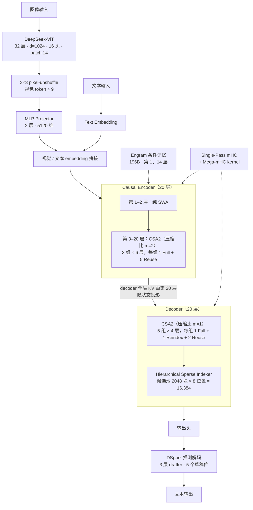
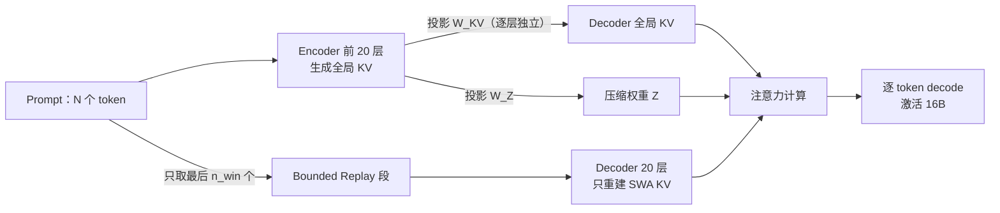

# DeepSeek-V4.1-Flash：把 KV Cache 压缩推到极限

论文：*DeepSeek-V4.1-Flash: Pushing the Limits of KV Cache Compression*（DeepSeek-AI，2026-09-17，arXiv:2609.19969，51 页）

## 一、技术背景

### 现状
长时程 agent（long-horizon agent）让模型负载从"输出密集"变成"**输入密集**"：每一轮工具调用都要把不断增长的上下文重新 prefill 一遍。前人的工作已经把长上下文计算成本压了很多（MLA 压 KV 头维度、CSA/HCA 压序列维度、DSA 稀疏选择），但三项成本仍然同时存在：

1. **prefill 算力**：新输入或 cache miss 时重算整个前缀；
2. **KV cache 容量**：HBM 装不下就往 SSD 溢写；
3. **数据搬运带宽**：KV 在 HBM/SSD/网络之间来回搬。

作者的判断很直接：这三项合起来才是"继续降低部署成本"的主要瓶颈，而 **KV cache 是其中最可控的一环**。

### 研究空白
已有工作只压单一维度：

| 维度 | 代表工作 | 局限 |
|---|---|---|
| 条目大小（entry size） | GQA、MLA | 只减每个 KV 条目的字节数 |
| 序列长度（sequence） | CSA、HCA（V4） | 每 m 个 token 压成 1 条 |
| 层间（layer） | IndexCache（复用 Top-K 索引）、YOIO（路由共享）、HySparse（稀疏层复用稠密层 KV） | **只省索引计算，不省 KV 存储**；或限制性能；或仍保留全注意力层 |

**没有方法同时覆盖这三个乘性维度**——这正是 CSA2 的切入点。

### 设计目标
在不牺牲能力的前提下：把全局 KV cache 压到 V4-Flash 的 1/4、持久化 KV 压到 1/8，同时把单 token decode FLOPs 在 1M 上下文下做成近似常数。

---

## 二、技术内容详解

### 0. 前置概念（读架构图前先对齐这几个词）

架构图里混了三类东西：**基础机制**（KV Cache、SWA、MoE）、**本文的压缩主线**（稀疏注意力谱系 → CSA2）、**外挂模块**（Engram、mHC、DSpark）。先各给一句直觉，再进正题。

**① KV Cache 与 prefill / decode**

自回归生成分两段：prefill 一次读完整段 prompt，算出每层的 K 和 V 存下来；decode 每步只算一个新 query，然后去读这些历史 KV。于是成本被拆成两条独立的曲线——**prefill 吃算力，KV Cache 吃 HBM 容量与带宽**。上下文越长，后者越先成为瓶颈，这就是全文盯着 "bytes per token" 的原因。（延伸：[[deepseek-v4]] 的「推理框架」与磁盘 KV 部分）

**② SWA（Sliding Window Attention，滑动窗口注意力）**

让每个 query 只看**最近 w 个 token**，而不是全部历史：复杂度从 O(N²) 降到 O(N·w)，代价是丢掉远距离信息。它的工程麻烦在于"局部且逐层"——想精确恢复某一层的 SWA 状态，得把 L×w 个 token 重跑一遍，这正是后文 SWA Bounded Replay 要解决的核心痛点。V4.1 里每层都保留一条 SWA 分支（w = n_win = 128），前两层是纯 SWA。（延伸：[[deepseek-v4]] 的「混合注意力机制」一节里"滑动窗口注意力"那条）

**③ MoE（Mixture-of-Experts，混合专家）**

每个 Transformer 层的 FFN 拆成很多"专家"，每个 token 只走其中几个，于是总参数可以很大、单 token 计算量却很小。DeepSeekMoE 的配方是"1 个共享专家 + 若干细粒度路由专家"。V4.1 是 1 共享 + 384 路由、每 token 激活 6 个——这就是"552B 总参数、prefill 只激活 8B"的来源。（延伸：[[deepseek-v4]] 的「Mixture-of-Experts (MoE)」一节）

**④ 稀疏注意力谱系：DSA → CSA → CSA2**

这是本文主线，三代是同一条思路的递进：

- **DSA**（DeepSeek Sparse Attention，V3.2 引入）：加一个轻量 indexer 给历史 KV 打分，只让 **Top-K** 条目参与注意力，把 O(N²) 降到 O(N·K)；但 indexer 自己仍要扫全量。
- **CSA**（Compressed Sparse Attention，V4）：先在**序列维度**压缩——把一段连续 token 的 KV 压成 1 条（压缩比 m），再在压缩条目上做 Top-K；V4 里与压缩率更大的 HCA（Heavily Compressed Attention）混用。
- **CSA2**（V4.1）：再叠一个**层维度**——main KV、indexer K、Top-K 索引都能从前面层复用，于是"条目大小 × 序列 × 层"三个乘性维度同时压；再配合层级稀疏索引器，把深层 indexer 的候选集限制在一次块选择的结果里（每 query 打分从线性于上下文变成常数）。

（延伸：[[deepseek-v3]] 的「DSA（DeepSeek Sparse Attention）」一节——注意该文件名是 `v3`，内容实为 V3.2 的技术笔记；以及 [[deepseek-v4]] 的 CSA / HCA 两节）

**⑤ Engram（条件记忆，conditional memory）**

思路是把"记住事实"从"算出来"里拆出去：对输入做 n-gram 哈希，直接去查一张巨大的 embedding 表，命中就把它拼进表示。加容量几乎不增加每 token 的矩阵乘，因为查表是稀疏的；代价是表很大，得放 host 内存甚至远端，靠**确定性寻址**做预取。V4.1 放了 196B 参数、N-gram 阶数 {2,3,4}、每阶 8 个 hash head、每个 head 约 16M 条目、FP8，位置在第 1、14 层。

知识库目前**还没有 Engram 专页**，详细机制见本文第 5 节「三个高效扩展」；原始论文是 arXiv:2601.07372（*Conditional Memory via Scalable Lookup*）。

**⑥ 另外两个外挂**

- **mHC**（Manifold-Constrained Hyper-Connections）：在相邻 block 之间维持多条残差流并做受约束的混合，提升深层数值稳定性；V4.1 改成 Single-Pass 版以便 kernel 融合。（详见 [[deepseek-mhc]]）
- **DSpark**：推测解码——小 drafter 一次并行出几个草稿 token，主模型一次验证。（详见 [[deepseek-dspark]]）

一句话串起来：**MoE 决定算力成本，KV Cache 决定内存/带宽成本，SWA 管局部、CSA2 管全局且省缓存，Engram 管记忆容量，mHC / DSpark 分别管训练稳定性与解码速度。**

### 1. 总体架构

- **552B backbone 参数 + 196B Engram 参数**；prefill 每 token 激活 **8B**，decode 激活 **16B**（非对称）。
- 40 层 Transformer：**20 层 causal encoder + 20 层 decoder**。
- 前 2 层纯 SWA；其余层用 CSA2（带压缩比 m 与工作模式）。
- 原生多模态：DeepSeek-ViT（32 层、d=1024、16 头、patch 14）+ 2 层 MLP projector（5120 维），3×3 pixel-unshuffle 把视觉 token 压 9 倍，支持到约 1344×1344。
- 1M 上下文；decode FLOPs 从 4K 到 1M（256 倍）只增长 1/4。

### 2. Causal Encoder-Decoder（CED）

**思路**（受 YOCO 启发）：decoder 的全局 KV 不必由自己的隐状态算出，而是直接从第 L/2 层（encoder 最后一层）投影：

$$
C_l = H_{L/2} W^{KV}_l,\quad Z_l = H_{L/2} W^{Z}_l,\quad l > L/2
$$

- prefill 只需跑前一半层，复杂度从 O(NL) 降到 O(NL/2 + n_win·L/2) ≈ **O(NL/2)**；
- SWA 仍按层计算（深度不降），代价是 decoder 需要"回放" L/2 × n_win 个 token 才能精确重建 SWA KV；
- 于是引入 **Decoder SWA Bounded Replay**：只 prefill 最后 n_win 个 token。

关键点：**全局 KV 一次投影即可复用，SWA KV 只回放 n_win 而不是 L/2 × n_win**——prefill 的层数砍半，回放的 token 数也砍到常数级。

### 3. Compressed Sparse Attention 2（CSA2）

**三模式设计**（每层静态指定一种，图 4）：

| 模式 | 主 KV | Indexer K | Top-K 索引 | 适用位置 |
|---|---|---|---|---|
| **Full** | 本层算 | 从主 KV 投影 | 本层新算 | 每组的第 1 层 |
| **Reindex** | 复用前一层 | 复用前一层 | 用本层 indexer Q 重新打分选新 Top-K | 部分 decoder 组首层 |
| **Reuse** | 复用前一层 | 复用前一层 | 复用最近一次索引结果 | 组内其余层 |

要点：

- 三种模式都**自己算** main Q 和 SWA KV，只共享"全局"部分；
- 把 KV 存储共享（main KV + indexer K）与索引复用（Top-K）**解耦**，所以能各自独立取舍；
- 相比 CSA：去掉了压缩时的重叠采样（2m 个源条目）和绝对位置编码，indexer K 改为由主 KV 投影而来，实现更简单、训练更省；
- V4.1 用**纯 CSA2**，不再保留 V4 的 CSA+HCA 混合。

### 4. Hierarchical Sparse Indexer（层级稀疏索引器）

跨层复用减少了索引次数，但剩下的索引器仍要扫全上下文。作者的观察是：**decoder 里浅层索引器的结果天然可以约束深层索引器的候选集**，不需要额外状态。

- 第一个 Full 模式层：对全部可见主 KV 打分，选出自己的 Top-512；同时做**块级选择**：每块取块内最大分，选出 2048 个块 × 8 位置 = **16,384 个候选位置**组成候选池；
- 后续 Reindex 层：只在该候选池内打分并选自己的 Top-512；
- 结果：固定候选池大小后，后续索引器每 query 的打分开销**与上下文长度无关**（常数级），只有第一个 Full 层仍扫全量。

关键工程细节：这个候选限制**训练和推理完全一致**（post-training 引入），否则 train-test 分布错位。

### 5. 三个高效扩展

**Single-Pass mHC**：V4 的 mHC 在相邻 block 间维持 n 条残差流，原本三 kernel 串行，激活访存 (4n+4)d。V4.1 把输入混合系数**平移一个 block**（用 A_{l−1} 而非 A_l）：

$$
X_{l+1} = B_l X_l + C_l F_l(A_{l-1} X_l)
$$

依赖断掉后，tile 级可以一次读完就同时算"输入混合 + 系数预测"，访存降到理想的 (2n+2)d；配套 **Mega-mHC** kernel 把三个 kernel 合成一个，激活访存减半，性能损失可忽略。

**Engram（条件记忆）**：196B 参数，均分两个模块，N-gram 阶数 {2,3,4}，8 个 hash head，每阶 2048 维，每 head 约 16M 条目（表大小取不同素数），FP8；放在第 1、14 层以平衡流水线阶段的内存。推理时确定性寻址 → 可用 RDMA 从 host 内存预取，第一个模块的预取与第一个 Transformer block 的计算重叠。相比原版去掉了短因果卷积（收益不抵推理栈复杂度）。

**DSpark（推测解码）**：3 层 drafter，SWA 窗口 128；一次前向并行给出 5 个 draft 位置的 base logits，轻量 Markov head 建模 draft 间依赖，confidence head 预测逐位置接受率 → 估计前缀存活概率，再结合 profiling 的吞吐曲线**动态选验证长度**。与 V3 的 MTP 不同：DSpark 在预训练后单独训练（backbone 冻结），post-training 时与 backbone 一起训但不回传梯度。

**FP4 主 KV Cache**：选 MXFP4（OCP 标准），E2M1 + 每 16 通道一个 E4M3 scale，**省掉 NVFP4 的二级全局 scale**——因为 RMSNorm 后 KV latent 的 L2 范数 ≤ √512 ≈ 22.6、训练中观测最大值约 10，而格式上限 448×6=2688，动态范围绰绰有余。post-training 做 QAT；**在 RoPE 之后量化**（RoPE 前量化只带来边际提升却增加 decode 开销）；SWA KV 仍保留 FP8（对量化更敏感）。相比 V4 的 FP8 主 KV，存储再减半。

### 6. 训练与推理基础设施

- 视觉编码器**解耦部署**：三步流水（ViT forward / LLM fwd-bwd / ViT backward），LLM 阶段不含视觉计算，保持纯文本并行策略；
- 对比学习阶段做**通信-计算重叠**：Forward(V) → [Forward(T) ∥ AllGather(V)] → ∇Text → [Backward(T) ∥ AllGather(T)] → ∇Vision；
- 超长多模态样本做**均衡图像分片**，条件为 ρ < (B_IO/B_GPU)·C（只与每 token 量有关，与序列长度、集群规模无关）；
- CSA2 跨流水线阶段共享状态：**shadow indexer**（每个 stage 一份可执行副本，单一逻辑 owner）、流水线 payload 扩展、micro-batch 级共享状态生命周期管理；
- 推理：EPD 解耦；Reuse 模式的层 prefill 只需 **15 个 kernel**、decode **11 个**。

### 7. 持久化 KV 管理：把 SWA KV 踢出 SSD

V4 部署里 SWA KV 占了持久缓存近一半，但它的复用窗口只有**分钟级**，与"保活 72 小时"的持久缓存策略根本不匹配。V4.1 的改法：

1. SWA KV 不再进持久缓存，改放**host DRAM 池（每机 10% DRAM）**，TTL 只有几分钟，靠高周转服务并发活跃会话；
2. 全局 KV 留在持久缓存，保证 ≥72h；
3. 未命中时用 **Encoder/Decoder SWA Bounded Replay** 兜底——只回放 n_win 个 token 而非 L×n_win，把"灾难性 miss"降级为"廉价的优雅退化"。

两个因子相乘得到 1/8：不再存 SWA KV（≈减半）× 全局 KV 再压到 1/4。

### 8. 预训练

- **45T 多模态 token**；从零开始就用 64K 序列的稀疏注意力训练（**没有 dense attention warmup**），34T token 时扩到 1M；
- batch 100.6M token，lr 2.6e-4 保持到 28T 再 cosine 降到 2.6e-5；文本:多模态 = **7:1**；best-fit packing 的 padding 率 ≤ 1e-4；
- ViT 单独训练：SigLIP sigmoid 对比损失、约 47B 图文对、分辨率限 224；再用 4B MoE LLM 做 236B token 的自回归微调，分辨率 544–1344，之后丢弃 LLM 只留 ViT。

### 9. 后训练：没有算法创新

明确写着"**不引入新的后训练算法**"：就是 SFT → RL → OPD 的标准范式。所有实质变化在**数据与环境管线**：

- 任务被形式化为三元组 (problem, environment, verification system)，用"难度 + 正确性"当奖励去**训练模型自己造任务**；
- 通用 agent：收集内部员工/外部伙伴的真实交互与失败反馈，构造大量 mock 工具复刻真实接口；
- coding agent：内部会话 + 高 star GitHub 仓库，由多个专用 agent 协作完成"判断可容器化 → 选 commit → 设计 fail-to-pass / pass-to-pass 评估点 → 装依赖 → 自测 → 清除答案痕迹 → 打包成新镜像层"。

作者的结论值得记住：**当前阶段，数据与环境管线的工程边际回报远高于后训练算法的新颖性**。

### 10. 评测

Base 模型（内部统一评测框架）：

| Benchmark | V4-Flash-Base (13B act) | V4-Pro-Base (49B act) | **V4.1-Flash-Base (8B/16B)** |
|---|---|---|---|
| MMLU-Pro | 68.3 | 73.5 | **74.1** |
| SimpleQA-Verified | 30.1 | **55.2** | 42.3 |
| HumanEval | 69.5 | 76.8 | **79.4** |
| GSM8K | 90.8 | 92.6 | **93.0** |
| LongBench-V2 | 44.7 | **51.5** | 45.2 |
| MMMU-Pro | – | – | 56.5 |
| DocVQA | – | – | 95.6 |

后训练模型（Max 档）：

| Benchmark | Opus-5 | GPT-5.6 Sol | K3 | V4-Pro | V4-Flash | **V4.1-Flash** |
|---|---|---|---|---|---|---|
| GPQA Diamond | 93.4 | **94.1** | 92.9 | 92.4 | 89.9 | 90.9 |
| HLE | **56.3** | 44.5 | 43.5 | 42.7† | 37.8† | 36.8 (39.1†) |
| Codeforces | – | – | – | 3348 | 3289 | **3471** |
| MathArena Apex | – | – | 65.6 | 65.3 | 58.6 | **65.6** |
| Terminal-Bench 2.1 | 89.1 | 88.8 | 88.3 | 87.9 | 82.7 | **90.6** |
| Terminal-Bench 4.0 | **51.8** | 39.9 | 12.6 | 12.4 | 7.0 | 31.2 |
| DeepSWE v1.1 | 74.0 | 73.0 | 67.5 | 62.7 | 54.4 | **74.2** |
| Automation-Bench | 50.3 | 45.8 | 46.7 | 43.2 | 37.7 | **54.8** |
| Agents' Last Exam | 28.6 | 26.7 | 27.6 | 25.7 | 25.2 | **31.8** |
| HLE w/ tools | 63.6 | – | 59.8 | 60.0 | 51.5 | **63.9** |

---

## 三、特别标签观点与核心关联内容

### 观点 1：`KV-Cache-as-First-Class-Cost`

- **标签**: `KV-Cache-First`, `Cost-Pareto`
- **核心论点**: 长上下文部署的主成本已经从"算力"迁移到"KV 的存、搬、算"三件事上，架构设计应当以 **bytes/token** 为一等目标而不是事后优化项。
- **关键证据**: 全局 KV 压到 **890 B/token**（V4-Flash 的 1/4），相对 DeepSeek-V1 降了 **437 倍**；持久化 KV 降到 1/8；1M 上下文下 decode FLOPs 相比 V4-Flash 几乎不随长度增长（4K→1M 只涨 1/4）。
- **深层含义**: 评估一个长上下文架构，应该同时报"每 token 的 HBM 占用、SSD 占用、网络搬运量"三个数，只报 FLOPs 会漏掉真正的成本项。

### 观点 2：`Triple-Axis-Compression`

- **标签**: `Multiplicative-Compression`, `Layer-Dimension`
- **核心论点**: KV 压缩的三个维度是**乘性**的（条目大小 × 序列压缩 × 层间共享），只压一维很快撞墙；层间共享若只共享"索引"而不共享"KV 本体"，省不到存储。
- **关键证据**: IndexCache 复用 Top-K 索引、YOIO 全层共享路由，都只降索引计算；HySparse 仍保留全注意力层。CSA2 同时共享 main KV、indexer K、Top-K 索引，才把 3 个维度乘起来。
- **深层含义**: 判断一个稀疏注意力方案的上限，先问它"共享的是计算还是状态"——共享计算只省时间，共享状态才省容量。

### 观点 3：`Prefill-Decode-Asymmetry`

- **标签**: `CED`, `Asymmetric-Activation`, `Input-Heavy`
- **核心论点**: 输入和输出不必用同样的有效深度：让 decoder 的全局 KV 从 encoder 末层投影，prefill 只跑一半层，能力几乎不掉。
- **关键证据**: prefill 激活 8B / decode 激活 16B；prefill 复杂度 O(NL) → O(NL/2)；base 能力仍持平 V4-Pro 并在 held-out 上 +5–10%。
- **深层含义**: agent 场景是 input-heavy 的，架构的非对称性应该**按 token 流向**设计（读多写少 → 读路径更浅），而不是给整网一个统一深度。

### 观点 4：`Approximate-State-is-Enough`

- **标签**: `SWA-Bounded-Replay`, `Graceful-Degradation`, `Approximation`
- **核心论点**: 缓存重建不必"数学等价"，只回放 n_win 个 token 的近似状态在质量上几乎无感；真正重要的是把"灾难性 miss"变成"有界退化"。
- **关键证据**: 精确重建需回放 L×n_win 个 token，SWA Bounded Replay 只回放 n_win；作者明确承认重建结果与全量前向不等价，但实验显示影响可忽略，且在 post-training 中模拟同样的 replay 做 train-aware 适配。
- **深层含义**: 系统设计里"一致性"可以分级：强一致 → 有界误差。一旦接受有界误差，整条缓存分层策略的空间就被打开了（这正是观点 5 的前提）。

### 观点 5：`Cache-Tiering-by-Access-Pattern`

- **标签**: `Cache-Tiering`, `TTL-Mismatch`
- **核心论点**: 缓存该放哪一层，取决于**复用窗口的长度**，而不是数据"重要不重要"。把分钟级复用的 SWA KV 放进 72 小时保活的持久缓存，是容量浪费。
- **关键证据**: V4 部署中 SWA KV 占持久缓存近一半却只在分钟级窗口内被复用；V4.1 把它挪进 10% host DRAM 的池子（TTL 分钟级），全局 KV 留 SSD 保活 ≥72h，总量反而降到 1/8。
- **深层含义**: 做 KV 分层（HBM / host DRAM / SSD / 远端）时，先画"复用距离分布"，再决定介质；TTL 与复用距离不匹配的层一定会浪费容量。

### 观点 6：`Small-Activation-Big-Capability`

- **标签**: `Parameter-Efficiency`, `Activation-Budget`
- **核心论点**: 能力不再由总参数决定，激活预算才是成本主变量；用 1/3 总参数、1/4 激活参数可以打到上一代旗舰的 base 水平。
- **关键证据**: 552B/8B-16B 的 V4.1-Flash-Base 与 1.6T/49B 的 V4-Pro-Base 在多数基准同级（MMLU-Pro 74.1 vs 73.5、HumanEval 79.4 vs 76.8、GSM8K 93.0 vs 92.6），并在 held-out 评测上高 5–10%；但知识类仍明显落后（SimpleQA 42.3 vs 55.2）。
- **深层含义**: 参数效率的收益是**不均衡**的——推理/代码/agent 先追平，世界知识最后追平。选型时应按任务类型看这条曲线，而不是看平均分。

### 观点 7：`Data-and-Environment-over-Algorithm`

- **标签**: `Post-Training-Data`, `Environment-Pipeline`, `No-Algorithm-Novelties`
- **核心论点**: 后训练阶段的算法已经收敛，边际收益在数据与环境的**规模化与可验证性**上；作者甚至把"造任务"本身变成了可训练能力。
- **关键证据**: 明确声明后训练"无算法创新"（SFT+RL+OPD 不变），但 Codeforces 3471、DeepSWE 74.2、Terminal-Bench 2.1 90.6 等成绩大幅超过 V4-Flash；任务被形式化为 (problem, environment, verification) 三元组，用难度+正确性当奖励迭代训练模型造任务。
- **深层含义**: 如果后训练效果不佳，先审计"环境是否可复现、验证是否可靠、任务是否够难"，而不是换 RL 算法。这条对做 agent 训练的团队是直接的工程指令。

### 观点 8：`Train-Aware-Approximation`

- **标签**: `Train-Test-Consistency`, `Approximation-Training`
- **核心论点**: 任何推理期的近似（候选池限制、状态近似重建）都必须在训练期以同样方式施加，否则模型在推理时看到的是它没优化过的分布。
- **关键证据**: Hierarchical Sparse Indexer 的候选限制"在训练和推理中施加完全相同"；Decoder SWA Bounded Replay 在 post-training 中额外模拟同样的 replay。
- **深层含义**: 近似推理不是"部署技巧"，而是**改变了模型定义**；把它写进训练目标，才谈得上"几乎无感"。

### 观点 9：`Effort-Control-Transfers-to-Agents`

- **标签**: `Reasoning-Effort`, `Cost-Accuracy-Front-Loading`
- **核心论点**: 在单轮推理上学到的 effort 标量控制，能原样迁移到长程 agent 轨迹上，控制的是"总探索与验证量"；收益集中在中低档，最高档性价比很差。
- **关键证据**: effort 25→100 时，8 个推理基准平均 Pass@1 67.1→76.3、DeepSWE 66.0→74.2、TB2.1 82.4→90.6，代价约 2.5× 输出 token；60–80 档已拿到大部分收益且 token 不到最高档一半，最后一步到 100 让轨迹变长 1.6–1.8× 却只换来边际提升。
- **深层含义**: 生产环境应把 effort 当成**调度参数**（按任务难度分档），而不是统一拉满；"最后一档"主要买的是心理安全感。

---

## 四、总结与局限

**贡献总结**：V4.1-Flash 用 CED（非对称 prefill/decode）+ CSA2（三模式跨层 KV/索引复用）+ FP4 主 KV + SWA Bounded Replay，把全局 KV 压到 890 B/token、持久 KV 压到 1/8，同时在 agentic 与推理基准上反超 V4-Flash 甚至部分超过 V4-Pro。它的价值不只是"更省"，而是给出了一套**可组合的压缩工具箱**：每个机制独立可解释、可单独关闭。

**作者自陈的局限**：
1. CSA2 的选择误差、SWA Bounded Replay 的近似重建，在未测试的极端输入下仍可能导致能力退化（"robustness boundaries 尚未完全刻画"）；
2. 基准趋于饱和，分数接近不等于在最高难度任务上追平闭源前沿；
3. 知识类能力（SimpleQA）仍是短板，明显落后 V4-Pro。

**阅读时的额外提醒**：
- 论文的对照模型（Opus-5、GPT-5.6 Sol、K3、GLM-5.3）在其内部框架下评测，跨表比较需谨慎；
- "1/4、1/8" 都是**同序列长度**下的比较，不等于同成本下的吞吐收益——真实收益还取决于命中率与请求形态。

## 五、关键引用

- 论文：*DeepSeek-V4.1-Flash: Pushing the Limits of KV Cache Compression*，arXiv:2609.19969（2026-09-17）https://arxiv.org/abs/2609.19969
- 权重与官方 PDF：https://huggingface.co/deepseek-ai/DeepSeek-V4.1-Flash
- 前代：*DeepSeek-V4: Towards Highly Efficient Million-Token Context Intelligence*，arXiv:2606.19348
- Engram：*Conditional Memory via Scalable Lookup*，arXiv:2601.07372
- DSpark：*Confidence-Scheduled Speculative Decoding with Semi-Autoregressive Generation*，arXiv:2607.05147
- 相关机制：YOCO（Sun et al., 2024）、YOIO（Sun et al., 2026b）、IndexCache（Bai et al., 2026）、HySparse（Gao et al., 2026）
